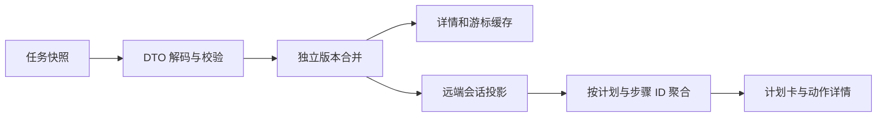

# AgentComputer APP 任务计划与动作链路接入指南

Octop 的任务计划、步骤结果和动作记录已采用宿主分配的稳定身份。APP 需要升级现有 DTO、版本合并、缓存和会话展示，才能按步骤显示同一份服务端结果。当前 APP 尚未完成本轮接线；重启 Octop 不能替代 APP 升级。

本文面向 `/Users/fangyuan/Desktop/code/AgentComputer/` 的客户端开发，核对基线为 `feature/0.0.2/octp @ 41fe8e5ab9d691ed9aaf286bc2d1440a89e5b6c9`。`AgentComputer2` 是本地规划和动作链路的参考实现，两者不要混淆。本次不修改 APP Swift 或 UI。合同更新日期：2026 年 10 月 19 日；最新实现的验证结果以交付记录为准，旧版测试数字不适用于本合同。

## 先完成内容类型升级

当前 [OctopTaskDetail.ContentBlock.Kind](/Users/fangyuan/Desktop/code/AgentComputer/AgentComputer/Services/Box/OctopTaskDetail.swift:9) 仅识别 `text`、`reasoning`、`reasoning_summary`、`tool`，并在同文件第 49 行强类型解码。收到 `plan` 或 `progress` 会使所属详情或订阅帧解码失败。因此先补齐类型和字段，再接界面。

任务 WebSocket 仍为 **v3**，没有新增顶层 `plan`、`progress` 事件或订阅入口，没有客户端规划开关。只检查 `ready.protocol_version == 3` 无法替代 DTO 升级。

协议来源：

- [任务 WebSocket 接入指南](project-task-websocket.md)：鉴权、命令、快照和重连。
- [完整 JSON Schema](project-task-websocket.schema.json)：字段类型和必填性。
- [完整 turn 帧示例](examples/project-task-planning-turn.json)：虚构业务内容，用于客户端解码和展示联调。
- [审批与暂停接入](agentcomputer-task-interactions.md)：继续沿用现有审批、提问和本机工具规则。

## 连接和任务发送沿用现有链路

原生 APP 连接 `/api/project-tasks/ws`，升级请求携带 `Authorization: Bearer <access token>`，收到 `ready` 后发送命令；已经通过请求头鉴权时，不再发送 `authenticate`。

首次发送用 `task.create`，追问用 `task.message`。创建不会自动订阅，需用返回的 `event_cursor` 订阅。APP 不注册或执行 `planning`、`message_notify_user`，它们由 Octop 主模型调用；APP 只消费服务端保存的快照。正式任务运行时关闭原生 `write_todos`，不再维护第二份 todo 状态。

| 数据到达位置 | 轮次路径 | 处理方式 |
| --- | --- | --- |
| 任务命令 `result` | `data.turns[]` | 合并已有轮次，不把回执当追加正文 |
| `snapshot` | `data.turns[]` | 重建最近一页基线，保护已收到的较新版本 |
| `turn` | `data.turn`，任务为 `data.task.task_id` | 合并单轮；应用成功后保存 `data.cursor` |
| REST 详情和历史页 | `turns[]` | 使用同一 DTO；历史页不推进实时游标 |

共享连接保持唯一接收循环。订阅事件可能先于回执到达；不能等待回执时丢弃其他事件。只有用户真实进入详情时调用 `task.open`；断线和恢复前台只恢复订阅。

`ws://127.0.0.1:8088/api/project-tasks/ws` 仅是开发地址示例。手机的 `127.0.0.1` 指手机自身；跨设备需使用可达的 Octop 地址和对应监听配置。项目和任务直连 Octop，不经 Bridge。

## 数据模型

### 轮次与计划

| 字段 | Swift 建议 | 含义 |
| --- | --- | --- |
| `plan` | `OctopTaskPlan?` | 本轮最新完整计划；未创建为 `null` |
| `plan_revision` | `Int` | 未创建为 `0`；有效计划变化才递增 |
| `content_blocks` | 扩展现有 `[ContentBlock]` | 有序完整快照，包含历史计划修订及动作 |
| `content_revision` | 现有 `Int` | 内容或块状态变化的独立版本 |

`plan != null` 时，`plan.revision == plan_revision`。新 `planning create` 由服务端生成新的 `plan_id` 和所有 `step_id`，创建时第一步进入 `in_progress` 并记录开始时间。即使同轮重新创建计划，修订仍递增，但新旧计划身份不同。

```swift
import Foundation

nonisolated struct OctopTaskPlan: Codable, Equatable, Sendable {
    enum Source: String, Codable, Sendable {
        case octopPlanning = "octop_planning"
        case harnessTodos = "harness_todos"
    }

    struct Step: Codable, Equatable, Sendable {
        enum Status: String, Codable, Sendable {
            case pending
            case inProgress = "in_progress"
            case completed, blocked, skipped
        }

        let stepID: String?
        let content: String
        let status: Status
        let result: String
        let startedAt: Date?
        let finishedAt: Date?
        let removedAt: Date?

        private enum CodingKeys: String, CodingKey {
            case stepID = "step_id"
            case startedAt = "started_at"
            case finishedAt = "finished_at"
            case removedAt = "removed_at"
            case content, status, result
        }
    }

    let source: Source
    let planID: String?
    let title: String
    let revision: Int
    let activeStepID: String?
    let steps: [Step]
    let retiredSteps: [Step]

    private enum CodingKeys: String, CodingKey {
        case planID = "plan_id"
        case activeStepID = "active_step_id"
        case retiredSteps = "retired_steps"
        case source, title, revision, steps
    }
}
```

这是远端 DTO 示例，日期解码需使用现有服务端 ISO 8601 解码器。`Turn` 补 `plan`、`planRevision`，CodingKeys 映射 `plan_revision`，同时更新自定义解码、构造和编码。按 Schema 校验网络输入：修订非负；managed 计划必须有计划和步骤身份；重复步骤 ID 或无效 `active_step_id` 不应进入界面。

| 计划字段 | 语义 |
| --- | --- |
| `source` | 新计划为 `octop_planning`；`harness_todos` 只表示已保存的旧计划，不是新运行入口 |
| `plan_id` | 宿主生成的字符串身份；旧计划可为 `null`，不得用标题补造 |
| `title` | 计划标题，可为空字符串 |
| `revision` | 本轮单调递增的计划版本，不按步骤数量或内容长度比较 |
| `active_step_id` | 明确选中的执行步骤，必须指向当前 `steps` 中的 `in_progress` 项；可为 `null` |
| `steps` | 当前有序步骤，最多 100 项；每项 `content` 非空、最多 500 字符 |
| `retired_steps` | 已移出当前列表的原步骤，保留身份、结果和移除时间，用于解释历史动作归属 |
| `step_id` | 宿主生成的步骤身份；改文字、改排不改变身份，新增项取得新身份 |
| `result` | 模型通过正式规划工具记录的结果、阻塞或跳过原因，最多 2000 字符；不是自动验收证明 |
| `started_at / finished_at / removed_at` | 宿主记录的 UTC 时间；未发生或历史未知为 `null` |

允许多个步骤 `in_progress`，但 `active_step_id` 只选定一个默认归属。不能猜“第一个执行中”或按数组下标绑定动作。显式清空时 `steps=[]`，已移除项留在 `retired_steps`，计划对象和新修订仍存在。

旧历史没有计划时保持 `null/0`；旧计划和旧动作没有 ID、结果或时间时保留空值，不从位置、正文、接收时间或当前计划回填。只读旧数据不表示恢复旧工具协议或自动迁移。

### 内容块与执行事实

`ContentBlock.Kind` 增加 `plan`、`progress`，并完整传递以下字段。ID 均保持字符串；`output` 使用支持对象、数组、字符串、数字、布尔和 null 的 JSON 值，不能统一转成字符串再持久化。

| 字段 | 类型 | 含义 |
| --- | --- | --- |
| `plan` | 计划或 null | 仅计划块携带该修订完整快照 |
| `plan_id / step_id` | string 或 null | 生成/执行当时固定的归属；之后改排、切换当前步不重绑 |
| `tool_label` | string 或 null | 服务端本地化动作名称；空缺时回退 `tool_name` |
| `arguments` | object 或 null | 实际工具参数；宿主的步骤元数据不混入业务参数 |
| `output` | JSON 值或 null | 实际 `ToolMessage.content`，保留其 JSON 结构 |
| `started_at / finished_at` | UTC datetime 或 null | 服务端实际开始执行及观察到结束的时间；尚未调度或历史未知为空 |
| `duration_ms` | 非负 number 或 null | 工具执行耗时，单位毫秒；未知时不显示数值 |

`type` 的展示责任保持分开：

| 类型 | APP 展示 |
| --- | --- |
| `plan` | 保留修订块；普通界面只画当前最新计划，不重复画所有历史计划 |
| `progress` | `text` 为公开进展，`tool_call_id` 为通知身份；不进入答案和复制内容 |
| `tool` | 动作名称、真实状态；展开查看参数、公开返回内容及已记录的时间/耗时 |
| `reasoning / reasoning_summary` | 可折叠过程文字或供应商公开摘要；保留其步骤归属，不当作工具完成证明 |
| `text` | 回答正文；沿用答案展示与复制 |

成功的 `planning`、`message_notify_user` 不重复画为普通工具动作；失败时显示失败工具块，无成功进展。进展最多 2000 字符，不修改计划状态。`output` 只来自实际 `ToolMessage.content`，不包含其私有 `artifact`、`additional_kwargs` 或加密推理。底层工具若已截断内容，此层无法恢复未返回的部分，不能宣称提供了原工具完整输出。

工具意图可以先出现，`started_at` 只在实际调度后填入；等待审批不是已经开始执行。`finished_at` 是服务端观察结束的时间，本机工具未知的现场时间不补造。界面不从轮次创建时间推算工具耗时，使用 `duration_ms`；UTC 时间按服务端配置时区展示。

`tool` 内容块只是展示记录，不能触发本机执行。真正的本机工具仍走独立的 `tool.call`、领取和结果回传。

## 版本合并、步骤聚合与缓存

按“实例、账号、task_id、turn_id”定位轮次，所有回执、REST、历史页和实时推送进入现有 `OctopTaskProjection`。

1. 摘要按 `list_revision` 合并。即使 `reply` 为空或列表版本不变，也要处理新计划、结果、进展及工具事实。
2. `content_blocks` 按不小于现存的 `content_revision` 替换完整数组；以 `block_id` 保持行身份，不能整批重复追加。
3. `plan`、`plan_revision` 按计划版本独立合并。新 `plan_id` 可以替换旧计划；旧版本不能恢复已清空列表。先选快照，再做终态保护，最后写回独立版本字段。
4. 按 **`(plan_id, step_id)`** 聚合动作、进展和思考。`active_step_id` 只决定当前默认归属，不用于把历史块重新分组。改排跟随 ID，删除项的历史组从 `retired_steps` 恢复；重建计划后，旧 `plan_id` 的活动仍属于旧计划。
5. 无绑定的旧块留在“未关联步骤”或轮次级过程区，不自动附到当前步骤。原始块顺序保持稳定，同一步组内按该顺序展示。
6. `reply`、`reasoning`、交互和附件沿用既有规则。计划全完成不代表轮次完成；`progress` 不拼入累计回答或思考。
7. 将合并结果与最后已应用 cursor 一起保存。迟到回执不推进现有订阅 cursor，不能只保存游标而丢内容。

```swift
let selectedPlan = turn.planRevision >= old.planRevision ? turn : old
let mergedPlan = selectedPlan.plan
let mergedPlanRevision = selectedPlan.planRevision
// 沿用内容、交互和终态保护，再写回独立计划状态。
turn.plan = mergedPlan
turn.planRevision = mergedPlanRevision
```

扩展 `OctopTaskBodyCache` 的 Codable 往返，保存新字段及任意 JSON output。现有缓存类会移除不可解码的本地可再建条目，再走只读 GET；保留的是服务端任务、轮次和原始记录。重取时建立内容与游标一致的基线，不新增自动迁移、双向同步或重发任务。保存失败不能宣称已可靠恢复该游标。

重连只恢复 `task.subscribe`。普通追问和手动重试的新轮次不继承旧计划完成状态；暂停后继续同一轮次沿用该轮计划、步骤 ID 和已保存的工具归属，不重复执行已完成副作用。

## 实际 APP 接线位置



| 实际 APP 文件 | 本轮改动 |
| --- | --- |
| [OctopTaskDetail.swift](/Users/fangyuan/Desktop/code/AgentComputer/AgentComputer/Services/Box/OctopTaskDetail.swift:8) | 新块、完整远端计划和步骤 DTO、归属、结果、工具事实；更新自定义编解码 |
| [OctopTaskProjection.swift](/Users/fangyuan/Desktop/code/AgentComputer/AgentComputer/Services/Box/OctopTaskProjection.swift:107) | 校验身份和 active step，按计划版本独立合并；所有输入共用规则 |
| [OctopTaskBodyCache.swift](/Users/fangyuan/Desktop/code/AgentComputer/AgentComputer/Data/Persistence/OctopTaskBodyCache.swift:12) | 完整持久化步骤结果、ID、工具参数/output 与游标；失败缓存可再建 |
| [OctopTaskSocketFrame.swift](/Users/fangyuan/Desktop/code/AgentComputer/AgentComputer/Services/Box/OctopTaskSocketFrame.swift:61) | 使用同一升级 DTO；无需新增顶层事件 |
| [OctopTaskSocket.swift](/Users/fangyuan/Desktop/code/AgentComputer/AgentComputer/Services/Box/OctopTaskSocket.swift:441) | 先验证、合并再推进 cursor，不能因列表版本不变漏刷新 |
| [OctopTaskSessionService.swift](/Users/fangyuan/Desktop/code/AgentComputer/AgentComputer/Services/Box/OctopTaskSessionService.swift:175) | 保存并投影完整更新至 `remoteConversationUpdated` |
| [OctopWorkspaceDataSource.swift](/Users/fangyuan/Desktop/code/AgentComputer/AgentComputer/Services/Box/OctopWorkspaceDataSource.swift:899) | 扩展两处类型分支，传递计划和执行事实；答案仍只取 text |
| [ConversationContentBlockSnapshot.swift](/Users/fangyuan/Desktop/code/AgentComputer/AgentComputer/Domain/AgentRuntime/ConversationContentBlockSnapshot.swift:10) | 扩展通用数据或增加专用远端展示模型，不丢 ID、结果和 JSON 类型 |
| [ConversationRunController.swift](/Users/fangyuan/Desktop/code/AgentComputer/AgentComputer/Core/ConversationRunController.swift:1218) | 还原远端计划和按 ID 的活动，结果/计划变化也触发刷新 |
| [TaskConversationView.swift](/Users/fangyuan/Desktop/code/AgentComputer/AgentComputer/Features/Workspace/TaskConversationView.swift:875) | 接远端计划卡和步骤活动组；保留移除步骤及旧计划的历史入口 |
| [TaskConversationToolCell.swift](/Users/fangyuan/Desktop/code/AgentComputer/AgentComputer/Features/Workspace/TaskConversationToolCell.swift:146) | 优先 tool_label；展开实际参数、output 和已知耗时；空值不补造 |

不要直接转为原生 `AgentPlan`。原生模型要求 UUID、顺序推进、最多 12 步、结果 notes，并冻结步骤文字；远端采用字符串身份、最多 100 步、显式修订和退役步骤，可并行或改排。即使现在都有结果和时间，两者的身份及状态机仍不同。复用原生面板视觉与交互，新增远端展示模型；不要启动本地 `PlanningFlow`。依据：[原生 AgentPlan 校验](/Users/fangyuan/Desktop/code/AgentComputer/AgentComputer/Domain/AgentRuntime/AgentPlan.swift:77)。

## 展示与验收

计划卡按轮次显示最新计划，可展开每一步的 `result`、真实起止时间和所属动作。被移除步骤不再计入当前清单进度，但历史活动仍可查看。多个当前项全部显示，默认选择以 `active_step_id` 为准。空列表不自动视为全部任务完成。

`completed` 块只表示块结束。等待、暂停、取消或失败保留最后记录的步骤状态，同时展示轮次状态；`in_progress` 不代表工具仍在运行，终态停止流式动画，不自动勾选未完成项。正文只取 text，思考/进展/工具输出不进入答案复制。

| 场景 | 通过标准 |
| --- | --- |
| 完整 turn 解码 | 六类块及计划/步骤 ID、结果、日期、工具事实均保留；空 reply 也显示进展 |
| 结果/计划单独变化 | 及时刷新，不等待 list_revision 增长 |
| 重复或迟到快照 | 稳定 block_id；独立修订不回退；不重复累计输出 |
| 改排、改文、并行和当前步切换 | 历史活动始终按 plan_id+step_id 归属，不跟随下标或当前步漂移 |
| 移除步骤、清空、重新建计划 | 保留 retired_steps 和旧计划活动，不串到新 ID |
| 工具等待、执行、失败 | 意图不冒充执行；真实时间/耗时及结构化 output 正确；空值保持未知 |
| 底层输出截断 | 展示实际收到内容，不宣称补回原始完整输出，不读取私有 artifact |
| GET/缓存/断线恢复 | 完整字段与游标一致；只恢复订阅，不重发消息或 task.open |
| 审批后恢复与通知失败 | 同轮保留归属，失败动作只出现一次，无成功 progress |
| 追问、手动重试、子代理 | 新轮计划隔离；子代理不能覆盖正式主计划 |
| 无 ID 的旧记录 | 轮次级显示，不回填 ID、结果或时间；服务端历史保留 |

客户端验收完成前，交付状态应写为“Octop 已提供新合同，APP 适配待完成”。示例与字段检查不等于 APP 构建、真机 UI、最新测试通过或真实模型端到端验收。
