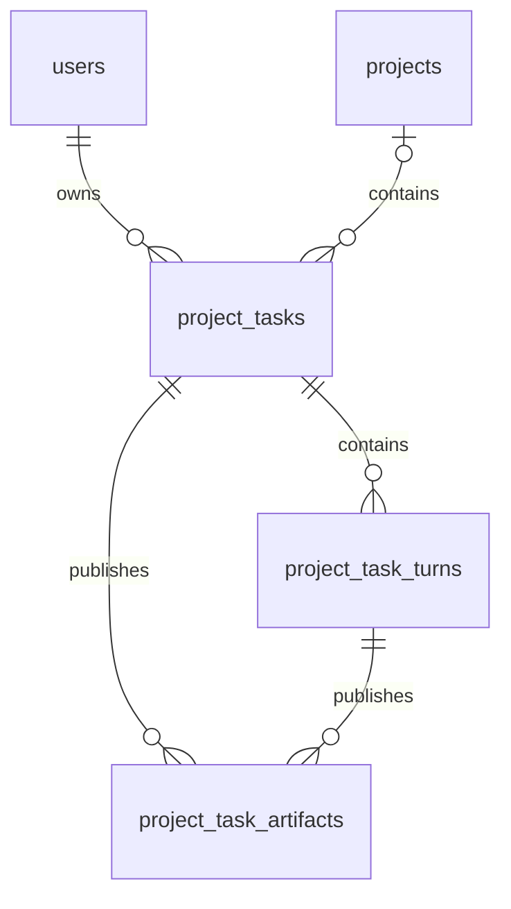

# 任务成果资料库服务端技术方案

日期：2026 年 10 月 20 日。状态：服务端列表与详情接口已实现。

资料库第一版收录当前账号所有任务**正式发布的成果文件**，包括项目任务和无项目任务。服务端已有统一的 `project_task_artifacts` 表，文件与任务、轮次的关系以及发布时的文件原件均已持久化。第一版直接在这张表上提供跨任务查询，无需另建资料库文件表，也无需复制文件。

新增两个只读接口：成果列表和单份成果详情；文件下载复用现有接口。资料库与任务共用生命周期：归档后仍可查看，永久删除任务或项目后，对应成果也会删除。独立上传、输入附件、收藏后脱离任务长期保存和知识库检索不属于第一版。

## 当前文件存储和关联

### 任务成果已有统一表

`project_task_artifacts` 的主要字段如下。SQLite 使用 BLOB 保存内容，PostgreSQL 使用 BYTEA。

| 字段                            | 含义                                         |
| ------------------------------- | -------------------------------------------- |
| `id`                            | 数据库内部整数主键，不作为 API 资源 ID       |
| `artifact_id`                   | 全局唯一的公开成果 ID                        |
| `task_id`                       | 关联 `project_tasks.task_id`                 |
| `turn_id`                       | 关联 `project_task_turns.turn_id`            |
| `tool_call_id` / `request_hash` | 发布调用身份与参数摘要；同轮同调用只发布一次 |
| `name` / `media_type`           | 发布文件名和记录的 MIME 类型                 |
| `byte_count` / `sha256`         | 文件长度及完整性校验摘要                     |
| `source_path`                   | 可选的服务端工作区相对来源路径               |
| `content`                       | 发布时保存的不可变原始字节                   |
| `created_at`                    | 发布时间，数据库内为 UTC 毫秒时间戳          |

关系为：



成果表不直接保存 `owner_id` 和 `project_id`。账号权限与项目归属从任务读取；无项目任务的 `project_id` 为 `null`。项目和任务的展示名称取当前值，文件名、内容及发布时间保持发布时的值。

现状依据：[成果表结构](../src/octop/infra/db/migrations/037_task_artifacts.sql)、[成果 Repo](../src/octop/infra/db/repos/project_task_artifacts.py)、[任务归属](../src/octop/infra/db/repos/project_tasks.py)。

### 正式发布与普通工作文件的区别

当前只有 `create_artifact`、`publish_workspace_file` 和 `publish_workspace_archive` 成功发布的文件进入成果表。普通文件写入、模型回复中的路径、工具临时输出以及工作目录中已有的文件，不会自动进入资料库。

发布记录和文件字节在同一数据库事务中保存。源文件随后被修改、移动或删除，不影响已发布快照。当前限额为单文件 25 MiB、每轮最多 5 份、每轮合计 50 MiB。SHA-256 用于校验，不作为跨任务合并文件的依据；不同发布记录即使内容相同，也保留各自的来源。

资料库按发布事实收录，不要求轮次最终为 `completed`。同一轮先成功发布文件、随后失败或取消时，已发布文件仍然有效；列表返回该轮当前状态，供界面解释来源。没有成功发布的文件不展示为成果。

现状依据：[发布事务及限额](../src/octop/infra/projects/artifacts.py#L172)、[项目文件编辑不强制发布的用例](../tests/integration/test_project_task_artifacts.py#L405)。

### 输入附件和知识库分别管理

| 内容                   | 当前保存位置                                               | 第一版资料库是否收录 |
| ---------------------- | ---------------------------------------------------------- | -------------------- |
| 任务正式发布成果       | `project_task_artifacts`                                   | 是                   |
| 用户发给任务的输入文件 | `project_task_attachments`；轮次输入元数据位于配置快照     | 否                   |
| 服务端工作区文件       | 对应任务或项目工作目录                                     | 仅显式发布后的快照   |
| 客户端工作区文件       | 用户电脑，由客户端管理                                     | 仅凭本地路径不收录   |
| 知识库文档             | `knowledge_bases` / `knowledge_documents` 及知识库文件存储 | 否                   |

现有 `/api/knowledge-bases` 面向文档管理、索引与检索，具有独立权限和模型依赖。成果资料库只浏览和下载交付文件，无需启用 embedding 或 OCR。若以后增加“加入知识库”，应设计显式导入操作，保留来源，不把发布成果自动变成知识库文档。

## 第一版能力

资料库提供跨任务分页浏览、按项目或任务筛选、按文件类型筛选、按文件名搜索、读取单份元数据、鉴权下载，以及来源任务和轮次标识。默认展示所有仍存在任务的成果，包括已归档任务或项目中的成果。

第一版不提供改名、删除单份成果、文件夹、标签、分享、独立上传或跨任务再次发送。成果记录继续保持不可变，不扫描任何工作目录。若用户需要编辑成果，先下载或在原工作区编辑，再显式发布新的成果记录。

## 接口设计

所有接口使用当前 Octop 账号鉴权，沿用 `/api/project-tasks` 正式入口；不增加 AgentComputer 专用前缀或 Bridge 转发。新增 JSON 接口返回 `Cache-Control: private, no-store`，不返回文件字节、服务器绝对路径、工作区凭据或工具原始参数。

| 操作           | 方法和路径                                                          | 状态         |
| -------------- | ------------------------------------------------------------------- | ------------ |
| 跨任务成果列表 | `GET /api/project-tasks/artifacts`                                  | 已实现       |
| 单份成果详情   | `GET /api/project-tasks/artifacts/{artifact_id}`                    | 已实现       |
| 下载原件       | `GET /api/project-tasks/{task_id}/artifacts/{artifact_id}/download` | 复用现有接口 |

### 成果列表

```http
GET /api/project-tasks/artifacts?scope=all&limit=50
Authorization: Bearer <access_token>
Accept-Language: zh-CN
```

| 参数          | 规则                                                                             |
| ------------- | -------------------------------------------------------------------------------- |
| `scope`       | `all`、`project` 或 `standalone`，默认 `all`。`all` 同时包含项目任务和无项目任务 |
| `project_id`  | `scope=project` 时必填；其他 scope 携带此参数返回 422                            |
| `task_id`     | 可选，限定某个任务；与其他筛选条件求交                                           |
| `kind`        | `all` 或下文定义的文件类型，默认 `all`                                           |
| `archived`    | `all`、`active` 或 `archived`，默认 `all`                                        |
| `q`           | 文件名的字面子串，最多 200 个字符；去除首尾空白，空串等同省略                    |
| `limit`       | 默认 50，范围 1–100                                                              |
| `page_cursor` | 下一页不透明游标；非空且最多 4096 个字符                                         |

筛选示例：

```http
GET /api/project-tasks/artifacts?scope=project&project_id=project_example&kind=document&q=报告
GET /api/project-tasks/artifacts?scope=standalone&archived=active
GET /api/project-tasks/artifacts?task_id=task_example
```

`archived=active` 要求任务未归档且所属项目未归档；无项目任务只检查任务状态。`archived=archived` 表示任务或项目至少一项已归档。响应分别返回两者的归档状态，不把项目归档写回任务。

指定的项目或任务不存在、属于他人时返回 404。本人任务存在，但与指定的项目、scope 或其他筛选不匹配时，返回空列表。参数结构错误返回 422。

成功返回 `200 OK`：

```json
{
  "items": [
    {
      "artifact_id": "artifact_example",
      "task_id": "task_example",
      "turn_id": "turn_example",
      "name": "季度分析报告.pdf",
      "media_type": "application/pdf",
      "byte_count": 123456,
      "sha256": "aaaaaaaaaaaaaaaaaaaaaaaaaaaaaaaaaaaaaaaaaaaaaaaaaaaaaaaaaaaaaaaa",
      "source_path": "reports/季度分析报告.pdf",
      "download_url": "/api/project-tasks/task_example/artifacts/artifact_example/download",
      "created_at": "2026-10-20T02:00:00Z",
      "file_kind": "document",
      "task_title": "生成季度分析报告",
      "task_archived": false,
      "turn_status": "completed",
      "project_id": "project_example",
      "project_name": "经营分析",
      "project_archived": false
    }
  ],
  "next_page_cursor": null
}
```

每个条目为 `TaskArtifactLibraryItem`，复用现有 `TaskArtifact` 全部字段，增加下表字段。现有任务历史与 WebSocket 的 `TaskTurn.artifacts` 保持原结构。

`created_at` 继续返回 UTC 的 ISO 8601 时间；界面按 Octop `default_timezone` 显示，不直接采用浏览器或设备本地时区。

| 新增字段                                           | 含义                                        |
| -------------------------------------------------- | ------------------------------------------- |
| `file_kind`                                        | 服务端按固定映射计算的浏览分类              |
| `task_title` / `task_archived`                     | 来源任务的当前标题与归档状态                |
| `turn_status`                                      | 来源轮次的当前状态，与任务轮次状态枚举一致  |
| `project_id` / `project_name` / `project_archived` | 来源项目的当前信息；无项目时三者均为 `null` |

`next_page_cursor=null` 表示当前筛选下已无后续记录；空列表也返回此结构。第一版不返回精确总数或分类统计，避免每次翻页都执行全量计数。

### 文件类型和搜索

`file_kind` 采用固定枚举及版本化映射，不引入桌面示例中的 Reports、Data、Routines 业务分类。

| 分类           | 典型扩展名                                                                                            |
| -------------- | ----------------------------------------------------------------------------------------------------- |
| `document`     | `.pdf`、`.doc`、`.docx`、`.odt`、`.rtf`、`.pages`                                                     |
| `spreadsheet`  | `.csv`、`.tsv`、`.xls`、`.xlsx`、`.ods`、`.numbers`                                                   |
| `presentation` | `.ppt`、`.pptx`、`.odp`、`.key`                                                                       |
| `text`         | `.txt`、`.md`、`.markdown`、`.log`                                                                    |
| `code`         | `.py`、`.js`、`.ts`、`.tsx`、`.swift`、`.json`、`.yaml`、`.html`、`.css` 等显式维护的代码和配置扩展名 |
| `image`        | `.png`、`.jpg`、`.jpeg`、`.gif`、`.webp`、`.svg`、`.heic` 等显式维护的图片扩展名                      |
| `archive`      | `.zip`、`.tar`、`.gz`、`.7z`、`.rar`                                                                  |
| `audio`        | `.mp3`、`.wav`、`.m4a`、`.flac`                                                                       |
| `video`        | `.mp4`、`.mov`、`.webm`、`.mkv`                                                                       |
| `other`        | 无法按固定映射归类的文件                                                                              |

完整扩展名和 MIME 对照保存在 `infra/utils/artifact_kinds.py`：已知扩展名优先，扩展名未知时按固定 MIME 表补充，最后落入 `other`。扩展名比较忽略 ASCII 大小写；不依赖运行主机的 MIME 注册表。SQL 筛选与响应分类来自同一规则，先筛选再分页，不在一页结果上做内存过滤。

当前成果 MIME 可由发布工具参数提供，并未对所有文件进行真实格式鉴别。因此 `file_kind` 只用于浏览分类，不构成安全格式判断，也不决定是否允许在浏览器执行或内联展示文件内容。

`q` 只搜索文件名，不搜索文件正文、路径、任务标题或项目名称，不接受 NUL 字符。英文 ASCII 字母忽略大小写，其余字符按字面匹配，不承诺拼音、分词或 Unicode 大小写归一化。SQL 使用参数绑定，并将 `%`、`_` 及转义符作为普通查询字符处理。两种数据库均通过字面替换折叠 ASCII 字母，不依赖默认 `LIKE` 或 `lower()` 的大小写规则；PostgreSQL 仍需实库验收。

### 游标分页

固定按 `created_at DESC, artifact_id DESC` 排序，下一页严格查询小于上页最后一条的二元位置。发布时间相同的文件由唯一 `artifact_id` 确定顺序。取 `limit + 1` 条判断是否还有下一页，不使用 offset。

复用现有 `CursorCodec` 的签名能力及 `history` 编码格式，以发布时间和成果 ID 保存位置；使用独立 scope，例如 `artifact-library-v1:<filter_hash>`。规范化后的 `scope/project_id/task_id/kind/archived/q` 全部进入筛选指纹；`limit` 可在翻页时调整。账号、实例和恢复纪元由现有 codec 绑定，客户端不得解析或修改游标。

篡改游标、切换账号或筛选后复用游标、跨实例使用时，沿用 `409 PROJECT_SYNC_RESET`，客户端清空该筛选列表并重新读取首页。合法的其他参数错误仍返回 422。

分页不维持跨请求数据库快照。每页查询时权限、删除和归档筛选实时生效；名称取当前值。新增成果通过刷新首页获取，客户端按 `artifact_id` 合并去重。第一版不承诺实时全局增量同步，也不把成果游标混入已有任务列表同步游标。

### 单份成果详情

```http
GET /api/project-tasks/artifacts/artifact_example
Authorization: Bearer <access_token>
```

成功返回 `200 OK`，响应体是单个 `TaskArtifactLibraryItem`，字段与列表条目完全相同。通过成果 ID 直接定位，无需先加载任务全部会话。归档成果仍可读取；不存在或不属于当前账号时返回 `404 NOT_FOUND`。

详情仍只读元数据，不读取或校验整份文件字节。客户端使用返回的 `download_url` 获取原件，按 `task_id` 打开来源任务，`turn_id` 标识发布文件的轮次。现有任务详情只支持最近历史页及 `page_cursor`；若目标轮次较早，精确定位需要继续读取历史分页寻找。第一版不增加按轮次直接定位的接口，也不返回与具体客户端绑定的跳转 URL。

### 下载和预览

继续使用现有下载地址：

```http
GET /api/project-tasks/task_example/artifacts/artifact_example/download
Authorization: Bearer <access_token>
```

下载先验证本人任务，再从成果表读取不可变字节，并验证长度和 SHA-256。响应保留 `Content-Disposition: attachment`、`Cache-Control: private, no-store` 和 `X-Content-Type-Options: nosniff`，支持中文文件名。访问令牌不放入 URL。

原生客户端可将鉴权下载结果保存到自己的临时缓存，再使用 Markdown 或系统文件预览；网页可获取 Blob 后在受限预览器中显示。HTML、SVG 和可执行内容不能仅凭扩展名或记录的 MIME 在主页面直接执行。第一版不增加 Office 转 PDF、缩略图生成或通用服务端预览接口。

元数据存在不代表客户端下载成功。文件内容校验失败时沿用 `404 TASK_ARTIFACT_UNAVAILABLE`；任务或成果已删除、归属不匹配时为 `404 NOT_FOUND`。列表不通过加载全部 BLOB 来生成“文件可用”标志。

## 查询和权限实现

### 元数据查询

列表和详情在 SQL 层关联任务，强制限定当前账号：

```sql
SELECT
    a.artifact_id, a.task_id, a.turn_id, a.name, a.media_type,
    a.byte_count, a.sha256, a.source_path, a.created_at,
    t.title AS task_title, t.archived AS task_archived,
    r.status AS turn_status,
    p.project_id, p.name AS project_name, p.archived AS project_archived
FROM project_task_artifacts a
JOIN project_tasks t ON t.task_id = a.task_id
JOIN project_task_turns r ON r.turn_id = a.turn_id AND r.task_id = t.task_id
LEFT JOIN projects p ON p.project_id = t.project_id AND p.owner_id = t.owner_id
WHERE t.owner_id = :current_owner_id
-- 按规范化参数追加 scope、归档、文件名及类型条件。
-- 后续页追加 (a.created_at, a.artifact_id) < (:last_created_at, :last_artifact_id)。
ORDER BY a.created_at DESC, a.artifact_id DESC
LIMIT :limit_plus_one;
```

上述为查询结构示意；具体参数占位符沿用仓库数据库适配方式。详情在相同归属条件下增加 `a.artifact_id` 过滤。任何查询均不得先读出他人的文件或来源信息，再在 Python 中过滤。管理员在这些接口中同样只读取自己的成果，不增加跨账号浏览权限。

列表和详情不选择 `content` 列，不逐个查询任务或加载 `content_blocks_json`。来源信息一次联查完成；现有下载服务继续负责内容读取与校验。

### 索引与迁移

原有成果索引为唯一成果 ID、同轮调用唯一约束以及 `(task_id, turn_id, id)`。schema 47 的成对迁移增加：

```sql
CREATE INDEX idx_task_artifacts_created
    ON project_task_artifacts(created_at DESC, artifact_id DESC);
CREATE INDEX idx_task_artifacts_task_created
    ON project_task_artifacts(task_id, created_at DESC, artifact_id DESC);
```

SQLite 的代表性多账号查询计划已检查：跨任务及项目筛选从任务索引进入，再通过新的任务成果复合索引联查并排序；单任务筛选直接使用该复合索引，不额外排序。实际性能随本人文件数量及数据分布变化；PostgreSQL 查询计划尚未实测。

第一版不增加业务表、不复制 BLOB、不回填历史成果、不改原发布事务。新增 `047_task_artifact_library.sql` 与 `.pg.sql`，并将独立项目迁移范围扩展到 47；已应用 v46 的本地数据库也会补齐索引，原成果记录和字节保留。

### 分层和路由注册

| 位置                                        | 改动职责                                               |
| ------------------------------------------- | ------------------------------------------------------ |
| `infra/projects/artifact_library_models.py` | 列表参数、条目及分页响应模型                           |
| `infra/projects/artifact_library.py`        | 归属校验、参数规范化、游标及响应组装                   |
| `infra/utils/artifact_kinds.py`             | 仅依赖标准库的固定文件类型映射，供领域服务与 Repo 共用 |
| `infra/db/repos/project_task_artifacts.py`  | 元数据联查、分页及单份读取；仅 SQL 持久化职责          |
| `api/routers/projects.py`                   | 两条只读路由、HTTP 参数校验和 typed response model     |
| `api/openapi_meta.py` 与 `docs/api.md`      | 更新项目和任务接口说明                                 |

路由通过 `server.services` 调用领域服务，不直接导入 Repo。数据库查询沿用现有异步路由中的 executor 调用方式，不在事件循环中执行同步 SQL。

文件类型映射放在 `infra/utils/` 叶子模块；Repo 根据映射生成数据库筛选条件，不反向导入 `infra/projects/`。

静态 `/artifacts` 路由必须注册在动态 `/{task_id}` 之前；成果详情也应放在静态资源路由区域，防止名称被任务路由捕获。每条路由提供 summary、参数描述和明确的响应模型，并在 `/api/docs` 检查显示。

## 客户端对接和生命周期

AgentComputer2 当前 iOS 资料库通过 `TaskArtifactLibraryService` 遍历本地会话、收集 assistant 消息中的成果，并按任务分组；桌面 `LibraryView` 仍包含示例数据。当前这条本地资料库链路没有 Octop 成果查询或下载请求。因此本方案提供的是新的服务端契约，本轮不修改 Swift 或 UI。

后续对接服务端资料库时，直接调用成果列表，不先拉取全部任务和所有历史轮次。用 `artifact_id` 作为服务端条目标识；它是不透明字符串，不能按客户端本地 UUID 模型强制解析。客户端缓存属于本机展示数据，不承担服务端文件权威存储职责。

本地会话成果与 Octop 成果具有不同来源，不能仅按文件名或 SHA-256 自动合并。接入时先明确当前展示的数据来源；本方案不自动迁移或上传客户端已有成果，也不探测 `client_directory`。

| 操作或状态             | 资料库行为                                             |
| ---------------------- | ------------------------------------------------------ |
| 正式发布工具成功提交   | 下一次查询即可看见，无需等待整轮完成                   |
| 轮次失败、取消或停止   | 已发布成果保留，返回实际 `turn_status`                 |
| 任务或项目归档         | 默认列表仍包含，仍可查看和下载                         |
| 项目或任务改名         | 来源名称随下次查询更新，成果名称不变                   |
| 工作区源文件修改或删除 | 已发布快照不变                                         |
| 永久删除任务           | 删除该任务全部成果，列表不再返回，旧下载地址失效       |
| 永久删除项目           | 删除项目及其全部任务成果，工作目录文件仍按现有规则保留 |

已缓存的资料库列表在页面重新进入、主动刷新及本客户端删除任务或项目成功后更新。已有任务 WebSocket 仍按原协议提供轮次 `artifacts`；第一版不新增全局成果事件。另一客户端删除数据后，本客户端可能在刷新前仍显示旧条目，点击收到 404 时应提示并刷新。

若以后要求“删除任务后资料仍保留”，必须建立独立资料实体，显式保存内容及来源快照，并调整删除规则。仅增加指向当前成果行的收藏外键不能满足独立保留，因为现有删除任务流程会删除成果字节。该能力需要单独设计及数据生命周期约定。

## 实施与验收

服务端元数据查询和接口已经实现，客户端后续可按上述契约接入。针对性验证覆盖以下范围，不新增客户端测试或验收页面。

| 验证范围       | 通过标准                                                                                                            |
| -------------- | ------------------------------------------------------------------------------------------------------------------- |
| 历史成果       | 现有数据无需重新发布，即可跨任务查询；项目与无项目任务均覆盖                                                        |
| 权限           | 列表、详情和下载均隔离账号；他人项目、任务、成果返回 404；管理员无隐式跨账号读取                                    |
| 正式发布边界   | 工作区未发布文件和用户输入附件不会出现；重复文件名或相同内容保留不同发布记录                                        |
| 状态与生命周期 | 覆盖运行中发布、后续失败或取消、项目及任务分别归档、删除任务和删除项目                                              |
| 分页           | 相同发布时间不重不漏；支持翻到末页；中途删除可继续；筛选、账号或游标用途不匹配返回重置错误                          |
| 搜索与分类     | 中文、ASCII 大小写、字面 `%` 和 `_`、无扩展名、未知 MIME、扩展名与 MIME 冲突均有用例；SQLite 和 PostgreSQL 行为一致 |
| 下载与预览     | 中文名称、完整性校验、已删除文件和原工作区已变更均符合原下载契约                                                    |
| 数据库成本     | 列表与详情不选取 BLOB，不按条目发起额外来源查询；核对多账号数据下查询计划                                           |
| HTTP 和文档    | `/artifacts` 不被当成任务 ID；OpenAPI 展示参数、分页响应和错误；旧历史及下载契约保持可用                            |

对应测试位于 `tests/integration/test_project_task_artifact_library.py`、`tests/unit/utils/test_artifact_kinds.py` 及现有数据库迁移用例。现有成果发布和下载、API 文档契约也纳入回归验证。本次没有新增错误码或修改中英文语言包；PostgreSQL 尚未进行实库验收。

## 现状核对依据

服务端代码核对基于 `feature/agentcomputer-foundation` 的本地提交 `3694b9bf` 及当时工作区内容。接口现状与本方案新增项已在上文分别标明。

| 事实                     | 代码位置                                                                    |
| ------------------------ | --------------------------------------------------------------------------- |
| 成果统一表与任务轮次外键 | `src/octop/infra/db/migrations/037_task_artifacts.sql:2`；PG 同名迁移       |
| 发布时保存快照           | `src/octop/infra/projects/artifacts.py:172`                                 |
| 下载归属与完整性校验     | `src/octop/infra/projects/artifacts.py:111`                                 |
| 当前成果公开字段         | `src/octop/infra/projects/artifact_models.py:100`                           |
| 现有历史附带成果         | `src/octop/infra/projects/tasks.py:464`                                     |
| 删除任务清理成果         | `src/octop/infra/db/repos/project_tasks.py:110`                             |
| 删除项目清理任务         | `src/octop/infra/projects/service.py:158`                                   |
| 输入附件另表保存         | `src/octop/infra/db/migrations/042_task_input_attachments.sql:2`            |
| 现有签名游标             | `src/octop/infra/projects/cursors.py:32`                                    |
| 客户端本地成果聚合       | AgentComputer2 `AgentComputer/Services/TaskArtifactLibraryService.swift:25` |
| 客户端本地文件快照       | AgentComputer2 `AgentComputer/Services/AI/ArtifactStore.swift:308`          |
| 桌面资料库示例           | AgentComputer2 `AgentComputer/Features/Library/LibraryView.swift:65`        |

仓库早期 `agentcomputer-project-documents.md` 中的 `/api/agentcomputer/v1` 项目文档接口属于历史方案，不作为此次资料库接口基础。
