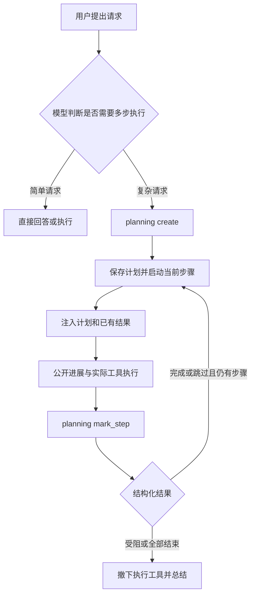

# Octop 任务规划与执行过程接入分析

Octop 已借鉴 AgentComputer2 的结构化规划和公开进展，增加宿主管理的 `planning`、稳定步骤身份、步骤结果和实际工具记录。新任务不再使用原生 `write_todos`；计划、动作、思考与最终回答分别保存，通过正式任务协议交给网页和 APP。

这里的“思维链”指用户可理解的公开判断、行动及结果。供应商未公开的内部推理、加密 reasoning 和私有工具 artifact 不属于可展示数据；计划与工具事实不依赖生成或猜测这类内容。

## 范围与代码基线

| 项目 | 分支与提交 | 用途 |
| --- | --- | --- |
| Octop | `feature/agentcomputer-foundation`，`3694b9bf5d193df52c63ecddfe61306da5a371de` | 当前主目录基线，保留已有审批与恢复改动；下文“当前实现”包含其上的未提交改动 |
| AgentComputer2 | `codex/next-best-query-recommendations`，`da4a8afdf19d3aa654d8040629758b4b80b4d03a` | 本地运行时、持久化与原生界面参考 |
| 实际 APP：AgentComputer | `feature/0.0.2/octp`，`4be12673af766308c6516b69ea2c6cd0be94174d` | 已接设置、互斥展示及原组件；已记录 brief 新合同的 H/I 真实复验，本次只读核对 |
| Octop 本地依赖 | 锁文件中的 `octop-harness 1.0.1` 及当前 `.venv` | 核对 Harness 事件与中间件能力，不直接修改已安装依赖 |

首次调研日期为 2026 年 10 月 17 日，当前正文合同更新于 2026 年 10 月 22 日。参考实现与当前实现分节描述；本合同的测试仍需以最新交付记录确认，前一版 todo 试接的验证数字不作为本轮结果。

## 当前已落地的合同

主模型对复杂请求调用 `planning create`，宿主生成稳定 `plan_id/step_id`、保存固定有序步骤并启动第一步。模型报告当前步骤结果后，宿主自动推进；完成或受阻后撤下工作工具，未结束的计划不能由普通终稿跳过。

动作生成开启时，宿主立即保存已收到请求的开场，并在计划启动当前步骤时保存步骤意图。独立异步模型根据真实事实补充公开进展和动作说明，主执行不等待这些文案；开场通知和宿主 `brief` 均不再是工具执行前置条件。2026 年 10 月 19 日的这项旁路方案替代此前门控，计划调度、审批和业务参数校验保持原有规则。

展示上，计划面板与动作链路互斥：有可见计划时只显示步骤、结果、当前短活动、已知时间/耗时和产物入口，不把完整思考、公开进展和工具列表嵌入步骤。无计划或关闭面板时，才由动作链路开关选择结构化 Process 或经典思考过程。此前“把整轮过程移进计划卡，再按步骤展开全部动作”的接入目标已撤销。

记录与展示分开。计划模式的 reasoning、progress 和实际工具事实仍正常保存；固定步骤身份继续用于恢复和追溯，不能为实现显示互斥删除数据。实现复用 `content_blocks_json`，计划变化追加完整快照；`TaskTurn.plan/plan_revision` 从最新计划块投影，不是第二份存储，无需新表或历史迁移。

主模型公开正文收到后直接增量保存为 `text/reply`，不再等待工具意图，也不因计划执行而改成思考。`reasoning/reasoning_summary` 保留模型原始类型，`progress` 保留公开进展来源；正文可以与它们及工具交错，始终位于过程展示之外。累计正文不代表最终结论或成功交付；交付纠正保留此前正文并建立新消息边界，真实附件收据、计划状态与轮次终态继续决定结果。失败、取消和暂停保留部分正文，不重写历史内容来源。

网页与 APP 已实现展示互斥；最新 APP 已通过远端只读快照复用原版“阶段 → 动作 → 阶段结果”、工具行与命令卡，并接入显式开场和权威整轮计时。网页 Process 仍筛选并平铺进展/工具，不能把两端状态混为一谈。最新接线与验收边界见 [APP 接入指南](agentcomputer-task-planning-and-progress.md#当前-app-的具体差异)；此前“步骤内嵌过程”和“APP Process 仅线性投影”均属于旧版现状。

这里仍须区分两种“项目规划”：

- **请求执行计划**：一次用户请求的步骤、结果与动作归属。本轮实现这一层。
- **项目长期规划**：跨多个 Task 的目标、里程碑、任务依赖和验收条件。尚需单独设计，不能把单次请求计划自动当成项目路线图。

AgentComputer2 的项目模型保存名称、工作区授权及导入信息；计划按用户消息归属，新消息默认从无计划开始，继续原消息才恢复计划。依据：[项目模型](/Users/fangyuan/Desktop/code/AgentComputer2/AgentComputer/Services/WorkspaceProjectStore.swift:12)、[会话计划恢复](/Users/fangyuan/Desktop/code/AgentComputer2/AgentComputer/Services/AI/AgentSessionService.swift:918)。

## AgentComputer2 如何规划和执行

### 用结构化工具保存正式计划

真实工具名是 `planning`，包含三个命令：

| 命令 | 行为 | 宿主约束 |
| --- | --- | --- |
| `create` | 创建标题和有序步骤 | 同一计划只能创建一次；结构允许 1 至 12 步，复杂任务提示建议 2 至 12 步 |
| `get` | 读取当前计划 | 必须已经存在计划 |
| `mark_step` | 报告当前步骤完成、受阻或跳过 | 只能修改当前执行步骤，必须给出非空结果或原因 |

每一步保存 `text`、`status`、`notes`、起止时间和阻塞原因。状态包括 `not_started`、`in_progress`、`completed`、`blocked`、`skipped`。顺序必须保持“已结束前缀、至多一个执行中或受阻步骤、尚未开始后缀”；计划创建后，标题、步骤数量和步骤文字不能重新编排。

依据：[PlanningTool](/Users/fangyuan/Desktop/code/AgentComputer2/AgentComputer/Services/AI/PlanningFlow.swift:17)、[AgentPlan 校验](/Users/fangyuan/Desktop/code/AgentComputer2/AgentComputer/Domain/AgentRuntime/AgentPlan.swift:77)。旧规格中的 `update_plan` 是模拟工具描述，不能当作当前运行接口。

### 由宿主决定何时推进



模型负责拟定步骤和报告结果，宿主负责验证并保存状态、启动下一步。每次请求都会注入当前计划和已有步骤结果；模型应只执行当前步骤。`planning` 必须独占一次工具调用批次，避免同批工作尚未返回就先标记完成。当前步骤没有结构化结果时，普通回答不能直接结束执行。

正式会话先持久化计划，再发布 `planUpdated`；保存失败会停止推进。计划完成或受阻后，运行时撤下普通执行工具，进入总结阶段。因此，文件发布和实际验证需要在最终步骤结束之前完成。

依据：[当前步骤指令](/Users/fangyuan/Desktop/code/AgentComputer2/AgentComputer/Services/AI/PlanningFlow.swift:127)、[运行循环](/Users/fangyuan/Desktop/code/AgentComputer2/AgentComputer/Services/AI/AgentRuntime.swift:672)、[调用批次校验](/Users/fangyuan/Desktop/code/AgentComputer2/AgentComputer/Services/AI/AgentRuntime.swift:1125)、[先保存再发布](/Users/fangyuan/Desktop/code/AgentComputer2/AgentComputer/Services/AI/AgentRuntime.swift:1558)。

这套机制约束执行顺序，但完成声明仍由模型提出。非空 `notes` 不等于自动验证了其中的证据，计划完成也不等于产品验收通过。

### 按原请求恢复计划

`plan.updated` 保存 `turnID`、`userMessageID` 和完整计划。历史回放校验归属和合法状态转换；继续原请求时保留已完成步骤，从首个未完成步骤恢复。取消或异常会阻塞当前步骤，并记录用户停止或执行错误。

恢复提示要求先核对工作区，再决定是否重复副作用。计划检查点本身不能保证命令、文件写入或外部操作只执行一次。Octop 应继续沿用现有工具回执和暂停恢复规则。

依据：[计划落盘](/Users/fangyuan/Desktop/code/AgentComputer2/AgentComputer/Data/Persistence/ConversationEventStore.swift:1119)、[计划回放](/Users/fangyuan/Desktop/code/AgentComputer2/AgentComputer/Data/Persistence/ConversationSessionReplayer.swift:533)、[步骤恢复](/Users/fangyuan/Desktop/code/AgentComputer2/AgentComputer/Services/AI/PlanningFlow.swift:82)。

## AgentComputer2 如何展示执行过程

本节保留旧客户端参考行为；其中开场通知和必填 brief 门控已由 Octop 在 2026 年 10 月 19 日随后采用的异步旁路方案替代，不代表当前服务端合同。

### 将不同来源的内容分开

| 内容 | 来源 | 产品用途 |
| --- | --- | --- |
| 正式计划和步骤结果 | `planning` 与宿主状态 | 展示进度、当前步骤和受阻原因 |
| 公开进展 | 主模型调用 `message_notify_user` | 解释接下来做什么、新发现和下一步 |
| 工具动作 | 真实工具调用与结果，附简短 `brief` | 展示正在执行的行动及可展开详情 |
| 可展示思考文字 | Provider 返回的 reasoning，或运行时归入过程的普通文字 | 作为过程详情；不作为完成证明 |
| 最终回答 | 最终输出阶段 | 交付成果、结论和限制 |

公开进展使用专门工具，工作前说明意图，工作后说明已观察到的事实。工具 `brief` 只描述动作与目的，真实路径、命令和结果保留在工具参数及结果中。公开进度模式下，宿主会拒绝在有效开场通知前执行工作工具；不需要为每段 reasoning 再请求一个摘要模型。

宿主在活动开始时绑定 `planID` 和 `stepIndex`，工具结束沿用开始时的归属。公开进展以 Commentary 记录，保留调用 ID 及回合关联，刷新后可以恢复。模型输出的文字不能反向修改计划状态或工具结果。

依据：[公开进展协议](/Users/fangyuan/Desktop/code/AgentComputer2/AgentComputer/Domain/AgentRuntime/AgentProgress.swift:34)、[阶段元数据](/Users/fangyuan/Desktop/code/AgentComputer2/AgentComputer/Domain/AgentRuntime/AgentProgress.swift:5)、[会话绑定及保存](/Users/fangyuan/Desktop/code/AgentComputer2/AgentComputer/Services/AI/AgentSessionService.swift:975)、[公开进展持久化校验](/Users/fangyuan/Desktop/code/AgentComputer2/AgentComputer/Data/Persistence/ConversationEventStore.swift:689)。

### 可见推理与模型上下文分开处理

参考适配器将 Responses 的可见 reasoning 增量、GLM 的 `reasoning_content` 转成过程事件。Responses 的加密 reasoning items 作为供应商上下文回传给模型，不作为用户可见文字。

运行时还会把计划执行阶段的一部分普通正文归入 Reasoning，因此参考项目中名为 Reasoning 的记录不全是 Provider 原生推理。Octop 接入公开进展时，应保留明确的内容来源，避免把普通旁白标成模型内部思考。

依据：[Responses 上下文](/Users/fangyuan/Desktop/code/AgentComputer2/AgentComputer/Services/AI/OpenAIResponsesProvider.swift:198)、[可见增量映射](/Users/fangyuan/Desktop/code/AgentComputer2/AgentComputer/Services/AI/OpenAIResponsesProvider.swift:356)、[GLM 增量](/Users/fangyuan/Desktop/code/AgentComputer2/AgentComputer/Services/AI/GLMChatCompletionsProvider.swift:237)、[执行阶段文字分类](/Users/fangyuan/Desktop/code/AgentComputer2/AgentComputer/Services/AI/AgentRuntime.swift:869)。

### 默认界面优先展示计划

参考项目默认开启动作链路和步骤面板。有正式计划且步骤面板开启时，显示计划标题、步骤状态、进度、耗时、当前动作、结果说明、恢复动作和产物入口，并隐藏重复的 Process 区域。

无计划或关闭步骤面板时，使用 Process。动作链路模式显示公开进展和工具活动，通常隐藏原始 reasoning；关闭动作链路后使用普通 Thinking。不能将其描述为默认同时铺开计划卡、全部推理和完整动作时间线。

依据：[展示开关](/Users/fangyuan/Desktop/code/AgentComputer2/AgentComputer/Features/Workspace/TaskConversationView.swift:112)、[Process 显隐规则](/Users/fangyuan/Desktop/code/AgentComputer2/AgentComputer/Core/TaskConversationPresentationModels.swift:313)、[计划面板](/Users/fangyuan/Desktop/code/AgentComputer2/AgentComputer/Features/Workspace/TaskConversationPlanProgress.swift:246)、[公开时间线投影](/Users/fangyuan/Desktop/code/AgentComputer2/AgentComputer/Core/TaskConversationPresentationModels.swift:601)。

## 从初始 todo 试接到正式规划

最初调研发现 Harness 默认的 `TodoListMiddleware` 提供 `write_todos`，但列表只有 `content` 与三态，没有稳定步骤身份、结果或时间。其完整状态通过 `state_snapshot` 到达，原任务运行时没有提取该状态。早期试接从主任务快照读取 todo，解决了“列表生成但页面看不到”的问题。

这只能提供清单，不能提供正式步骤调度和稳定执行归属。列表可改排、增删或并行，位置与文字不代表身份。中间版本曾扩展为动态计划，并把执行记录嵌入步骤；本轮已撤销该展示目标及动态修改命令，改用固定步骤调度和互斥面板。当前 `TaskPlanning` 替换原生 todo，任务配置明确 `todos_enabled=False`；不保留两个活动计划来源，不双向同步，也不从旧列表猜测身份。已保存的 `source=harness_todos` 旧计划只读保留。

依赖调研依据：[默认开关](/Users/fangyuan/Desktop/code/Octop/.venv/lib/python3.13/site-packages/octop_harness/config/__init__.py:611)、[原生 Todo](/Users/fangyuan/Desktop/code/Octop/.venv/lib/python3.13/site-packages/langchain/agents/middleware/todo.py:25)、[Harness 事件投影](/Users/fangyuan/Desktop/code/Octop/.venv/lib/python3.13/site-packages/octop_harness/protocols/langgraph.py:231)。这些是初始诊断依据，不是当前 Octop 新计划入口。

## Octop 正式规划规则

### 固定计划与宿主推进

新轮次的规划工具仅有三个命令：

| `planning` 命令 | 当前行为 |
| --- | --- |
| `create` | 同轮仅能创建一次；标题非空、最多 200 字符，1～12 步，每步非空、最多 500 字符；宿主生成身份，修订为 1，启动首步 |
| `get` | 读取已有计划，不修改修订；计划不存在时返回工具错误 |
| `mark_step` | 必须匹配 expected_revision 和当前 step_id，报告 completed/blocked/skipped 及非空 result（最多 2000 字符），保存结束时间 |

标题、步骤文字、数量和顺序创建后冻结。状态保持“已结束前缀、当前一个执行中或受阻步骤、待执行后缀”。完成或跳过当前步后，宿主自动启动下一步并记录时间；受阻则停止推进。普通工具的步骤元数据不能选择未来步骤。

规划必须独占模型工具批次，与工作或另一规划调用混批时整体拒绝。只有主任务维护正式计划，子代理和团队成员返回工作结果。规划工具收据将完整当前计划与已有结果交给主模型，宿主按当前状态门控；计划变化先持久化成功，再向模型返回收据，防止下一步工作先于计划落盘。

计划执行阶段的公开正文即时进入 `text/reply`；完成或受阻后进入总结阶段并撤下执行工具；计划已完成但仍缺交付时，只放行真实附件发布工具。尚有未结束步骤却结束主循环时，轮次保存为 `failed/TASK_PLAN_UNFINISHED`；计划受阻则为 `failed/TASK_PLAN_BLOCKED`，不把部分结果记作全部完成。模型报告的非空 result 或已经发布的正文仍须由真实结果支持，不是自动验收证明。

不再支持 update、start_step、select_step、清空、改排、并行步骤或同轮重建。通用读取模型保留旧记录最多 100 项的边界、retired_steps 和既有结果/身份，属于历史读取，不代表新的执行入口。旧数据不删除、不迁移，也不按位置或文字回填身份。

### 工具事实与宿主元数据

主模型响应开始时固定其 plan/step 上下文，实际工具开始后保留同一归属，完成和恢复时不改绑。无计划的简单任务保留轮次级关联。

| 字段 | 来源与边界 |
| --- | --- |
| `brief` | 可缺失/null；独立旁路生成后更新原工具块，最多 240 字符，描述真实动作与目的，不是业务参数或完成证明；历史未知不补造 |
| `arguments` | 实际业务参数，不混入宿主的 task_step_id 或 brief |
| `output` | 实际 ToolMessage.content 的 JSON 值；保留对象、数组或字符串等结构 |
| `started_at / finished_at` | 实际调度和服务端观察结束的 UTC 时间；未知为空 |
| `duration_ms` | 已记录的非负工具毫秒耗时；未知为空 |
| `tool_label` | 服务端本地化工具名称，brief 缺省时可回退到该名称 |

宿主只复制并扩展发给模型的工具 schema，不修改真实业务 schema。`task_step_id` 仍为可选标注，只允许当前有效执行步。新请求不再注入必填宿主 `brief`，缺少旁路说明不阻止审批或派发。工具开始时立即保存本地化 `tool_label` 和真实执行状态；说明生成成功后按原 `tool_call_id` 更新同一块，保持原位置、归属、参数和起止时间。

业务 schema 已有同名 `brief` 时，保留其原类型、required 与业务含义，不额外收紧，也不把业务值当作宿主摘要。宿主标注在实际派发前剥离，权限、审批、提问和客户端工具回执继续使用真实业务事实。不得为了文案修改已批准参数。已派发客户端结果仍按原 call_id 消费，原生 respond 恢复不重新调用 handler，不因补 brief 重新派发。历史 DTO 的 brief 继续允许缺失/null，已有完成记录不补写，客户端按真实标签回退。

参考客户端对指定内置工作工具收紧已有 brief 的行为仍作为历史参考；当前 Octop 由旁路补充宿主说明，也适用于 MCP 等未声明同名业务字段的工作工具。这里采用本项目 240 字符合同，不能将参考版必填规则视为当前服务端要求。

工具意图与实际执行分开，审批等待不能显示为已执行。中断等待不当作完成，恢复不重放已完成副作用。本机工具的现场时间未知时不补造。output 不读取私有 artifact、additional_kwargs 或加密 reasoning，底层已经截断的内容无法补回。产物以实际 artifacts 和下载接口为准，不从计划中的路径猜测。

### 宿主准入错误与真实拒绝

混合规划批次、无效步骤关联和 question_limit 等宿主准入错误，不能伪装成用户拒绝。若错误发生在原生 HITL 检查点，服务端只使用内部 `octop_host_error` 恢复分支，核对原 call_id 和工具名，返回 `ToolMessage(status="error")` 并保留原本地化原因；内容块因此为 failed，output 是该原始错误字符串，不添加 `User rejected…` 前缀或再套旧 JSON 错误包。未派发调用不补执行时间。历史开场/brief 错误保留原值，但新请求不再以这两项文案作为执行准入条件。

真实人工 deny 仍走原生 reject；已完成客户端调用的实际 result_json 仍按原 respond 消费，不与宿主错误混用。`octop_host_error` 不是公开 allowed_decisions、WebSocket 命令或客户端可提交的审批决定，output DTO 仍接受任意 JSON，不能因此改成仅字符串。任务 HITL 中间件按原名称替换既有槽位以保持检查点拓扑，主任务审批映射不注入子代理或 peer 的独立审批配置。

此修正不改写已完成 I 等历史输出；旧记录中实际保存的用户拒绝前缀或 JSON 包保持原值。本轮只读审计未发现尚未终结的旧 inline 错误项，不新增历史迁移或客户端 UI 补丁。

### 独立异步公开进展

每个运行轮次有一个旁路任务，最多一个模型请求在途、一个可替换的最新待处理事实快照。同一事实身份去重，新快照使旧结果失效；计划修订、步骤及工具状态再次核对后才允许写回。输入只含用户目标、已保存计划、真实工具开始/结束等事实摘要，不消费私有思考、供应商隐藏推理或任意完整工具上下文。生成文案不回灌主模型，不推进计划，也不修改执行事实。

旁路上下文同时携带当前执行阶段、计划步骤真实结果及有上限的近期实际工具回执；遗漏和未知不表示尚未开始，不使用旁路自己生成的 brief 作为事实。工具说明只描述当前动作，不能根据写测试文件或一次命令回执判断整个软件的完成状态。完整输出在摘要截断前保守提取 Node spec/TAP 或 pytest 明确统计，测试数由宿主按结构化计数生成，不交给模型改写；缺少可信汇总时不猜测试数量。

旁路复用本轮已保存的 `model_ref`，独立请求最多 512 个输出 token、8 秒超时，返回纯文本最多 240 字符；按声明能力关闭思考，不能关闭时使用支持的低 effort。没有新增模型选择开关，也不修改全局配置。生成失败、超时、无有效文本或配额不足时保留宿主提示和工具标签，主执行继续。

开场和计划步骤意图先由宿主保存，生成后仅更新原进展块。旁路 progress 的 `tool_call_id` 使用稳定的 `narration:...` 身份，不代表真实工具调用；工具 brief 则更新真实 call_id 的原工具块。主模型的新请求隐藏 `message_notify_user`，注册表只保留它以正常消费已有调用，不要求模型额外通知再执行。

公开正文不结束旁路，后续真实工具说明和计划进展仍可更新；正文开始后丢弃尚未返回的开场改写。暂停或等待、取消和终态收尾时关闭旁路，不等待在途模型清理。迟到、过期或归属不符的文案丢弃；已收到的 Token 用量仍原子加到原 turn，与主模型用量互不覆盖，终态后收到的已知用量同样登记。恢复沿用已保存块和稳定身份，即使已有正文也可为后续真实事实启动旁路，不重跑旧开场，也不补跑旧说明。复用现有内容块与协议，无新 API 字段、数据库迁移或 Swift/UI 修改。

## 全局配置与轮次快照

管理员可直接在“应用设置 → 环境变量”维护以下两项，默认均为 true；本机本轮核对时两项都已配置为 true，未修改实际值。

| 环境变量 | 职责 |
| --- | --- |
| `OCTOP_TASK_ACTION_TIMELINE_ENABLED` | 新轮宿主进展及异步公开进展/动作说明的生成默认值，同时提供当前过程显示偏好 |
| `OCTOP_TASK_STEP_PANEL_ENABLED` | 已生成计划的面板显示默认值，不控制是否规划或执行 |

支持 true/false、1/0、yes/no、on/off，大小写不敏感且忽略两端空白。环境变量保存前校验这两项，非法值返回 `TASK_SETTINGS_INVALID` 且不保存本次修改。其他环境变量沿用现有规则。

登录用户通过 `GET /api/project-tasks/settings` 读取 `{action_timeline_enabled, step_panel_enabled}`，均为布尔值，响应 no-store，无需管理员权限。该接口不返回任意环境变量或密钥，APP 不应读取整个环境列表。

每次读取持久化 `OCTOP_HOME/env`。文件存在时，该文件对两键权威，缺键回默认 true；仅文件不存在时回退进程环境，再缺省为 true。因此保存和删除键可对后续请求热生效，多 worker 不会被另一进程残留的旧环境值覆盖，也不依赖 agent 重载或服务重启。

生成优先级是 `options.action_timeline_enabled` 显式严格布尔值优先，否则采用入队时全局默认。省略或 null 继承；有效值冻结在轮次 configuration_json 顶层，turn.options 回显。原 execution_options 保留原请求用于幂等比较；同 request_id 重传复用旧轮，暂停、审批、客户端工具等待后恢复不重新读取默认，新轮才重新解析。旧轮缺字段按 true 读取，不补写历史。

关闭动作生成时不启动进展旁路，也不生成宿主开场或要求宿主 brief；普通工具执行、实际结果和 Provider 公开思考仍保留，业务同名字段沿用原合同。开启时宿主即时保存进展，旁路随后补充说明，与是否建计划无关；计划状态不由这些文字驱动。主模型的新请求均隐藏通知工具，已有调用仍可通过保留的注册项正常结束。

显示设置采用当前安全接口的值，与既有轮次生成快照分开。步骤面板开关即时影响已有计划是否可见；无可见计划时，当前动作开关决定结构化 Process 或经典过程区。改变显示不会补生成公开进展，也不会删原始记录。网页与 APP 已接设置读取和恢复刷新；APP 的阶段树与原工具组件复用属于后续已完成的客户端接线，详见专项指南。

## 持久化恢复与界面

content_blocks 按 content_revision 替换完整数组，plan/plan_revision 独立选择最新快照，不依赖 list_revision 或回复长度。先选择内容与计划版本，再做状态保护；迟到回执和终态保护不能吞掉新的结果。完整正文和已应用 cursor 一起缓存，不能只保存游标。

暂停恢复同一轮保留计划、生成策略、步骤身份、结果及工具关联；普通追问或手动重试的新轮从无计划开始。取消、失败和等待保留最后事实，不伪造完成。已保存的旧计划、退役步骤及无 ID 记录继续读取，不自动迁移或恢复旧命令。

审批恢复时，规划状态和规划调用的幂等回执只从当前轮的持久化 `content_blocks` 恢复。Harness 检查点包含作为模型上下文传入的前几轮消息，不能扫描其中的 `planning` 回执来决定本轮计划，也不能跨轮比较 `revision`。规划修改在工具成功返回前已保存计划快照、调用 ID 和参数；即使检查点尚未保存工具返回，也能从本轮记录恢复同一回执。历史消息继续作为会话上下文保留。

| 可见条件 | 网页和 APP 应采用的展示 |
| --- | --- |
| 步骤面板开启且有计划 | 唯一计划面板：步骤、结果、已知时间/耗时、当前短活动和产物入口；不嵌完整动作列表，不并列 Process |
| 无可见计划且动作链路开启 | APP 已显示开场、阶段标题/状态、阶段内工具与可展开阶段结果，无正式计划时展示轮次级进展和工具；网页仍为线性进展/工具，默认隐藏原始思考 |
| 无可见计划且动作链路关闭 | 经典过程区显示已保存思考/供应商摘要和工具事实；不删除旧 progress |

正文与答案复制始终只取 text。面板内当前短活动来源于当前步骤已发生的最新 progress 或工具 brief/label，不是展开整条动作链。步骤耗时可以从已知起止时间求得；工具耗时使用 duration_ms，不从轮次时间估算。

实际 APP 已完成阶段、阶段结果、原工具行/命令卡、运行占位互斥及整轮计时接线，记录见 [SPEC029 第 64 行起](/Users/fangyuan/Desktop/code/AgentComputer/SPEC/029-octop-box-integration.md:64)。阶段按 `(plan_id, step_id)` 归属，开场仅认显式 introduction，未知时间不补造；保留远端字符串身份，不启动本机 PlanningFlow，也不构造执行用 AgentPlan。[后续 H/I 真实复验](/Users/fangyuan/Desktop/code/AgentComputer/SPEC/029-octop-box-integration.md:76) 已覆盖有效 brief 的具体动作标题，以及无计划调用缺失 brief 在审批前被拒、补正后仅执行一次。G 仍保持原 null，I 的历史错误归因也不由 APP 改写。240 字符边界与提问豁免尚未新增真实模型覆盖，宿主错误分支的后续 APP 复验需另行记录；详见 [APP 接入指南](agentcomputer-task-planning-and-progress.md)。

## 实现位置与边界

| 源码 | 当前职责 |
| --- | --- |
| [progress.py](../src/octop/infra/projects/progress.py) | 公共计划/步骤模型、旧计划读取、公开通知 |
| [planning.py](../src/octop/infra/projects/planning.py) | 固定有序计划、修订校验、当前步骤结果与宿主推进 |
| [execution.py](../src/octop/infra/projects/execution.py) | 主任务阶段约束、可选步骤元数据与实际执行事实；不以公开文案门控执行 |
| [narration.py](../src/octop/infra/projects/narration.py) | 独立短请求、最新事实合并、过期结果丢弃及非阻塞收尾 |
| [control.py](../src/octop/infra/projects/control.py) | 批次/主任务约束、已有权限和暂停机制 |
| [hitl.py](../src/octop/infra/projects/hitl.py) | 在原 HITL 槽位区分宿主准入错误、真实拒绝及客户端 respond，保留原调用身份与错误原因 |
| [runtime.py](../src/octop/infra/projects/runtime.py) | 关闭 native todos、装配 planning/旁路/执行记录、统一内容写入、恢复和持久化 |
| [content.py](../src/octop/infra/projects/content.py) | 稳定块、计划修订、公开进展与工具详情更新 |
| [tasks.py](../src/octop/infra/projects/tasks.py) | 入队冻结动作生成配置，从持久块投影统一 TaskTurn |
| [settings.py](../src/octop/infra/projects/settings.py) | 读取两项全局默认值并验证布尔环境配置 |
| `dashboard/src/pages/BoxProjects/` | 独立版本合并、互斥计划面板与 Process、当前设置刷新 |
| [实时协议](project-task-websocket.md)及 Schema | APP/网页共享合同 |

接口保持 `/api/projects`、`/api/project-tasks`；不恢复 `/api/agentcomputer/v1` 或 Bridge。项目独立于专家。客户端目录仍仅保存用户电脑绝对路径，规划不授权服务端探测、读取或上传该目录内容。

项目长期规划仍属后续设计：若要跨 Task 的里程碑和依赖，应独立建模并按实际任务结果与用户决策更新。固定步骤调度属于本轮当前实现，项目跨 Task 的路线图仍不在此合同内。

## 验证与验收目标

### 2026 年 10 月 19 日异步旁路更新

本次将开场和动作说明从主执行前置条件移出，新增独立旁路及原子用量累加。验证关注零等待派发、最新快照合并、同 key 去重、超时或取消不拖主回答、迟到内容丢弃、已知用量计入原轮次和冷恢复不重复开场。没有新增 API 字段、迁移或原生客户端修改；服务加载、真实模型验收与定向结果须分别记录，不沿用下方旧交付数字。

本轮覆盖 607 个不同定向用例，分组复验后全部通过：联合运行 603 项通过、4 项因新增宿主进展导致旧首块排序断言失败，适配后的思考整文件 7 项通过；最终源码再验旁路、检查点、规划和思考整组 38 项通过。旁路集成的 11 项包含同状态真实 output 更新时丢弃旧摘要、取消写入原子拦截及本地回滚、计划先落盘再生成，以及迟到已知用量累加。Ruff、格式检查、6 个源码文件严格 Mypy 和差异检查通过。模型全部使用离线夹具，未新增真实 GLM 请求，也未重复完整门禁或提交、推送。

2026 年 10 月 19 日 21:28（Asia/Shanghai）空闲检查后已加载至本机 8088，PID 从 21055 更新为 47807；停止前在线备份与完全退出后的备份均已保存。重载前后 5 个项目、34 个任务、106 个轮次及工具、审查、执行收据等 11 张相关表的完整原列摘要一致，配置和环境文件字节不变，数据库仍为 46，健康检查、首页和 API 文档通过。796 个源码/迁移/语言包文件摘要在加载前后相同。证据见 `.runtime/8088/task-narration-runtime-latest.json` 与 `.runtime/8088/task-narration-runtime-verification.json`；真实 GLM 的首条进展耗时和 APP 视觉体验尚待实测。

#### GLM-5.3 真实开关对照

2026 年 10 月 19 日 21:35—21:36（Asia/Shanghai），按用户要求在 8088 创建两条全新无项目任务，完全相同输入、模型与主任务思考选项，仅切换动作生成开关。服务端请求及供应商响应元数据均为 `glm-5.3`；主任务使用与旧客户端普通请求一致的默认思考参数，最大输出 32768 token。按[官方能力说明](https://docs.bigmodel.cn/cn/guide/models/text/glm-5.3)为该模型新增不可关闭思考、low/high/max 的配置，旁路因此使用 enabled + low，而非 disabled。未切换全局默认模型，既有模型条目保留。

| 指标 | 异步动作开启 | 关闭对照 |
| --- | --- | --- |
| 宿主即时开场 | 0.040 秒 | 无 |
| 模型真正生成的进展，排除宿主初值 | 4.231 秒 | 无 |
| 首个计划可见 | 11.907 秒 | 11.988 秒 |
| 首个真实工作工具可见 | 17.683 秒 | 17.097 秒 |
| 工具说明后续更新可见 | 21.737 秒 | 无 |
| 主回答首次可见 | 32.265 秒 | 32.290 秒 |
| 服务端整轮执行耗时 | 32.652 秒 | 32.451 秒 |

开启任务 `task_01M5A600TD3QJKRHA5CJRZ8SK8` 的真实说明比计划早 7.676 秒；工具先执行，说明约 4 秒后补充到原块。整轮比关闭任务 `task_01M5A611QC0BJG320TAEQEFXNP` 多 201 毫秒（0.619%），本组未观察到明显拖慢。两轮均完成两步计划，只执行一次 create_artifact；下载附件的固定 42 字节内容、SHA256 与工具回执一致。两轮正常标题生成也实际并发运行，用量已单独记录，未混入主轮 Token 数。

可见时间来自 100 毫秒 REST 轮询，整轮耗时采用服务端 processing_duration_ms；这只是一对顺序样本，仍受供应商排队、缓存和生成差异影响，不能据此保证稳定提速或零开销。主与旁路的公开用量合并，不能把 Token 差值直接当作旁路用量。脱敏观测结果及脚本分别为 `.runtime/8088/glm53-live-progress-comparison.json` 和 `.runtime/8088/glm53-live-progress-comparison.py`；未改生产源码、提交或推送。APP 视觉体验仍由实际客户端验收。

```bash
uv run pytest tests/unit/projects/test_narration.py \
  tests/unit/projects/test_execution.py \
  tests/integration/test_project_task_narration.py \
  tests/integration/test_project_task_opening.py \
  tests/integration/test_project_task_brief.py \
  tests/integration/test_project_task_response_classification.py -q
```

以下 APP 实测与服务端交付记录保留当时事实；其中开场通知和必填 brief 门控已由上述同日随后实施的旁路方案替代，不改写历史错误、工具结果、验证数字或服务加载记录。

### APP brief 实测与宿主错误归因

最新客户端 [SPEC029 H/I 记录](/Users/fangyuan/Desktop/code/AgentComputer/SPEC/029-octop-box-integration.md:76) 来自独立的两条真实模型任务。H 有两步计划，工作 brief 为“打印验收标记，核对真实命令链路”，参数只有 command；实际执行返回退出码 0、工具 12ms，原组件显示具体动作标题。I 无计划，首次缺 brief 的调用在审批前失败，没有关联审批或执行起止时间/耗时；模型改用新调用并补说明后，只有补正调用获批，实际执行一次，退出码 0、19ms。G 的旧 brief 仍为 null，未补写历史。

I 同时暴露了宿主错误误归因为用户拒绝的问题：当时的 output 带原生 `User rejected the tool call…` 前缀，但该调用没有用户拒绝回执。当前服务端改用上述内部宿主错误分支，保留原工具身份、失败状态和本地化原因，不能仅在 APP 隐藏前缀，也不能用成功 respond 代替错误。已完成 I 保留原值。H/I 没有新增 240/241 字符边界、空白、业务同名字段、关闭动作或提问豁免的真实模型验收；本段不将既有定向测试数量或构建结果计作这次新跑结果。

本次服务端修复先以真实 Harness 复现参数错误被添加用户拒绝前缀，修复后联合定向验证 114 项通过，覆盖原始错误内容与 error 状态、调用身份、无派发、真实用户 deny 对照、冷恢复、提问超限、审批模式、客户端结果重传、项目权限及委派隔离。原生审批槽位名称与最终工具审批配置保持，宿主内部决定的身份/内容错误及不支持的中断配置会拒绝恢复。Ruff、格式检查、4 个源码文件严格 Mypy、公开 Schema 一致性及差异检查通过。没有新增模型请求或修改 Swift/UI，未运行完整门禁，未提交或推送。

```bash
uv run pytest tests/unit/projects/test_hitl.py \
  tests/integration/test_project_capabilities.py \
  tests/integration/test_project_task_checkpoints.py \
  tests/integration/test_project_task_interactions.py \
  tests/integration/test_project_task_step_interactions.py \
  tests/integration/test_project_task_approval_modes.py \
  tests/integration/test_project_task_client_tools.py \
  tests/integration/test_project_task_brief.py \
  tests/integration/test_project_task_opening.py -q
```

修复于 16:32（Asia/Shanghai）平滑加载到本机 8088，PID 从 74751 更新为 82838。加载前等待实际任务结束，并核对全部未终结轮次不存在旧 inline 准入决定；没有引入历史迁移或修改已完成错误。重启前后 5 个项目、29 个任务、98 个轮次、25 条标题任务的全部原列摘要一致，配置及环境文件字节不变，数据库仍为 44。健康检查、首页与 API 文档通过；备份和加载信息见 `.runtime/8088/task-host-error-runtime-latest.json`，源码摘要及验证信息见 `.runtime/8088/task-host-error-runtime-verification.json`。这项错误归因修复尚未进行新的 APP 真实模型复测。

### 服务端 brief 必填修复

2026 年 10 月 19 日客户端 G 验收反馈暴露了生成合同缺口：工作调用没有提供 brief，APP 因此正确回退“执行指令”。服务端现已在模型工具 schema 和执行前校验中同时要求适用工作工具的宿主 brief，在审批授权消费或客户端派发前拒绝缺失、空白、类型错误和超长值，供模型纠正；控制工具、关闭动作模式及同名业务字段按上文合同处理，历史记录不补造。

联合定向回归 327 项通过，覆盖执行、规划、通知、正文分类、审批、提问、客户端工具、检查点和经典过程。独立复核随后发现按已开始 call_id 豁免校验可被同批重复 ID 绕过，已移除该豁免并新增两项并发回归；最终受影响的执行单元与 brief 集成整组 62 项通过。Ruff、格式检查、3 个源码文件严格 Mypy、公开 Schema 一致性和差异检查通过。新集成验证包括缺失/空白 brief 在普通工具、审批及客户端路径的零派发，纠正后仅一次执行，brief 保存且不透传业务参数，冷恢复/重复回执不重执行，关闭动作模式无需 brief。没有新增真实模型请求、修改 Swift/UI、运行完整门禁或提交代码。

```bash
uv run pytest tests/unit/projects/test_execution.py \
  tests/integration/test_project_task_brief.py -q
```

修复已于 16:05（Asia/Shanghai）加载到本机 8088，PID 从 52549 更新为 74751。停止前和完全退出后均已备份；健康检查、首页和 API 文档通过，数据库仍为 44，无新迁移。重启前后 5 个项目、26 个任务、95 个轮次、22 条标题任务的全部原列摘要一致，配置和环境文件字节不变；当时无活动轮次或待审批原生检查点。加载证据见 `.runtime/8088/task-brief-runtime-latest.json`，源码摘要与测试证据见 `.runtime/8088/task-brief-runtime-verification.json`。该次交付时尚未进行 APP 新 brief 合同的真实模型复验；后续 H/I 记录已补在上文，G 的真实执行与冷恢复事实继续保留。

### 服务端动作生成与计时修复

2026 年 10 月 19 日对比后，服务端代码已补齐以下行为，APP 展示代码本轮未修改：

以下为当时交付记录；其中按工具意图分类正文及只在禁用工具阶段即时发布的策略，已由 2026 年 10 月 22 日的原类型增量正文合同取代。历史轮次和当时的验收事实保持原样。

- planning 与通知的中英文提示明确要求独占模型响应；动作生成开启时，工作与 mark_step 必须等本轮开场成功保存后的下一次模型响应。同批通知不放行业务，失败通知不放行，关闭动作生成时不要求开场。
- 通知先持久化 progress 及显式 introduction 标记，再返回成功回执；本轮首条为 true、其余 false、历史未知 null。恢复仅认可本轮显式标记，重放调用保留原回执；旧轮通知不授权追问。
- 普通正文在模型工具意图确定后分类，建计划前的带工具说明及纠正说明进入过程，最终无工具且非执行计划的正文才进入答案。供应商异常或用户取消前已收到的待分类正文、公开摘要保留为过程。心跳写入异常不会跳过轮次最终收尾。
- 计划 completed 或 blocked 后，最终模型请求已禁用工具，正文立即流式进入答案，不再等待整段分类；中断时保留已收到的部分答案。其他阶段继续按工具意图分类。
- 迁移 044 为 project_task_turns 增加 nullable started_at/finished_at；API 另返回可空 processing_duration_ms。首次实际开始到终态的墙钟跨度包含审批、暂停和恢复等待，排除首次排队；恢复不重置开始，旧记录不补造，工具耗时独立。

主要验证位置：[开场与冷恢复](../tests/integration/test_project_task_opening.py)、[正文分类及流式故障](../tests/integration/test_project_task_response_classification.py)、[计时仓储与迁移](../tests/unit/db/test_project_task_turn_timing.py)、[计时 HTTP](../tests/integration/test_project_task_timing.py)、[心跳故障收尾](../tests/integration/test_project_task_output_persistence.py)。WebSocket 仍为 v3，完整 Schema 和帧示例已同步。APP 后续已接入阶段树、显式开场及整轮耗时；客户端验证独立记在 SPEC029，不以服务端测试代替。

本次共覆盖 627 个不同定向用例，分批通过：联合首跑 626 项中 624 项通过、2 项失败，失败原因是旧文件/MCP 读取脚本未按新合同发送开场；该业务测试改为明确关闭动作生成，原文件/MCP 与安全断言不变，受影响的任务与开场整组 38 项复验通过，另含新增 Native HITL 拒绝用例。最终收集数为 627，未将重复运行累计。Ruff、差异与格式检查、8 个相关源码文件严格 Mypy、JSON Schema 和完整示例验证通过。模型测试使用确定性假模型，没有新增真实模型请求；按约定未重跑完整 make all。

```bash
uv run pytest tests/unit/projects tests/unit/i18n \
  tests/unit/db/test_db_pool.py tests/unit/db/test_project_task_turn_timing.py \
  tests/integration/test_project_task*.py \
  tests/integration/test_project_capabilities.py \
  tests/integration/test_project_api_contract.py -q
uv run pytest tests/integration/test_project_tasks.py \
  tests/integration/test_project_task_opening.py -q
```

随后同一工作区合入用户另行授权的“三种审批模式始终可选”改动，重新核对合并后的执行、规划、开场、正文分类、审批和客户端工具：最终稳定版本联合回归 272 项全部通过，16 个相关源码文件严格 Mypy 与当前模型/Schema 一致性检查通过。复验期间记录并校验了 45 个源码文件的摘要。中间一次运行载入尚未适配开场的旧客户端审批 fixture，6 项在工具派发前超时；临时库确认未创建审批或客户端调用，更新后的样例单文件 21 项通过，随后上述完整组合复跑通过，未通过放松产品门控来消除失败。

服务加载与代码验证分开：加载前两次任务状态检查发现审批已恢复实际执行，保护检查退出，没有停止服务或执行生产迁移；另一次源码检查发现并行审批改动，等待合并验证后才继续。2026 年 10 月 19 日 14:45（Asia/Shanghai），真实任务执行结束后平滑重启本机 8088 服务，PID 从 22204 更新为 52549，数据库从 43 迁移至 44。健康检查、`/api/docs`、首页和新增 OpenAPI 字段均通过。重启前后 5 个项目、24 个任务、91 个轮次、20 条标题任务的原列摘要一致，历史轮次的新计时列全为空，配置与环境文件字节不变。停止前在线备份与完全退出后的最终备份均保存；当时已无待审批轮次，因此本次没有需要单独备份的活动原生检查点。备份与核对结果见 `.runtime/8088/task-action-runtime-latest.json`，源码及测试验证见 `.runtime/8088/task-action-runtime-verification.json`。本次没有新建真实模型任务，也未重跑 APP UI 验收。

后续数字分别记录先前各次交付，不与本次联合验证累计或混作真实模型结果。

2026 年 10 月 19 日本轮共覆盖 299 个不同的后端定向用例，分批执行：主联合回归 287 项通过；新增原生动作说明与历史恢复边界后，受影响的规划和等待交互整组 75 项通过，其中包含新增的 12 项。前端七个相关测试文件共 132 项通过。Ruff、相关 11 个源码文件的严格 Mypy、TypeScript、Prettier 和 `make build-frontend` 通过。

最后受影响后端组的复验命令：

```bash
uv run pytest tests/unit/projects/test_planning.py \
  tests/integration/test_project_task_planning.py \
  tests/integration/test_project_task_step_interactions.py -q
```

覆盖包括 settings、planning、execution、严格 Harness 流程、审批/提问/客户端工具恢复、关闭动作生成、互斥展示、设置刷新与原版本合并。Schema 和完整帧示例通过 JSON Schema 及服务端模型检查。Harness 验证使用确定性假模型，未发起真实 LLM 请求；本轮未修改或构建 AgentComputer Swift/UI，按约定未重复完整 `make all`，未提交或推送。

此前配置接线交付已平滑重启本机 8088 服务，健康检查通过；当时登录后的 `GET /api/project-tasks/settings` 返回两项 `true` 和 `Cache-Control: no-store`。重启前后 5 个项目、21 个任务、84 个轮次、17 条标题任务的逐表摘要一致，数据库版本和用户环境文件摘要不变。备份与验证信息保存在 `.runtime/8088/task-env-modes-latest.json`，当时尚未新建模型任务检验服务；后续 APP 的修改与实测见下文及专项指南。

### 客户端真实测试发现的跨轮恢复缺陷

上述定向测试未覆盖“完成计划后，同一任务的新轮次等待审批再恢复”。客户端后续三轮真实模型测试中，两项独立计划完成，但无计划追问审批后导入了上一轮已完成的 revision 4 计划，导致工作工具未派发，轮次仍完成；整体端到端验收未通过。复现与客户端修复情况见 [APP 交接记录](/Users/fangyuan/Desktop/code/AgentComputer/SPEC/029-octop-box-integration.md:38)。服务端只读核对确认，失败追问与前轮 plan_id 相同，而 execute 无开始时间或耗时。

服务端恢复现已移除对完整检查点历史规划回执的扫描，只使用本轮持久化规划与调用回执。新增 `test_approval_restore_does_not_import_a_previous_turn_plan` 回归先在修复前复现两项失败，修复后覆盖动作生成开/关与无计划/新计划四种组合：旧 revision 4 不覆盖新轮，跨轮相同规划调用 ID 不串用缓存，审批后工具只派发一次，重复审批后内容与执行次数不变。该验证使用确定性假模型和可计数工具后端，没有新增真实模型测试或重跑 APP。

此次修复的联合定向验证为 189 项通过，包含规划、动作、公开进展、审批、提问、客户端工具、检查点和经典过程；Ruff、格式检查、差异检查及 `runtime.py` 严格 Mypy 通过。复验命令：

```bash
uv run pytest tests/unit/projects/test_planning.py \
  tests/unit/projects/test_execution.py tests/unit/projects/test_progress.py \
  tests/integration/test_project_task_planning.py \
  tests/integration/test_project_task_checkpoints.py \
  tests/integration/test_project_task_interactions.py \
  tests/integration/test_project_task_step_interactions.py \
  tests/integration/test_project_task_client_tools.py \
  tests/integration/test_project_task_approval_modes.py \
  tests/integration/test_project_task_classic_process.py -q
```

该次修复已加载到本机 8088 服务（PID 22204），健康检查与数据库检查通过。重启前后 5 个项目、23 个任务、87 个轮次、19 条标题任务的逐表摘要一致，配置和环境文件不变；备份及核对结果见 `.runtime/8088/task-plan-restore-latest.json`。原失败轮次保留原始记录，未自动清空计划、补结果或重跑工具。该次服务端交付时尚未进行 APP 真实模型复验；后续客户端交接记录第 47～50 行记录无计划追问、新计划与冷恢复通过，第 57～61 行记录关闭面板后的真实执行与恢复通过。再后续的原阶段树、工具组件、占位和计时接线已记录在第 64 行起，不再沿用当时“原 UI 尚未接通”的判断；最新边界见 [APP 接入指南](agentcomputer-task-planning-and-progress.md)。

| 场景 | 应观察到的行为 |
| --- | --- |
| 简单问答 | 不制造占位计划；可直接回答或执行，动作生成开启时宿主与旁路进展不阻塞工作 |
| 复杂任务 | 必填标题和固定 1～12 步，宿主生成稳定身份、启动首步 |
| 完成、跳过、受阻 | 必填真实结果；完成/跳过推进下一步，受阻停止并保留原因 |
| 越步、混批、重建、提前终稿 | 拒绝非法工具或以明确 error_code 结束，不能派发不应发生的动作 |
| 计划面板 | 不嵌思考/进展/工具列表，与卡外 Process 互斥，答案独立 |
| 无可见计划 | 当前动作开关选择结构化或经典过程；原始数据不删除 |
| 配置更新 | 安全 GET 热读两布尔值，缺键默认；旧 worker 环境不能覆盖文件 |
| 生成快照 | 显式本轮覆盖优先；暂停和请求重传不漂移，新轮重新读取默认 |
| 工具事实与元数据 | 参数/output/时间真实，宿主 brief/步骤元数据与同名业务字段隔离 |
| 历史与 APP | 旧数据保留，客户端最新验证见交接记录，不以服务端定向通过代替端到端复验 |

## 本机目录与默认进展的复测问题（2026-10-19）

笔记软件任务 `task_01M5A7HE8P5RCJRTR4KGK1RKHW` 的目录快照为 `directory=null`、`client_directory=/Users/fangyuan/Desktop/code/笔记软件`，但 `execution_options={}`。这轮未声明任何本机工具，实际文件写入任务服务端工作区；只保存客户端路径不建立本机授权或文件同步。运行时现将实际服务端工作区、保存的客户端路径与本轮已声明本机工具明确提供给模型，要求用真实本机回执确认客户端写入。

客户端核对发现，现有本机文件授权控件没有挂到页面，项目选目录也仅保存路径；Process 默认折叠则隐藏了已经收到的公开进展。这两处须由客户端接通授权入口及折叠态公开进展，增加后端通知无法替代。历史错误文案和本轮数据保留，不因修复回写为新的执行事实。

服务端修复后，对该轮五段原始测试输出只读回放，明确统计全部一致，包括 36/29/7 和最终 36/36/0。新增旁路持久化并发回归：主回答首段立即保存，旁路 SQL 同时校验尚无回答和内容版本，取消后尚未结束的数据库线程不能覆盖已流出的答案。

2026-10-20 已在同一任务新增补交轮 `turn_01M5BF5FPRAF2R3FP4S4G2T8CM`，用 GLM-5.3 将已有九个文件通过显式清单发布成 `notes-app.zip`。该轮约 15.33 秒，ZIP 为 21086 字节；下载内容与服务端工作区逐文件字节一致，原轮完整记录摘要前后相同。这验证的是现有成果补交，不是再次开发软件的总耗时对照。记录见本机 `.runtime/8088/notes-artifact-delivery-repair.json`。

## 客户端目录就是项目文件目标（2026-10-20）

用户创建项目时选定的客户端目录就是项目文件工作和成果写入目录，不是只展示路径的备注。客户端在现有项目创建或编辑流程选择该目录时保存本机 bookmark，并在发送时携带现有文件工具。按用户要求，输入区保持原布局，不增加目录胶囊或本机文件授权入口；此前新增的两个输入区入口及配套展示已撤回，已有目录授权和实际读写能力保留。授权仍按账号、实例与当前设备隔离，命令权限沿用独立机制。

配置了 client_directory 后，模型不再获得内置服务端 write_file/edit_file/execute，真实工具准入也拒绝这些替代操作；子任务同样遵守。服务端保留只读工具供技能和上传附件使用，显式附件导出仍可进行。缺本机工具时说明原目录的执行通道未就绪，不自行改用服务端目录或 ZIP 代替本机写入。服务端内部资源和检查点目录用于运行状态，不是新建的软件工作目录。

已将此前生成的九个文件补写到用户最初指定的 `/Users/fangyuan/Desktop/code/笔记软件`，入口直接为该目录的 `index.html`；未覆盖任何原文件，逐文件摘要与已核对 ZIP 一致。在该客户端目录运行 `node --test tests/unit.test.js tests/dom.test.js`，36/36 通过，退出码 0。记录见 `.runtime/8088/notes-client-directory-delivery-20261020.json`。
