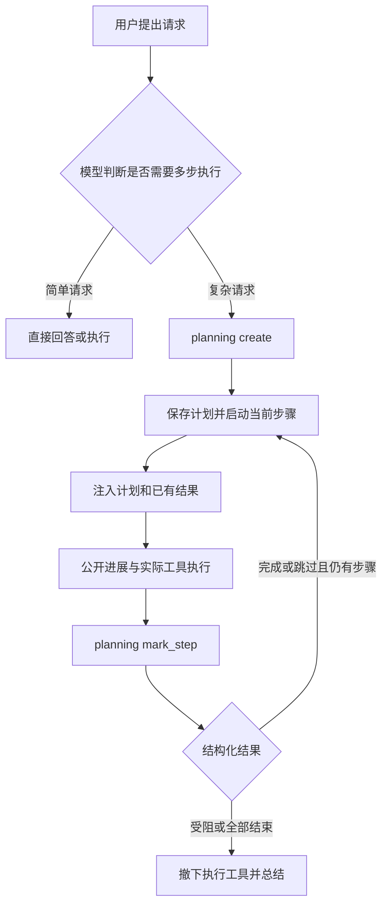

# Octop 任务规划与执行过程接入分析

Octop 已借鉴 AgentComputer2 的结构化规划和公开进展，增加宿主管理的 `planning`、稳定步骤身份、步骤结果和实际工具记录。新任务不再使用原生 `write_todos`；计划、动作、思考与最终回答分别保存，通过正式任务协议交给网页和 APP。

这里的“思维链”指用户可理解的公开判断、行动及结果。供应商未公开的内部推理、加密 reasoning 和私有工具 artifact 不属于可展示数据；计划与工具事实不依赖生成或猜测这类内容。

## 范围与代码基线

| 项目 | 分支与提交 | 用途 |
| --- | --- | --- |
| Octop | `feature/agentcomputer-foundation`，`490e97aa9eefa28c36cd725f2c0e3b6b02c104cf` | 本轮开发基线；下文“当前实现”包含其上的未提交改动 |
| AgentComputer2 | `codex/next-best-query-recommendations`，`da4a8afdf19d3aa654d8040629758b4b80b4d03a` | 本地运行时、持久化与原生界面参考 |
| 实际 APP：AgentComputer | `feature/0.0.2/octp`，`41fe8e5ab9d691ed9aaf286bc2d1440a89e5b6c9` | 已有 Octop 任务连接，本轮尚未修改 Swift 或 UI |
| Octop 本地依赖 | 锁文件中的 `octop-harness 1.0.1` 及当前 `.venv` | 核对 Harness 事件与中间件能力，不直接修改已安装依赖 |

首次调研日期为 2026 年 10 月 17 日，当前合同更新于 2026 年 10 月 19 日。参考实现与当前实现分节描述；本合同的测试仍需以最新交付记录确认，前一版 todo 试接的验证数字不作为本轮结果。

## 当前已落地的合同

主模型对复杂请求调用 `planning create`，宿主生成 `plan_id` 和各个 `step_id`，第一步进入执行中。随后通过显式步骤身份和 `expected_revision` 更新计划、开始或选择步骤、记录完成/阻塞/跳过结果。每次有效变化保留完整计划修订，旧动作继续指向执行当时的身份。

`message_notify_user` 发送公开开场、新发现和阻塞。工具记录保存实际参数、公开返回内容和已知的执行时间/耗时。正文、思考及进展通过明确的 `plan_id + step_id` 关联，不按步骤下标、文字相似度或“第一个执行中”推断。

实现仍复用 `content_blocks_json`：计划变化追加 `plan` 块，通知成功追加幂等 `progress` 块，工具在同一稳定块上补齐执行事实。`TaskTurn.plan` 和 `plan_revision` 从最新计划块投影，不是第二份计划存储，无需新增表或迁移。

网页消费同一合同；APP 需要扩展已有 DTO、合并、缓存和展示，不能只重启服务。详见 [APP 接入指南](agentcomputer-task-planning-and-progress.md) 和 [任务实时协议](project-task-websocket.md)。

这里仍须区分两种“项目规划”：

- **请求执行计划**：一次用户请求的步骤、结果与动作归属。本轮实现这一层。
- **项目长期规划**：跨多个 Task 的目标、里程碑、任务依赖和验收条件。尚需单独设计，不能把单次请求计划自动当成项目路线图。

AgentComputer2 的项目模型保存名称、工作区授权及导入信息；计划按用户消息归属，新消息默认从无计划开始，继续原消息才恢复计划。依据：[项目模型](/Users/fangyuan/Desktop/code/AgentComputer2/AgentComputer/Services/WorkspaceProjectStore.swift:12)、[会话计划恢复](/Users/fangyuan/Desktop/code/AgentComputer2/AgentComputer/Services/AI/AgentSessionService.swift:918)。

## AgentComputer2 如何规划和执行

### 用结构化工具保存正式计划

真实工具名是 `planning`，包含三个命令：

| 命令 | 行为 | 宿主约束 |
| --- | --- | --- |
| `create` | 创建标题和有序步骤 | 同一计划只能创建一次；结构允许 1 至 12 步，复杂任务提示建议 2 至 12 步 |
| `get` | 读取当前计划 | 必须已经存在计划 |
| `mark_step` | 报告当前步骤完成、受阻或跳过 | 只能修改当前执行步骤，必须给出非空结果或原因 |

每一步保存 `text`、`status`、`notes`、起止时间和阻塞原因。状态包括 `not_started`、`in_progress`、`completed`、`blocked`、`skipped`。顺序必须保持“已结束前缀、至多一个执行中或受阻步骤、尚未开始后缀”；计划创建后，标题、步骤数量和步骤文字不能重新编排。

依据：[PlanningTool](/Users/fangyuan/Desktop/code/AgentComputer2/AgentComputer/Services/AI/PlanningFlow.swift:17)、[AgentPlan 校验](/Users/fangyuan/Desktop/code/AgentComputer2/AgentComputer/Domain/AgentRuntime/AgentPlan.swift:77)。旧规格中的 `update_plan` 是模拟工具描述，不能当作当前运行接口。

### 由宿主决定何时推进



模型负责拟定步骤和报告结果，宿主负责验证并保存状态、启动下一步。每次请求都会注入当前计划和已有步骤结果；模型应只执行当前步骤。`planning` 必须独占一次工具调用批次，避免同批工作尚未返回就先标记完成。当前步骤没有结构化结果时，普通回答不能直接结束执行。

正式会话先持久化计划，再发布 `planUpdated`；保存失败会停止推进。计划完成或受阻后，运行时撤下普通执行工具，进入总结阶段。因此，文件发布和实际验证需要在最终步骤结束之前完成。

依据：[当前步骤指令](/Users/fangyuan/Desktop/code/AgentComputer2/AgentComputer/Services/AI/PlanningFlow.swift:127)、[运行循环](/Users/fangyuan/Desktop/code/AgentComputer2/AgentComputer/Services/AI/AgentRuntime.swift:672)、[调用批次校验](/Users/fangyuan/Desktop/code/AgentComputer2/AgentComputer/Services/AI/AgentRuntime.swift:1125)、[先保存再发布](/Users/fangyuan/Desktop/code/AgentComputer2/AgentComputer/Services/AI/AgentRuntime.swift:1558)。

这套机制约束执行顺序，但完成声明仍由模型提出。非空 `notes` 不等于自动验证了其中的证据，计划完成也不等于产品验收通过。

### 按原请求恢复计划

`plan.updated` 保存 `turnID`、`userMessageID` 和完整计划。历史回放校验归属和合法状态转换；继续原请求时保留已完成步骤，从首个未完成步骤恢复。取消或异常会阻塞当前步骤，并记录用户停止或执行错误。

恢复提示要求先核对工作区，再决定是否重复副作用。计划检查点本身不能保证命令、文件写入或外部操作只执行一次。Octop 应继续沿用现有工具回执和暂停恢复规则。

依据：[计划落盘](/Users/fangyuan/Desktop/code/AgentComputer2/AgentComputer/Data/Persistence/ConversationEventStore.swift:1119)、[计划回放](/Users/fangyuan/Desktop/code/AgentComputer2/AgentComputer/Data/Persistence/ConversationSessionReplayer.swift:533)、[步骤恢复](/Users/fangyuan/Desktop/code/AgentComputer2/AgentComputer/Services/AI/PlanningFlow.swift:82)。

## AgentComputer2 如何展示执行过程

### 将不同来源的内容分开

| 内容 | 来源 | 产品用途 |
| --- | --- | --- |
| 正式计划和步骤结果 | `planning` 与宿主状态 | 展示进度、当前步骤和受阻原因 |
| 公开进展 | 主模型调用 `message_notify_user` | 解释接下来做什么、新发现和下一步 |
| 工具动作 | 真实工具调用与结果，附简短 `brief` | 展示正在执行的行动及可展开详情 |
| 可展示思考文字 | Provider 返回的 reasoning，或运行时归入过程的普通文字 | 作为过程详情；不作为完成证明 |
| 最终回答 | 最终输出阶段 | 交付成果、结论和限制 |

公开进展使用专门工具，工作前说明意图，工作后说明已观察到的事实。工具 `brief` 只描述动作与目的，真实路径、命令和结果保留在工具参数及结果中。公开进度模式下，宿主会拒绝在有效开场通知前执行工作工具；不需要为每段 reasoning 再请求一个摘要模型。

宿主在活动开始时绑定 `planID` 和 `stepIndex`，工具结束沿用开始时的归属。公开进展以 Commentary 记录，保留调用 ID 及回合关联，刷新后可以恢复。模型输出的文字不能反向修改计划状态或工具结果。

依据：[公开进展协议](/Users/fangyuan/Desktop/code/AgentComputer2/AgentComputer/Domain/AgentRuntime/AgentProgress.swift:34)、[阶段元数据](/Users/fangyuan/Desktop/code/AgentComputer2/AgentComputer/Domain/AgentRuntime/AgentProgress.swift:5)、[会话绑定及保存](/Users/fangyuan/Desktop/code/AgentComputer2/AgentComputer/Services/AI/AgentSessionService.swift:975)、[公开进展持久化校验](/Users/fangyuan/Desktop/code/AgentComputer2/AgentComputer/Data/Persistence/ConversationEventStore.swift:689)。

### 可见推理与模型上下文分开处理

参考适配器将 Responses 的可见 reasoning 增量、GLM 的 `reasoning_content` 转成过程事件。Responses 的加密 reasoning items 作为供应商上下文回传给模型，不作为用户可见文字。

运行时还会把计划执行阶段的一部分普通正文归入 Reasoning，因此参考项目中名为 Reasoning 的记录不全是 Provider 原生推理。Octop 接入公开进展时，应保留明确的内容来源，避免把普通旁白标成模型内部思考。

依据：[Responses 上下文](/Users/fangyuan/Desktop/code/AgentComputer2/AgentComputer/Services/AI/OpenAIResponsesProvider.swift:198)、[可见增量映射](/Users/fangyuan/Desktop/code/AgentComputer2/AgentComputer/Services/AI/OpenAIResponsesProvider.swift:356)、[GLM 增量](/Users/fangyuan/Desktop/code/AgentComputer2/AgentComputer/Services/AI/GLMChatCompletionsProvider.swift:237)、[执行阶段文字分类](/Users/fangyuan/Desktop/code/AgentComputer2/AgentComputer/Services/AI/AgentRuntime.swift:869)。

### 默认界面优先展示计划

参考项目默认开启动作链路和步骤面板。有正式计划且步骤面板开启时，显示计划标题、步骤状态、进度、耗时、当前动作、结果说明、恢复动作和产物入口，并隐藏重复的 Process 区域。

无计划或关闭步骤面板时，使用 Process。动作链路模式显示公开进展和工具活动，通常隐藏原始 reasoning；关闭动作链路后使用普通 Thinking。不能将其描述为默认同时铺开计划卡、全部推理和完整动作时间线。

依据：[展示开关](/Users/fangyuan/Desktop/code/AgentComputer2/AgentComputer/Features/Workspace/TaskConversationView.swift:112)、[Process 显隐规则](/Users/fangyuan/Desktop/code/AgentComputer2/AgentComputer/Core/TaskConversationPresentationModels.swift:313)、[计划面板](/Users/fangyuan/Desktop/code/AgentComputer2/AgentComputer/Features/Workspace/TaskConversationPlanProgress.swift:246)、[公开时间线投影](/Users/fangyuan/Desktop/code/AgentComputer2/AgentComputer/Core/TaskConversationPresentationModels.swift:601)。

## 从初始 todo 试接到正式规划

最初调研发现 Harness 默认的 `TodoListMiddleware` 提供 `write_todos`，但列表只有 `content` 与三态，没有稳定步骤身份、结果或时间。其完整状态通过 `state_snapshot` 到达，原任务运行时没有提取该状态。早期试接从主任务快照读取 todo，解决了“列表生成但页面看不到”的问题。

这不能满足按步骤查看动作和结果：列表可改排、增删或并行，位置与文字都不能代表身份。因此当前方案已用 `TaskPlanning` 替换原生 todo，任务配置明确 `todos_enabled=False`；不保留两个活动计划来源，不双向同步，也不从旧列表猜测身份。已保存的 `source=harness_todos` 旧计划只读保留。

依赖调研依据：[默认开关](/Users/fangyuan/Desktop/code/Octop/.venv/lib/python3.13/site-packages/octop_harness/config/__init__.py:611)、[原生 Todo](/Users/fangyuan/Desktop/code/Octop/.venv/lib/python3.13/site-packages/langchain/agents/middleware/todo.py:25)、[Harness 事件投影](/Users/fangyuan/Desktop/code/Octop/.venv/lib/python3.13/site-packages/octop_harness/protocols/langgraph.py:231)。这些是初始诊断依据，不是当前 Octop 新计划入口。

## Octop 正式规划规则

### 由宿主管理身份和修订

| `planning` 命令 | 当前行为 |
| --- | --- |
| `create` | 用标题和非空步骤文字新建计划；宿主分配新 plan/step ID，首步开始；同轮重建也取得新 plan_id，并递增轮次计划版本 |
| `get` | 返回当前完整计划或 null，不改变修订 |
| `update` | 携带 expected_revision 及完整步骤列表；保留项必须显式提交 step_id；新项不带 ID，由宿主分配；省略的旧项写入 retired_steps 并记录 removed_at |
| `start_step` | 用 expected_revision 和 step_id 开始/重新进入该步，记录已知开始时间并设为 active_step_id |
| `select_step` | 用 expected_revision 明确选择一个 in_progress 步骤作为默认归属，或清空选择 |
| `mark_step` | 用 expected_revision、step_id、completed/blocked/skipped 和非空 result 记录结果及结束时间；不自动启动下一项 |

步骤状态是 `pending / in_progress / completed / blocked / skipped`，最多 100 项，文字最多 500 字符，结果最多 2000 字符。计划保存 `title`、`active_step_id`、当前 `steps` 和已移除 `retired_steps`；步骤保存宿主生成的身份及 UTC `started_at / finished_at / removed_at`。重复读取或无变化更新不增加版本。

更新必须匹配当前修订，不能根据文字或下标识别旧步骤。允许显式改排、改文和并行，但只有 `active_step_id` 表示默认执行归属；标记完成不自动把下一项设为执行中。新建计划、移除步骤与切换当前步骤不能改变已保存活动的归属。

规划调用必须独占模型的工具调用批次，不能和业务工作、另一规划调用混在同批并发；混批整体拒绝，防止工作尚未完成就先改步骤。正式计划只由主任务管理，子代理和团队成员不得覆盖它。规划不授予权限，原有审批、提问、暂停、客户端工具及恢复机制继续生效。

这已经实现宿主身份、修订和步骤结果约束，但不等同于 AgentComputer2 的严格顺序调度：Octop 没有冻结整个步骤列表，没有“只准当前一项”的规则，也没有自动撤下全部工作工具进入最终总结的同款外层状态机。模型声明完成仍需真实结果支持，非空 `result` 本身不是验收证据。

### 动作在发生时固定步骤归属

主任务每次模型响应开始时确定其 `plan_id / step_id`，思考和文字保留该归属。工具默认绑定显式选中的当前步骤；模型也可通过工具 schema 中的宿主元数据 `task_step_id` 指定另一个有效执行中步骤。该元数据由宿主校验，剥离后才送入业务工具；工具本身已有同名业务参数时保留其业务语义。

实际执行开始后，工具块保留其原始归属，结束、恢复或后续计划改排不会重新计算。公开进展沿用通知调用的固定归属。客户端按 `(plan_id, step_id)` 分组，不按当前下标聚合，也不把无 ID 的旧活动补绑到当前步。

移除步骤保留在 `retired_steps`，因此旧动作仍能找到原步骤。重新 `create` 的新计划使用新 ID，旧计划的活动不得串到新计划；计划修订块保留历史快照。无正式计划的简单任务仍可直接工作或回答，活动保留轮次级归属。

### 工具详情来自实际执行

| 字段 | 来源与边界 |
| --- | --- |
| `arguments` | 实际工具参数；不混入宿主步骤元数据 |
| `output` | 实际 `ToolMessage.content` 的 JSON 值；保留对象、数组或字符串结构 |
| `started_at` | 服务端实际调度时记录的 UTC 时间；模型提出调用意图不算开始 |
| `finished_at` | 服务端观察到结束的 UTC 时间 |
| `duration_ms` | 执行器记录的非负毫秒耗时；未知时为 null |
| `tool_label` | 服务端本地化动作名称，缺失时回退工具名 |

授权前可以出现工具意图，等待审批时不能显示成已执行。中断等待不当作工具完成；恢复使用已有调用与归属，不重放已完成副作用。客户端工具未提供可核实的现场执行时间时不补造。工具异常、取消或失败保留已观察事实；计划状态不覆盖真实工具状态。

`output` 不读取私有 `artifact`、`additional_kwargs`、模型上下文或加密 reasoning。底层工具如果已经截断输出，本层只能保存实际返回的内容，无法恢复未返回部分；“真实返回内容”不等于原程序的无限制完整输出。发布附件仍以真实附件元数据与下载接口为准，不从计划结果或文本路径猜测产物。

## 持久化、恢复和界面

`content_blocks` 是完整有序快照，客户端按 `content_revision` 替换；`plan/plan_revision` 按独立计划版本合并。两者都不依赖任务列表版本或回复长度。迟到回执、历史页和终态保护不能吞掉较新的计划结果或动作事实；完成块不代表任务完成，轮次终态以 `turn.status` 为准。

暂停恢复同一轮次时保留计划、步骤身份、结果和工具关联；普通追问或手动重试的新轮次从无计划开始。取消、失败、等待和进程恢复保留最后已记录的步骤，不自动完成或阻塞它们，不推造结果或时间。

历史没有记录的字段保持 null、空结果或既有缺省值，不回填身份、时间、参数或输出。APP 的可再建缓存无法解码时沿用丢弃该本地条目并只读重取的路径，服务端任务和轮次记录保留；不能只保留 cursor 而丢掉对应正文。无需新旧协议同步或自动迁移。

网页和 APP 应显示最新计划卡、当前步骤及结果，并按计划/步骤 ID 展开思考、公开进展与真实工具详情；移除步骤和旧计划仍可查看历史活动。原始块顺序保持稳定。`progress` 不进入最终答案或复制内容，不需要额外调用模型生成摘要。

实际 APP 已有远端任务网络、统一合并、缓存和会话投影，但其块类型尚不识别 plan/progress；需要按 [专项接入文档](agentcomputer-task-planning-and-progress.md) 升级。不能把远端计划直接强转原生 `AgentPlan`：后者是 UUID、最多 12 步、冻结文字和顺序推进的另一状态机。

## 实现位置与边界

| 源码 | 当前职责 |
| --- | --- |
| [progress.py](../src/octop/infra/projects/progress.py) | 公共计划/步骤模型、旧计划读取、公开通知 |
| [planning.py](../src/octop/infra/projects/planning.py) | 宿主分配身份、修订校验、步骤生命周期、结果与退役记录 |
| [execution.py](../src/octop/infra/projects/execution.py) | 主任务步骤上下文、工具参数元数据、实际执行事实 |
| [control.py](../src/octop/infra/projects/control.py) | 批次/主任务约束、已有权限和暂停机制 |
| [runtime.py](../src/octop/infra/projects/runtime.py) | 关闭 native todos、装配 planning/通知/执行记录、恢复和持久化 |
| [content.py](../src/octop/infra/projects/content.py) | 稳定块、计划修订、公开进展与工具详情更新 |
| [tasks.py](../src/octop/infra/projects/tasks.py) | 从持久块投影统一 TaskTurn |
| `dashboard/src/pages/BoxProjects/` | 独立版本合并、计划/步骤聚合与动作详情 |
| [实时协议](project-task-websocket.md)及 Schema | APP/网页共享合同 |

接口保持 `/api/projects`、`/api/project-tasks`；不恢复 `/api/agentcomputer/v1` 或 Bridge。项目独立于专家。客户端目录仍仅保存用户电脑绝对路径，规划不授权服务端探测、读取或上传该目录内容。

项目长期规划仍属后续设计：若要跨 Task 的里程碑和依赖，应独立建模并按实际任务结果与用户决策更新。严格单步调度也属另一项执行语义选择，不能因为计划卡已经存在就声称自动实现。

## 验证与验收目标

2026 年 10 月 19 日的定向验证：后端 226 项、前端 118 项通过，Ruff、8 个相关源码文件的严格 Mypy、TypeScript 和前端构建通过。完整示例通过当前 JSON Schema、服务端模型和本文 APP 指南中的 Swift DTO 解码检查。真实 Harness 流程使用假模型，没有调用真实 LLM，也没有构建或验收 APP。

后端验证范围与命令：

```bash
uv run pytest \
  tests/unit/projects/test_task_stream.py \
  tests/unit/projects/test_progress.py \
  tests/unit/projects/test_planning.py \
  tests/unit/projects/test_execution.py \
  tests/integration/test_project_task_planning.py \
  tests/integration/test_project_task_step_interactions.py \
  tests/integration/test_project_task_reasoning.py \
  tests/integration/test_project_task_checkpoints.py \
  tests/integration/test_project_task_interactions.py \
  tests/integration/test_project_task_client_tools.py \
  tests/integration/test_project_api_contract.py \
  tests/unit/i18n -q
```

前端验证覆盖 `TaskTurnContent`、`useTaskConversation`、`TaskConversations`、`TaskConversations.queue` 和 `useTaskMessageQueue` 五个测试文件；`make build-frontend` 成功。本轮按约定没有重复完整 `make all` 门禁；本地提交沿用仓库已有提交钩子，不推送。

本机 8088 服务已平滑重启并通过健康、首页及 API 文档检查；原环境设置保留，既有 5 个项目、20 个任务、83 个轮次和 16 条标题任务逐表摘要一致，数据库版本未改变。此检查未发送模型任务；历史无 ID 的记录仍不会补造关联。

| 场景 | 应观察到的行为 |
| --- | --- |
| 简单问答 | 无计划可直接回答，不制造通用占位计划 |
| 新建复杂任务计划 | planning 成功后宿主返回新 plan/step ID、首步状态与时间 |
| 明确更新与并行 | expected_revision 校验；旧 ID 保留，新项取得新 ID；活动不随排序漂移 |
| 步骤结束、阻塞、跳过 | 保存 result 和已知结束时间，不自动推进下一项、不把声明当验收 |
| 移除、清空、同轮重建 | retired_steps 与旧计划活动保留；新 plan_id 不混入旧活动 |
| 规划混批或子代理规划 | 不改变正式主计划或派发与混批竞态有关的工作 |
| 实际工具结果 | 参数/output JSON 类型及真实时间保持，未调度不显示开始，未知不回填 |
| 重复/迟到更新与历史页 | plan/content 版本独立不回退，稳定 ID 不产生重复记录 |
| 暂停/审批/本机工具恢复 | 同轮计划和归属保留，不重复派发副作用 |
| 取消/失败与普通追问 | 不伪造步骤完成；新轮计划隔离，原轮记录保留 |
| 私有数据与底层截断 | 不公开 private artifact，不承诺恢复工具未返回的输出 |
| APP 对接 | DTO、合并、缓存、步骤聚合全部升级；当前未修改或验收 Swift/UI |
