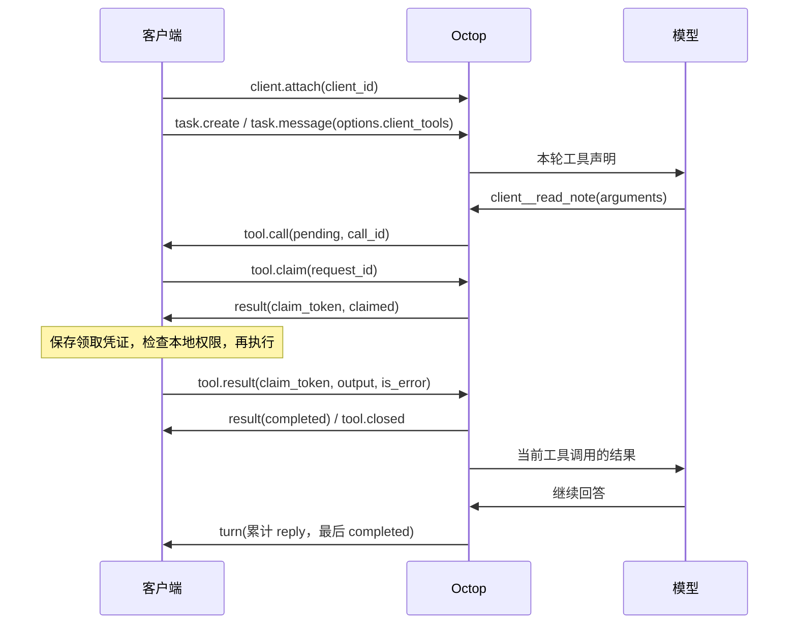

# 任务 WebSocket 客户端接入指南

协议版本：`3`，对应 `ready.protocol_version`。更新日期：2026 年 10 月 16 日。

客户端通过一条经过认证的连接提交消息，并订阅多个任务的实时状态。服务端保存任务及轮次，连接断开后任务继续执行；重新连接只恢复订阅。模型执行槽保持串行，主 Task 等待客户端工具时保存检查点并释放执行槽，其他排队任务可以继续；生成中的正文按约 0.5 秒的保存节奏更新。

这是 Octop 的任务协议，不使用 OpenAI 的 `response.create` 或 `function_call_output` 消息。当前支持文字和图片输入、独立的思考内容、工具活动摘要、停止、服务端附件交付，以及客户端工具声明、调用和结果回传。主 Task 支持三档任务审批模式、远端独立 Reviewer、提问和手动暂停恢复；`client_directory` 只保存路径，不授予客户端文件访问能力。客户端工具接入见[第 12 节](#12-客户端工具完整接入协议)，服务端附件见[第 13 节](#13-服务端附件交付)，图片输入见[第 15 节](#15-图片输入)。

- [JSON Schema](project-task-websocket.schema.json)：请求按实际 Pydantic 模型导出；服务端数据模型与 REST 共用定义。
- [API 参考](api.md)：项目配置、任务列表、历史分页、改名与归档。
- [列表增量同步](project-task-incremental-sync.md)：侧栏任务状态同步。
- [审批、提问及暂停恢复](project-task-interactions.md)：v3 已实现契约及语义。
- [AgentComputer 交接文档](agentcomputer-task-interactions.md)：客户端接线说明，本次未修改客户端。
- 网页参考实现：[连接管理](../dashboard/src/api/modules/projectTaskSocket.ts)、[命令封装](../dashboard/src/api/modules/projects.ts)、[状态合并和恢复](../dashboard/src/pages/BoxProjects/useTaskConversation.ts)。

目录：[最短流程](#1-最短接入流程) · [连接与鉴权](#2-连接与鉴权) · [标识约定](#3-标识与公共约定) · [客户端命令](#4-客户端命令) · [服务端事件](#5-服务端事件与完整示例) · [数据合并](#6-数据模型与状态合并) · [本轮设置](#7-本轮模型与资源) · [APP 思考接入](#app-思考内容接入) · [断线恢复](#8-断线恢复与多任务复用) · [错误与关闭](#9-错误与关闭) · [Swift 示例](#10-原生客户端最小连接示例) · [联调检查](#11-客户端联调检查) · [客户端工具](#12-客户端工具完整接入协议)。

示例中的 task_example、provider/model 和 opaque_event_cursor 等为占位值，联调时使用服务端实际返回的标识和游标。

## 1 最短接入流程

1. 使用现有 Octop 登录流程取得 access token，连接 `/api/project-tasks/ws`。
2. 完成鉴权，收到 ready 后才发送业务命令。
3. 用 task.create 发送首条消息，通过命令 id 匹配 result，保存返回的 task_id。
4. 用创建响应的 event_cursor 发送 task.subscribe。创建成功不会自动订阅。
5. 在唯一的接收循环中处理全部事件，再按任务 ID 分发。
6. 用 task.message 继续同一任务。断线后重新鉴权、重新订阅，不自动重发用户消息。

打开已有任务详情时，先发送 task.open 获取 TaskDetail，再用返回的 event_cursor 订阅。它表示用户明确进入任务，只在本次进入时发送；列表预加载、历史分页和断线恢复不发送 task.open。

任务完成通过 `turn.status=completed` 表达，没有单独的 done 消息。一轮结束不会关闭连接，后续追问继续沿用 task_id。

## 2 连接与鉴权

开发地址示例为 `ws://127.0.0.1:8088/api/project-tasks/ws`。HTTPS 部署使用 `wss://<Octop 主机>/api/project-tasks/ws`。地址和端口取用户实际配置。当前直接访问 Octop，不支持项目和任务的 Bridge 转发。

应用消息均为 **UTF-8 JSON 文本帧**，每帧一个 JSON 对象，不采用 SSE 行格式或二进制 JSON 帧。不声明 WebSocket subprotocol。

### 原生客户端使用请求头

在升级请求中添加 `Authorization: Bearer <access token>`。服务端验证后直接返回 ready，客户端不要再发送 authenticate。

### 浏览器使用首帧

无法设置升级请求头时，在连接打开后的 10 秒内发送：

```json
{"type":"authenticate","token":"<access token>","locale":"zh"}
```

token 必填，长度 1–16384 字符。locale 可省略或为 null，非空时仅接受 zh/en；已保存的用户语言偏好优先。authenticate 不带命令 id，也没有 result 回执。

不要把凭据放进 URL 的 token/access_token 查询参数，当前入口不读取它们。鉴权成功返回：

```json
{"type":"ready","protocol_version":3}
```

连接绑定首次认证的用户，不能重新发送 authenticate 切换身份。退出登录或切换账号时，关闭旧连接并清理该账号的内存订阅和待处理命令。

### 续期与心跳

每条命令都会重新验证登录态；空闲时约每 10 秒也会检查一次。滑动续期时返回：

```json
{"type":"session","access_token":"<renewed access token>"}
```

客户端按原来的登录保存策略替换 token，后续连接和 REST 请求使用新 token。服务端同时更新当前连接的凭据，无需再发鉴权。旧账号的迟到 session 消息不能覆盖新账号的凭据。

空闲期间的应用层心跳为：

```json
{"type":"heartbeat"}
```

heartbeat 不需要回复。下文的 ping 命令用于主动检查请求与回执，返回 result，不返回 pong。

## 3 标识与公共约定

| 字段 | 含义 | 客户端规则 |
| --- | --- | --- |
| 命令 id | 匹配本次命令与 result/error | 同一连接的在途命令使用不同值；8–128 位字母、数字、短横线或下划线，推荐 UUID 字符串 |
| data.request_id | 消息的持久化幂等标识 | 同一消息重试复用；新消息和新的手动重试使用新值；格式与命令 id 相同 |
| task_id | 多轮任务会话 | 不透明字符串，原样保存，不转为 UUID；命令顶层字段长度 1–256 字符 |
| turn_id | 一条用户消息对应的一轮执行 | 停止和重试时指定，不能只传“当前任务”而省略轮次 |
| cursor / event_cursor | 单个任务的实时同步位置 | 原样保存，不解析或比较字符串大小；订阅时非空字符串最长 4096 字符 |
| list_revision | 任务摘要版本 | 合并列表字段用，不表示正文版本 |
| sequence | 轮次排序序号 | 按数值升序排列，可能不连续，不是资源身份 |

请求模型拒绝未声明字段。除明确允许 null 的字段外，不要用 null 代替省略；例如 options 可以省略，但 `options:null` 不合法。响应解析应忽略未知字段，并为未知错误码提供通用处理。

服务端不使用命令 id 去重。网络重发可以换命令 id，但要保留 data.request_id、正文、attachment_ids 及顺序和 options。命令按连接上的接收顺序处理，回执和订阅事件可以交错出现。

## 4 客户端命令

### 创建任务 task.create

```json
{"type":"task.create","id":"command-create-001","data":{"project_id":null,"request_id":"message-first-001","prompt":"请概括下一步工作"}}
```

project_id 为 null 或省略时创建无项目任务；指定项目时必须属于当前用户。prompt 去除首尾空白后最多 32768 个 Unicode 码点，还受帧字节限制；可省略或为空，但此时必须带非空 attachment_ids。图片先通过 HTTP 上传，每轮 attachment_ids 最多九个不重复 ID，规则见[第 15 节](#15-图片输入)。options 可省略，规则见第 7 节。

成功 result.data 为 TaskDetail，通常包含 queued 的首轮。成功仅表示已保存和排队；模型或资源不满足要求时返回错误，不创建空任务。创建 Task 不会绑定或创建专家。

### 继续对话 task.message

```json
{"type":"task.message","id":"command-message-002","task_id":"task_example","data":{"request_id":"message-second-002","prompt":"继续细化第二步"}}
```

成功 result.data 为同一任务的 TaskDetail，新增一个轮次。每轮采用当时项目配置与本轮 options，不修改项目。有活动轮次时返回 TASK_BUSY；归档任务须先通过 REST 恢复。

### 停止指定轮次 task.cancel

```json
{"type":"task.cancel","id":"command-cancel-001","task_id":"task_example","data":{"turn_id":"turn_example"}}
```

成功 result.data 为 TaskDetail。排队轮次可能直接进入 cancelled；执行中的轮次先保存 cancel_requested=true，之后以推送的终态为准，不能收到回执就宣称已停止。重复或迟到的停止只作用于指定 turn_id，不影响后续轮次。取消保留正文，不回滚已经发生的工具操作。

### 手动重试 task.retry

```json
{"type":"task.retry","id":"command-retry-001","task_id":"task_example","turn_id":"turn_failed","data":{"request_id":"message-retry-001","options":{"mcp_servers":[]}}}
```

只能重试最后一个 failed/cancelled 轮次，且任务当前没有活动轮次。成功 result.data 为 TaskDetail：保留原记录，用原 prompt 和当前配置创建新 turn_id，记录 retry_of_turn_id。它会重新执行工作，可能重复已有工具操作，不能用于自动网络重连。

同一次重试的网络重发仍使用原 request_id 和 options。要再次执行另一轮重试，使用新 request_id。图片输入沿用原轮次的附件和顺序，重试请求无需上传或重复提交 attachment_ids。

### 打开任务 task.open

```json
{"type":"task.open","id":"command-open-001","task_id":"task_example"}
```

成功 result.data 为最近一页 TaskDetail，与详情 GET 的数据形状相同。命令表示本次进入该任务，并按需排队生成语义标题，不创建轮次、不重放原消息或工具，也不自动订阅。客户端随后用 result.data.event_cursor 发送 task.subscribe，接收后台标题更新。

已有模型生成标题或手动标题时不重新命名；旧任务只有仍保留首条消息前 80 字符的默认标题、且没有新版本手动改名记录时，才首次补生成。只处理打开的这一项，不扫描其他历史任务。标题请求使用首轮已保存的模型，仍受用户配额约束，失败不影响对话读取。

排队中、执行中和已完成的标题不会因重复打开而重复请求。打开旧任务首次最多尝试一次；失败后冷却至少 10 分钟，冷却结束后的下一次 task.open 才允许再尝试一次，不在后台持续重试。新任务创建时原有的最多两次初始尝试保留。累计尝试次数和 Token 用量不清零，过期执行的迟到结果不能覆盖新尝试。生成结果不改变任务活动时间；生成期间用户改名仍优先保留用户标题。

APP 应将 task.open 与真实的进入详情动作绑定。停留页面、恢复前台和断线重连仅恢复 task.subscribe；不得把后台订阅或批量预加载当作打开。task.open 的冷却与去重由服务端统一判断，客户端无需根据标题文本猜测是否已生成。

task.open 回执丢失时，生成请求可能已入队；本次进入的自动恢复应通过详情 GET 获取快照再订阅，不自动重发 task.open。再次明确进入任务时才能重新发送。

### 订阅任务 task.subscribe

有实时游标时：

```json
{"type":"task.subscribe","id":"command-watch-001","task_id":"task_example","cursor":"opaque_event_cursor"}
```

没有缓存或需要重建时：

```json
{"type":"task.subscribe","id":"command-snapshot-001","task_id":"task_example"}
```

带 cursor 时补齐该位置之后各轮的最新状态。省略或传 null 时先返回最近一页 snapshot，再补齐期间的变化。成功 result.data 为 null；没有新状态也会返回回执。

订阅只恢复数据观察，不检查或重试标题；需要按需补标题时，用户进入详情应先发送 task.open。

**snapshot/turn 可以先于订阅命令的 result 到达。** 发送订阅前登记事件接收方；不要等回执才开始读取，也不要在等待某个回执时丢弃其他帧。

每条连接每个 task_id 只有一个服务端订阅，重复订阅会更新其基线。多个本地界面观察同一任务时，在连接管理层合并观察者，最后一个观察者离开时再取消订阅。

### 取消订阅 task.unsubscribe

```json
{"type":"task.unsubscribe","id":"command-unwatch-001","task_id":"task_example"}
```

成功 result.data 为 null。对未订阅的任务发送也成功，不停止执行。回执之前已在途的帧仍可能到达，客户端根据当前观察者判断是否展示。

### 检查连接 ping

```json
{"type":"ping","id":"command-ping-001"}
```

```json
{"type":"result","id":"command-ping-001","data":null}
```

## 5 服务端事件与完整示例

| type | 主要字段 | 处理方式 |
| --- | --- | --- |
| ready | protocol_version | 鉴权完成，开始发送业务命令 |
| result | id、data | 完成匹配命令，不结束接收循环 |
| snapshot | data: TaskDetail | 建立或重建最近一页正文与实时基线 |
| turn | data: TaskUpdate | 按任务与轮次合并完整状态，应用后保存 cursor |
| error | status、error，可能带 id 或 task_id | 按第 9 节区分命令、订阅和连接错误 |
| session | access_token | 保存续期凭据 |
| heartbeat | 无 | 保持连接活跃，不改变任务状态或游标 |

### 创建回执

```json
{
  "type":"result",
  "id":"command-create-001",
  "data":{
    "task_id":"task_example",
    "project_id":null,
    "title":"请概括下一步工作",
    "archived":false,
    "status":"queued",
    "active_turn_id":"turn_example",
    "list_revision":1,
    "created_at":"2026-10-15T05:01:00Z",
    "updated_at":"2026-10-15T05:01:00Z",
    "next_page_cursor":null,
    "event_cursor":"opaque_event_cursor",
    "turns":[{
      "sequence":1,
      "turn_id":"turn_example",
      "request_id":"message-first-001",
      "prompt":"请概括下一步工作",
      "reply":"",
      "reasoning":"",
      "content_blocks":[],
      "content_revision":0,
      "status":"queued",
      "error_code":"",
      "activity":"",
      "artifacts":[],
      "model_ref":"provider/model",
      "options":{"model_ref":"provider/model","reasoning_mode":null,"reasoning_effort":null,"skills":[],"mcp_servers":[]},
      "interactions": [],
      "interaction_revision": 0,
      "pause_requested": false,
      "cancel_requested":false,
      "retry_of_turn_id":null,
      "input_tokens":0,
      "output_tokens":0,
      "project_revision":null,
      "created_at":"2026-10-15T05:01:00Z",
      "updated_at":"2026-10-15T05:01:00Z"
    }]
  }
}
```

### 轮次推送

```json
{
  "type":"turn",
  "data":{
    "task":{
      "task_id":"task_example",
      "project_id":null,
      "title":"请概括下一步工作",
      "archived":false,
      "status":"running",
      "active_turn_id":"turn_example",
      "list_revision":2,
      "created_at":"2026-10-15T05:01:00Z",
      "updated_at":"2026-10-15T05:01:01Z"
    },
    "turn":{
      "sequence":1,
      "turn_id":"turn_example",
      "request_id":"message-first-001",
      "prompt":"请概括下一步工作",
      "reply":"",
      "reasoning":"先确认项目目标，再整理下一步。",
      "content_blocks":[{"block_id":"turn_example:1","type":"reasoning","text":"先确认项目目标，再整理下一步。","status":"streaming","tool_call_id":null,"tool_name":null}],
      "content_revision":1,
      "status":"running",
      "error_code":"",
      "activity":"",
      "artifacts":[],
      "model_ref":"provider/model",
      "options":{"model_ref":"provider/model","reasoning_mode":"enabled","reasoning_effort":null,"skills":[],"mcp_servers":[]},
      "interactions": [],
      "interaction_revision": 0,
      "pause_requested": false,
      "cancel_requested":false,
      "retry_of_turn_id":null,
      "input_tokens":0,
      "output_tokens":0,
      "project_revision":null,
      "created_at":"2026-10-15T05:01:00Z",
      "updated_at":"2026-10-15T05:01:01Z"
    },
    "cursor":"opaque_event_cursor_next"
  }
}
```

上例是只有思考内容的推送：reply 仍为空，APP 也应更新思考区块。思考没有独立的 reasoning 事件，始终随 turn 完整状态发送。

reply 和 reasoning 各自是累计全文。例如 reasoning 第一次为“先确认项目目标”，第二次为“先确认项目目标，再整理下一步。”。客户端分别替换累计文本，或确认前缀一致后仅追加新增部分，不能直接拼接两次累计文本。

新轮次还提供 `content_blocks` 和 `content_revision`，用于按发生顺序展示摘要、思考、工具活动与回答。它们随同一条 turn 完整状态发送，不是增量事件。展示规则见下文“有序内容块”。

snapshot.data 与创建回执的 result.data 使用相同 TaskDetail 结构，没有 data.task 包装。识别任务分别用 `snapshot.data.task_id` 和 `turn.data.task.task_id`。

## 6 数据模型与状态合并

JSON Schema 给出完整字段、必填性和 null 语义。响应时间为 UTC ISO 8601，展示使用 `GET /api/settings/timezone` 返回的服务端时区。

Schema 根节点接受双向帧；`$defs.ClientCommand`、`$defs.AuthenticateFrame`、`$defs.ServerEvent` 可分别用于请求、鉴权和响应校验。它校验消息形状，不代替服务端对资源权限、引用重复和游标有效性的检查。协议变更时同步更新 Schema 和示例。

### TaskSummary

| 字段 | 类型 | 含义 |
| --- | --- | --- |
| task_id / project_id | string / string 或 null | 任务与可选项目身份 |
| title / archived | string / boolean | 标题与归档状态 |
| status | string | 当前或最近一轮的 queued、running、waiting_approval、waiting_answer、waiting_client_tool、paused、completed、failed、cancelled |
| active_turn_id | string 或 null | 活动轮次，null 表示暂时没有活动轮次 |
| list_revision | integer | 摘要版本，仅列表字段变化时递增 |
| approval_policy | object | 任务共享的 mode、独立 revision、updated_at；按其 revision 合并 |
| created_at / updated_at | datetime string | 任务创建与最近摘要更新时间 |

### TaskTurn

| 字段 | 类型 | 含义 |
| --- | --- | --- |
| sequence | integer | 稳定排序序号 |
| turn_id / request_id | string | 轮次与消息幂等身份 |
| prompt / reply | string | 用户消息与已保存的累计回复 |
| attachments | array | 本轮用户上传图片元数据，按提交顺序排列；预览需要鉴权 HTTP，字段见第 15 节 |
| reasoning | string | 模型实际返回的可展示思考文本，与 reply 分开保存；无内容时为空字符串 |
| content_blocks | TaskContentBlock[] | 按首次发生顺序排列的完整内容块快照；历史未记录时为空 |
| content_revision | integer | 本轮内容块版本，独立于任务列表版本；客户端按此版本替换内容块 |
| status / error_code | string | 轮次状态；错误码为空字符串时无错误 |
| activity | string | 当前工具名称；空字符串表示无活动摘要，不含参数或工具结果 |
| model_ref | string | 实际模型引用 |
| options | TaskExecutionOptions | 本轮实际模型与资源，继承部分已解析为实际选择 |
| approval_policy_at_start | object | 本轮开始时的模式；动作采用各自创建时的冻结版本 |
| interactions / interaction_revision | array / int | 完整交互列表与独立版本，见交互协议 |
| pause_requested | boolean | 已请求暂停，status=paused 才表示已生效 |
| cancel_requested | boolean | 已请求停止，仍须等待终态 |
| retry_of_turn_id | string 或 null | 手动重试来源 |
| input_tokens / output_tokens | integer | 本轮用量，执行中可能仍为零 |
| project_revision | integer 或 null | 发送时项目版本，无项目时为 null |
| created_at / updated_at | datetime string | 轮次创建与最近持久化时间 |

TaskDetail 在 TaskSummary 上增加 `turns:TaskTurn[]`、`next_page_cursor:string|null`、`event_cursor:string|null`。TaskUpdate 为 `{task:TaskSummary,turn:TaskTurn,cursor:string}`。

合并规则：

1. 按 task_id 找任务，摘要保留较大的 list_revision。不能用历史 turn.status 覆盖任务的当前 status。
2. 按 turn_id 合并轮次，按 sequence 排序。终态不回退；恢复等待允许重新排队，不能用 running 永不退回 queued 的旧规则；cancel_requested=true 不被迟到的 false 清除。
3. 同一轮的累计 reply 和 reasoning 分别合并，不接受迟到短文本覆盖。迟到的 REST 写入回执和历史页使用相同规则。终态正文可能为空，例如排队时被取消。
4. 回复、思考和工具活动变化不递增 list_revision；同一个摘要版本下仍要应用新 turn。
5. 应用 turn 后保存其 cursor。已有订阅时，不用迟到写入回执的 event_cursor 跳过尚未应用的事件。

重建 snapshot 基线时替换原加载范围，防止在未知历史缺口两侧直接拼接。需要更早正文时再按分页接口读取。

## 7 本轮模型与资源

创建、追问和重试的 data 都可以包含 options：

```json
{"type":"task.message","id":"command-options-001","task_id":"task_example","data":{"request_id":"message-options-001","prompt":"请检查代码，不调用外部连接","options":{"model_ref":"provider/model","skills":[{"package_id":"pkg_example","slug":"review"}],"mcp_servers":[]}}}
```

| options 字段 | 省略或 null | 显式值 |
| --- | --- | --- |
| model_ref | 使用发送时的默认可用模型 | 1–512 字符；不可用报错，不静默换模型 |
| reasoning_mode | 使用所选模型的默认模式 | auto / enabled / disabled；不支持的模式返回 422 TASK_REASONING_INVALID |
| reasoning_effort | 使用所选模型的默认强度 | 必须来自该模型 reasoning_config.efforts；不支持的值或关闭思考时指定强度返回 422 TASK_REASONING_INVALID |
| skills | 继承发送时项目选择，无项目时为空 | 完整替换本轮选择；[] 禁用；最多 64 项，不可重复 |
| mcp_servers | 继承发送时项目选择，无项目时为空 | 完整替换本轮选择；[] 禁用；最多 64 项，不可重复 |
| plugins | 继承发送时项目选择，无项目时为空 | 已安装且全局启用的插件 ID；[] 禁用；最多 64 项，不可重复 |
| subagents | 继承发送时项目角色，无项目时为空 | 内置角色 slug；[] 清空；最多 16 项，不可重复 |
| memory_enabled | 继承项目，无项目时为 true | 严格布尔值；任务独立的持久记忆捕获与搜索 |
| team_enabled | 继承项目，无项目时为 false | 严格布尔值；通过 agent_list/ask_agent 与所选角色同步协作 |
| client_id | 无客户端执行端 | 8–128 位字母、数字、短横线或下划线；与 client.attach 一致 |
| client_tools | 本轮无客户端工具，不继承前轮或项目 | 完整工具定义，最多 64 项，名称唯一；非空时必须同时传 client_id；[] 禁用 |

已安装 Skill 使用 `{package_id,slug}`；SkillHub 引用使用 `{source:"skillhub",slug,name,description?}`。MCP 使用当前账号可用的 server_name，不提交凭据或任意连接地址。候选资源来自 `GET /api/project-tasks/resources`。

options 只影响本轮，不写回项目。相同 request_id 的网络重发保持原 options，不在重连时重新计算继承结果。

### APP 思考内容接入

#### 有序内容块

`TaskTurn.content_blocks` 是按首次发生顺序排列的完整快照，`content_revision` 是本轮单调递增的内容版本。WebSocket、SSE、REST 详情和历史分页使用同一结构。客户端仅用版本不小于已保存版本的快照替换内容块；与 `list_revision` 独立，不按文字总长度裁决。终态仍以 `turn.status` 判断，收到终态时停止所有流式动画。

| 字段 | 含义 |
| --- | --- |
| block_id | 本轮内稳定的标识；追加文字、结束或刷新后保持一致 |
| type | `text` 回答文字；`reasoning` 可展示思考；`reasoning_summary` 供应商返回的思考摘要；`tool` 工具活动 |
| text | 本块累计文字，客户端替换，不重复追加 |
| status | `streaming` 仍在生成/执行；`completed` 此块结束；`failed` 工具返回错误；`interrupted` 未完成即停止或中断 |
| tool_call_id / tool_name | 工具调用标识和名称；非工具块为 null。不包含工具参数、输出或凭据 |

例如同一轮可以依次收到“摘要① → 工具 A → 摘要② → 回答① → 回答②”。模型响应、供应商摘要项、思考/正文切换和工具调用是分段边界，网络 token 批次与 Markdown 换行不是分段依据。并行工具各有独立标识，完成顺序不改变其原始位置。`completed` 只表示当前内容块结束，不表示任务完成，也不代表回答内容已经通过验证。

有内容块时按数组顺序渲染，思考/摘要可折叠，工具显示名称及状态；不要再同时渲染累计 `reply`、`reasoning` 或当前 `activity`，否则会重复。这些累计字段继续保存。历史没有记录分段的轮次返回 `content_blocks: []`、`content_revision: 0`，直接展示原有累计文本，不推测旧工具顺序、不改写历史数据。

OpenAI 官方端点或已使用 Responses 的模型，在启用思考且声明相应能力时请求 `reasoning.summary: auto`，保存其公开摘要；加密推理内容只用于模型上下文续接，不发给客户端。GLM 等 Chat Completions 接口继续读取 `reasoning_content`，保存为 `reasoning` 块，不冒充供应商摘要，不额外调用模型改写。两种来源均支持工具前后的独立分段。

失败、取消与断线恢复保留已生成的块；进程异常退出留下的 streaming 块在终态读取时标记 interrupted。重试会创建新轮次及新内容块，不续写旧块。

#### 累计思考文本

APP 在轮次数据模型中增加 `reasoning: string`，按 task_id/turn_id 保存并与 reply 分开渲染；非空时显示可折叠的“思考过程”，为空时隐藏。不要以 reply 非空或 list_revision 增长作为处理 turn 的条件，思考可能先于正式回复出现。

| 数据来源 | 思考字段路径 |
| --- | --- |
| WebSocket turn 实时推送 | data.turn.reasoning |
| WebSocket snapshot | data.turns[].reasoning |
| task.create / task.open / task.message / task.retry / task.cancel 的 result | data.turns[].reasoning |
| REST 详情或历史分页 | turns[].reasoning |

reasoning 与 reply 一样使用累计文本，通过已有 turn 事件约每 0.5 秒更新。仅思考增长也会产生新游标，不递增任务列表版本。APP 分别保留两类文本中已收到的较长内容，再按第 6 节合并状态；不能因为一个字段较短就丢弃整条 turn，否则可能漏掉另一字段增长或终态。应用完事件后保存 cursor。

断线恢复、历史分页和详情返回同一字段；完成、失败或取消后均保留已收到的内容。思考内容到达不表示任务完成，仍以 turn.status 判断。模型没有返回可展示内容，以及历史未记录思考的轮次，reasoning 均为空字符串。

资源接口的 models[].reasoning_config 描述 supported、toggle、default_mode、efforts、default_effort、effort_type 和 adapter；null 表示未声明思考能力。status_only 模型显示“始终推理”，不提供关闭或强度选择。实际采用的模式、强度及供应商参数按轮保存，不隐式沿用上一轮选择。模型未返回可展示的思考内容时，reasoning 保持空字符串，不从回复推测或生成思考文本。

APP 从 `GET /api/project-tasks/resources` 的选中模型读取该能力，只提供模型支持的选项。省略或 null 使用模型默认值；关闭思考时清除 reasoning_effort，切换模型时清除前一个模型的模式和强度选择。例如，仅当目标模型支持 enabled 且 efforts 包含 high 时，可发送：

```json
{"type":"task.message","id":"command-thinking-001","task_id":"task_example","data":{"request_id":"message-thinking-001","prompt":"请分析下一步工作","options":{"model_ref":"provider/model","reasoning_mode":"enabled","reasoning_effort":"high"}}}
```

这两个选项同样用于 task.create 和 task.retry 的 data.options。收到 TASK_REASONING_INVALID 时刷新候选能力，让用户调整本轮设置后用新的 request_id 发送。

主任务只展示自己的思考内容，团队成员和子代理的思考不会混入；长期记忆仍只捕获用户消息和正式回复。接入前需确保服务端已部署并重启到包含 reasoning 字段的版本；本指南中的 Swift 示例不代表 AgentComputer APP 已完成展示接入。

任务跨轮恢复完整工具上下文；内部工具参数、结果及记忆不通过 task.open、历史分页或订阅发送给客户端。停止后追问会看到工具中断结果，不自动重跑工具。所选插件提供工具、中间件及技能；子代理通过 task 委派，团队成员使用同一组选定角色，独立于专家。长期记忆按任务隔离，可跨执行环境重建和服务重启检索。团队成员文本由主任务汇总，成员和子代理模型用量计入本轮；目前仅支持同步团队调用。

## 8 断线恢复与多任务复用

每个客户端到同一 Octop 实例和账号维持一条共享连接，连接内部保存 task_id 到已应用 cursor 的映射。不同任务事件可交错到达，接收循环读取全部帧后再分发，不能为等待一个任务而暂停整条连接。

每条连接最多订阅 32 个不同任务。只订阅打开的任务正文，其他侧栏任务使用列表增量同步。多任务订阅不会增加后台执行并发。

### 恢复已有任务

1. 保留最后确认的正文和同步位置，标记连接中断，不把任务标为失败或完成。
2. 重连后等待 ready，分别发送 task.subscribe，携带各任务最后应用的 cursor。
3. 合并收到的完整状态，可能直接从 running 跳到 completed；离线期间的中间文字和工具活动不会逐一重放。
4. PROJECT_SYNC_RESET 只重建受影响任务：清除实时基线，不带 cursor 订阅取得 snapshot，其他任务继续。

游标绑定实例、账号、任务和用途。列表 sync_cursor、历史 page_cursor、实时 event_cursor 互不通用。游标失效不表示需要重新执行任务。

REST 首次详情默认最近 50 轮，最多 100 轮；历史页 event_cursor 为 null。用 `GET /api/project-tasks/{task_id}?page_cursor=...` 读取更早轮次，实时位置保持不变。

### 发送后没收到回执

此时是否已保存未知，不自动换新 request_id 重发。保留原正文、attachment_ids 及顺序、options、project_id/task_id 和 request_id；用户选择重试时，用新命令 id 重发同一消息。服务端按消息身份返回原任务或轮次，不重复排队。内容、图片、选项或重试来源变化却复用旧 request_id，会返回 TASK_REQUEST_CONFLICT。

连接断开不等于服务端进程重启。执行中断可能留下 failed/TASK_INTERRUPTED；重连只恢复持久状态，不承诺恢复模型工具执行现场。用户明确选择 task.retry 才会创建新执行轮次。

### 心跳与超时建议

服务端约每 10 秒发送心跳。现有网页用 10 秒等待连接就绪，用 30 秒等待命令回执或任意入站活动，超过后显示连接问题。客户端可采用相同策略，对重连使用有上限的退避。命令超时不是任务失败，也不是自动重新发送的依据。切换任务用 unsubscribe，不发送 cancel。

## 9 错误与关闭

命令错误：

```json
{"type":"error","id":"command-message-002","status":409,"error":{"code":"TASK_BUSY","message":"任务正在执行，请等待完成或停止后再操作。","details":{}}}
```

订阅推送错误：

```json
{"type":"error","task_id":"task_example","status":409,"error":{"code":"PROJECT_SYNC_RESET","message":"同步位置已失效，请重新加载。","details":{}}}
```

| 范围 | 识别方式 | 处理 |
| --- | --- | --- |
| 命令 | 带 id | 拒绝匹配命令，其他任务继续；超时命令的迟到回执或错误不影响其他订阅 |
| 订阅 | 带 task_id，不带 id | 服务端已移除该订阅，只恢复此任务 |
| 连接或无法关联的格式错误 | 无 id 和 task_id | 根据错误码处理；鉴权失败恢复登录；在途发送保留原幂等信息 |

订阅命令自身失败通过 id 返回，不等于移除已有订阅。只有推送阶段带 task_id 的错误表示订阅已移除。无法解析合法命令 id 时错误没有 id，服务端不回显无效正文。

| status / error.code | 含义与处理 |
| --- | --- |
| 401 / AUTH_FAILED、TOKEN_EXPIRED | 登录不可用，恢复登录 |
| 403 / USER_DISABLED | 用户已停用，结束旧会话 |
| 403 / FORBIDDEN、TOKEN_QUOTA_EXCEEDED | 权限或配额不足，不自动换账号 |
| 404 / NOT_FOUND | 任务、轮次或项目不存在，或不属于当前用户 |
| 404 / TASK_IMAGE_UNAVAILABLE | 图片不存在、已过期、不属于当前用户或已绑定其他任务 |
| 409 / PROJECT_SYNC_RESET | 游标非法或不适用；跨账号游标也可能先报此错，重建该任务快照 |
| 409 / TASK_BUSY | 已有活动轮次，等待或由用户停止 |
| 409 / TASK_ARCHIVED | 先通过 REST 恢复归档任务 |
| 409 / TASK_REQUEST_CONFLICT | 幂等标识与消息、图片 ID 及顺序、options 或重试来源冲突，核对本地待发记录 |
| 409 / TASK_RETRY_UNAVAILABLE | 指定轮次不能重试，刷新状态 |
| 409 / TASK_MODEL_UNAVAILABLE | 当前模型不可用，刷新模型选择 |
| 409 / CONTROL_PLANE_BUSY | worker 不接收新执行，稍后由用户重试；没有因此创建空任务 |
| 422 / TASK_FRAME_INVALID | 格式错误或超过 32 个订阅，修正请求 |
| 422 / TASK_REASONING_INVALID | 所选模型不支持该思考模式或强度，刷新模型能力并调整本轮设置 |
| 422 / TASK_IMAGE_INVALID | 上传内容不是支持的有效图片；修正文件后重新上传 |
| 413 / TASK_IMAGE_LIMIT | 图片超过服务端大小限制或无法压缩到模型可接收大小 |
| 422 / TASK_IMAGE_MODEL_REQUIRED | 本轮或历史有图片，须明确选择支持图片的模型 |
| 422 / PROJECT_RESOURCE_INVALID | 所选 Skill/MCP 无效或无权使用，刷新候选 |
| 500 / INTERNAL_ERROR | 服务端异常，保留发送身份并按错误范围处理 |

status 是 JSON 业务字段，不是连接建立后的 HTTP 状态。按 code 分支，用本地化 message 展示。执行中的 TASK_RESOURCE_UNAVAILABLE、TASK_EXECUTION_FAILED、TASK_INTERRUPTED 通常通过 `turn.status=failed` 和 turn.error_code 表达；刚收到成功 result 也可能在后续执行失败。

| 关闭代码 | 含义 | 处理 |
| --- | --- | --- |
| 4401 | 鉴权失败、过期或用户停用 | 查看之前的 error，恢复登录或结束该账号会话 |
| 1009 | 入站文本帧超过 512 KiB | 缩小请求，按 UTF-8 字节计算 |
| 1011 | 服务端异常 | 保留任务和发送身份，重连后恢复观察 |
| 1013 或升级失败 | 服务暂不可用，例如数据库未就绪 | 退避重连；握手前拒绝时可能只有连接失败，不保证收到 error 或关闭帧 |

客户端主动关闭或传输层断开同样按第 8 节恢复，不根据 socket 关闭推断任务终态。

## 10 原生客户端最小连接示例

下面的 Swift 示例验证请求头鉴权、创建、订阅、分别读取累计思考与回复。它只有一个接收循环，不发送 authenticate。生产接入时，将待确认命令、任务状态、游标和重连纳入既有会话服务，按前述规则处理错误与恢复。

```swift
import Foundation

func observeExampleTask(endpoint: URL, accessToken: String) async throws {
    var request = URLRequest(url: endpoint)
    request.setValue("Bearer \(accessToken)", forHTTPHeaderField: "Authorization")
    let socket = URLSession.shared.webSocketTask(with: request)
    socket.resume()
    defer { socket.cancel(with: .normalClosure, reason: nil) }

    let requestID = UUID().uuidString // 保存此值和正文，回执丢失时复用。
    func send(_ frame: [String: Any]) async throws {
        let bytes = try JSONSerialization.data(withJSONObject: frame)
        try await socket.send(.string(String(decoding: bytes, as: UTF8.self)))
    }

    while true {
        let message = try await socket.receive()
        guard case .string(let text) = message,
              let frame = try JSONSerialization.jsonObject(
                with: Data(text.utf8)
              ) as? [String: Any],
              let type = frame["type"] as? String else {
            throw URLError(.cannotParseResponse)
        }
        switch type {
        case "ready":
            guard frame["protocol_version"] as? Int == 3 else {
                throw URLError(.cannotParseResponse)
            }
            try await send([
                "type": "task.create", "id": "command-create-001",
                "data": ["request_id": requestID, "prompt": "请概括下一步工作"]
            ])
        case "result" where frame["id"] as? String == "command-create-001":
            guard let detail = frame["data"] as? [String: Any],
                  let taskID = detail["task_id"] as? String,
                  let cursor = detail["event_cursor"] as? String else {
                throw URLError(.cannotParseResponse)
            }
            try await send([
                "type": "task.subscribe", "id": "command-watch-001",
                "task_id": taskID, "cursor": cursor
            ])
        case "turn":
            // 两个字段都是累计全文，reply 为空时也要处理思考更新。
            // 实际界面按任务和轮次分别合并，再保存 update.cursor。
            if let update = frame["data"] as? [String: Any],
               let turn = update["turn"] as? [String: Any] {
                let reasoning = turn["reasoning"] as? String ?? ""
                let reply = turn["reply"] as? String ?? ""
                print(turn["turn_id"] ?? "", "思考:", reasoning, "回复:", reply)
            }
        case "session":
            // 在既有凭据存储中保存 access_token，不打印 token。
            break
        case "error":
            // 按 id/task_id 分发，根据 error.code 处理。
            break
        default:
            // heartbeat、订阅回执等不会结束接收循环。
            break
        }
    }
}
```

## 11 客户端联调检查

- 等待 ready 后发命令；鉴权失败不无限重发业务消息。
- 创建回执只确认已接收；订阅可看到 running、累计文字和终态，完成后还能追问。
- 两个任务共用连接，事件分发正确，一个排队时仍能查看或停止另一个。
- 订阅回执前到达的 turn 不丢失；迟到回执不覆盖终态或较长正文。
- reply 为空、reasoning 增长且 list_revision 未变时，思考区块仍实时更新；累计文本不会重复追加。
- 思考和回复分别合并，迟到较短的思考不截断已有内容，也不阻挡新回复或终态。
- 停止、失败、完成及重连后，已收到的思考仍可查看；无思考内容时隐藏区块。
- 模型选择只展示支持的思考设置；切换模型清除不适用的选择，关闭思考同时清除强度。
- 断线后任务继续，重连补齐结果，没有额外创建任务或轮次。
- 回执丢失后的显式重试保留原 request_id、正文、attachment_ids 及顺序和 options。
- 游标失效只重建对应任务；取消订阅和切换页面不停止任务。
- 停止指定 turn_id，等待 cancelled；迟到停止不影响下一轮。
- 续期沿用原凭据保存策略，切换账号后不处理旧连接数据。
- 失败通过 error_code 展示，没有把网络断开、result 或 socket 关闭误当成执行终态。

## 12 客户端工具完整接入协议

服务端把本轮声明的客户端工具提供给模型。模型选择工具时，当前轮次停在工具执行处；服务端保存调用，向匹配的客户端推送 tool.call。客户端领取、执行并回传真实结果后，模型继续同一轮，随后通过普通 turn 事件更新正文。无需另发 task.message，也不创建新轮次。



### 12.1 绑定执行端并声明本轮工具

客户端为当前安装生成并保存稳定的 client_id；同一安装重连继续使用，切换账号时隔离本地执行记录。鉴权并收到 ready 后发送：

```json
{"type":"client.attach","id":"attach-command-001","client_id":"mac-install-001"}
```

成功返回 result.data=null。每条连接只能绑定一个 client_id；重复绑定同值成功，改成其他值返回 TASK_FRAME_INVALID。可使用同一连接订阅多个任务并执行这些任务的客户端工具。绑定独立于 task.subscribe：关闭任务页面不应关闭仍承担工具执行的共享连接。

client_id 是当前登录用户下的**路由标识**，不是独立的设备认证凭据。相同账号的连接可以声明同一个 client_id；服务端通过原子领取防止它们同时得到不同的执行授权。需要设备级可信身份时，应另行设计设备注册和认证，不能把 client_id 当密钥。

创建、追问、手动重试都在本轮 options 中显式提交工具：

```json
{"type":"task.create","id":"tool-task-command-001","data":{"request_id":"tool-message-001","prompt":"读取我电脑上的笔记并概括","options":{"client_id":"mac-install-001","client_tools":[{"name":"read_note","description":"读取用户电脑上的指定笔记，路径由客户端权限检查。","input_schema":{"type":"object","properties":{"path":{"type":"string"}},"required":["path"],"additionalProperties":false}}]}}}
```

| 字段 | 约束 |
| --- | --- |
| client_tools | 省略、null 或 [] 表示本轮不提供客户端工具；不继承前轮和项目。非空时必须带 client_id，最多 64 项 |
| name | 首位英文字母，后接字母、数字、下划线，总长 1–48 字符；本轮唯一。create_artifact、publish_workspace_file 为服务端保留工具名，客户端不能注册 |
| description | 1–4096 字符，说明工具的功能、参数及执行条件 |
| input_schema | 根 type=object 的 Draft 2020-12 JSON Schema，序列化后最多 32 KiB；只支持 # 开头的文档内引用，不允许 $id 或远程引用 |

模型侧工具名加 client__ 前缀，例如 client__read_note；推送给客户端的 name 仍为 read_note。该声明只允许模型请求这些工具，不上传客户端实现代码，不修改项目、专家或服务端 MCP 配置。客户端工具和服务端工具同时可用；需要用户电脑数据时，应在工具描述和行动指南中说明使用客户端工具。服务端不会读取或解析 client_directory 指向的文件。

客户端不在线时也允许提交任务。模型调用客户端工具后等待执行端重连，最多十分钟；离线不会自动切换到其他电脑，也不会改用服务端文件工具。

### 12.2 接收调用并领取

绑定后，服务端约每 0.5 秒检查该用户、该 client_id 的未结束调用。无需订阅任务，连接也能收到：

```json
{"type":"tool.call","data":{"call_id":"call_example","task_id":"task_example","turn_id":"turn_example","client_id":"mac-install-001","name":"read_note","arguments":{"path":"note.md"},"approval_context":{"mode":"ask_for_approval","revision":1,"action_digest":"aaaaaaaaaaaaaaaaaaaaaaaaaaaaaaaaaaaaaaaaaaaaaaaaaaaaaaaaaaaaaaaa","requires_user":false},"dispatch_allowed":true,"manual_review_required":false,"review":null,"status":"pending","error_code":"","created_at":"2026-10-15T08:00:00Z","updated_at":"2026-10-15T08:00:00Z","expires_at":"2026-10-15T08:10:00Z"}}
```

call_id 为服务端生成的不透明标识，客户端以它做持久化去重。task_id、turn_id、call_id 三项必须一起原样回传；它不等于模型内部的 function call ID。arguments 已经由服务端按声明的 input_schema 验证，序列化后最多 128 KiB；客户端仍须按自己的权限检查参数和路径。

**收到 tool.call 不代表可以立即执行。** 先把 call_id 和新生成的领取 request_id 写入本地执行记录，再发送：

```json
{"type":"tool.claim","id":"claim-command-001","task_id":"task_example","turn_id":"turn_example","call_id":"call_example","request_id":"claim-request-001"}
```

成功的 result.data 是 `{call:ClientToolCall,claim_token:string}`，其中 call.status=claimed。领取回执中的 claim_token 是执行和回传凭证，客户端应在执行前保存；普通 tool.call、tool.closed、tool.get 及任务详情都不包含它。不要把凭证写入普通日志。

同一调用只允许首次 pending→claimed。领取回执丢失后，在任意重连上复用原 request_id，可恢复同一个 claim_token；换 request_id 会返回 TASK_CLIENT_TOOL_CLAIMED。命令 id 仍只匹配这次收发，可以更换。

多个连接可能同时收到同一调用；只有领取成功者执行。claimed 推送仅表示调用已经领取，**不授权重新执行**。执行开始前再次核对本地记录，确保同一个 call_id 不被多个本地处理器重复执行。

### 12.3 回传结果并继续模型

执行完成后回传一个 JSON 值，可以是对象、数组、字符串、数字、布尔或 null。output 必填；序列化后最多 256 KiB。is_error 默认为 false，工具报错或用户拒绝本地执行时设为 true，并在 output 中提供可供模型理解的信息。

```json
{"type":"tool.result","id":"tool-result-command-001","task_id":"task_example","turn_id":"turn_example","call_id":"call_example","data":{"claim_token":"example_claim_token_replace_with_receipt","output":{"text":"客户端笔记的实际内容"},"is_error":false}}
```

服务端校验当前登录用户、连接绑定的 client_id、三个调用标识、claim_token、轮次状态和截止时间，持久保存结果后返回 result.data=ClientToolCall，status=completed。completed 在这里表示**调用结果已接收**；is_error=true 的结果也结束等待，模型看到错误后决定如何回复。任务仍需等待 turn.status 的终态。

模型收到的工具返回内容为 `{"output":<实际值>,"is_error":<布尔>}`，由 harness 关联回原来的模型工具调用，继续同一轮执行。无需客户端主动发送“继续”，也不要把工具输出伪装成用户追问。

相同 call_id、claim_token、output、is_error 的回传可重复发送，JSON 对象键顺序不影响去重，即使轮次已经完成也返回成功。已经接收结果后再传不同内容返回 TASK_CLIENT_TOOL_RESULT_CONFLICT，不替换结果、不再次唤醒模型。结果回执丢失时只重传已经保存的结果，不能重新执行工具来“取一个新结果”。

### 12.4 调用状态、超时和取消

| status | 含义 | 客户端处理 |
| --- | --- | --- |
| pending | 等待领取 | 保存领取 request_id，领取成功并完成派发前检查后才执行 |
| claimed | 已领取，等待结果 | 从本地记录恢复；没有执行证据时不要自动重做 |
| completed | 已接收结果，包括工具错误 | 保存回执；等待任务文字和终态 |
| cancelled | 用户已停止该轮 | 停止尚未开始的操作，对运行中的操作尽力取消 |
| expired | 调用创建后十分钟未收到结果 | 调用失效，该轮 failed，错误 TASK_CLIENT_TOOL_TIMEOUT |
| interrupted | 轮次或服务进程中断 | 不自动重放操作；告知用户核对已发生的副作用 |

截止时间从服务端创建调用开始计算；领取、重连、心跳都不延长。主 Task 等待客户端期间该轮为 waiting_client_tool、保留活动轮次，但释放模型执行槽，其他任务可以推进。Octop 保存原生检查点和工具调用顺序，全部结果到齐后继续同一轮；不会额外创建工具调用或用户消息。一次模型响应可能提出多个工具调用，客户端必须按 call_id 分别处理，不按工具名去重。子代理和团队成员内部的客户端调用尚未接入嵌套检查点恢复，保留原有等待方式。

已经在该连接上推送的调用进入终态后，服务端发送 tool.closed，data 结构与 tool.call 一致。它可能与 tool.result 的回执交错到达，不能阻塞唯一的接收循环。

```json
{"type":"tool.closed","data":{"call_id":"call_example","task_id":"task_example","turn_id":"turn_example","client_id":"mac-install-001","name":"read_note","arguments":{"path":"note.md"},"approval_context":{"mode":"ask_for_approval","revision":1,"action_digest":"aaaaaaaaaaaaaaaaaaaaaaaaaaaaaaaaaaaaaaaaaaaaaaaaaaaaaaaaaaaaaaaa","requires_user":false},"dispatch_allowed":false,"manual_review_required":false,"review":null,"status":"cancelled","error_code":"","created_at":"2026-10-15T08:00:00Z","updated_at":"2026-10-15T08:01:00Z","expires_at":"2026-10-15T08:10:00Z"}}
```

取消不回滚客户端已发生的副作用。已取消、超时或中断的调用拒绝迟到的首次结果，返回 TASK_CLIENT_TOOL_CLOSED，不能恢复旧轮次或影响下一轮。已经 completed 的相同结果重传仍然允许。保存成功的主 Task 等待不受 90 秒运行租约回收影响，Worker 重建后可继续等待或消费已保存结果；检查点缺失或不符时以 TASK_INTERRUPTED 结束，不重发消息。执行中异常退出的失效运行租约仍约 90 秒被恢复为中断，工具不会自动重新执行。

### 12.5 断线与本地执行记录

重连后重新鉴权并 client.attach；服务端重新下发尚未结束的 pending/claimed 调用，call_id 和 expires_at 保持不变。已结束调用不会作为新的执行请求回放。task.subscribe 的 cursor 只管文字状态，与工具恢复独立。

本地执行记录至少保存：账号与服务端地址、client_id、三个调用标识、领取 request_id、claim_token、执行是否开始/完成、固定的 output/is_error，以及服务端确认状态。按下面顺序恢复：

1. pending 且本地没有成功领取：发 tool.claim；若曾经发送过领取，用原 request_id 恢复凭证。
2. 已有执行完成记录但无服务端回执：重传原 tool.result。
3. claimed 且本地执行仍运行：继续等待本地结果，不再启动一次。
4. 本地进程崩溃，无法确认操作是否发生：先核对本地实际状态或让用户处理，不能仅凭收到 claimed 自动重做；可回传明确的 is_error=true 结果说明执行状态不确定。
5. 断线期间服务端调用可能已结束，通过 tool.get 查询并停止本地后续操作。

```json
{"type":"tool.get","id":"tool-get-command-001","task_id":"task_example","turn_id":"turn_example","call_id":"call_example"}
```

tool.get 也要求先 client.attach；result.data=ClientToolCall，返回状态、固定参数、标识、时间、approval_context、dispatch_allowed、manual_review_required 和可选 review，不返回结果正文或 claim_token。可查询 completed/cancelled/expired/interrupted 等终态。未知调用或不属于当前用户返回 NOT_FOUND，绑定了其他 client_id 返回 FORBIDDEN。

服务端保证领取互斥和结果幂等；网络协议无法保证客户端外部副作用严格只发生一次。客户端工具最好也接受 call_id 作为内部幂等键；执行记录和本地权限控制是接入的一部分。

### 12.6 错误和联调要求

| 错误码 | 状态 | 含义 |
| --- | --- | --- |
| TASK_FRAME_INVALID | 422 | 未绑定执行端、连接内切换 client_id，或帧/声明/结果格式不合法 |
| TASK_CLIENT_TOOL_CLAIMED | 409 | 该调用已被其他领取 request_id 领取 |
| TASK_CLIENT_TOOL_CLOSED | 409 | 该调用已结束或所在轮次已失效 |
| TASK_CLIENT_TOOL_RESULT_CONFLICT | 409 | 已接收不同内容的结果 |
| TASK_CLIENT_TOOL_TIMEOUT | 408 | 等待客户端工具结果超过截止时间；该轮 error_code 同值 |
| TASK_CLIENT_TOOL_ARGUMENTS_INVALID | 422 | 模型参数不符合声明；不会下发客户端，模型收到结构化错误后可纠正 |
| FORBIDDEN / NOT_FOUND | 403 / 404 | 执行端/领取凭证不匹配，或调用标识/所属用户不匹配 |

REST 创建/追问/重试也接受相同 options 字段，格式错误走标准 422 校验响应；工具领取和结果回传仅使用 WebSocket。网页当前不声明客户端工具，原生客户端按本节实现执行器。

客户端联调需覆盖：正常执行后继续同轮回答、工具报错、领取回执丢失、结果回执丢失、pending/claimed 两种状态重连、多个连接争领、取消期间迟到结果、十分钟超时、客户端崩溃且副作用不确定，以及无工具声明的下一轮不会继承工具。

## 13 服务端附件交付

create_artifact 和 publish_workspace_file 均由 Octop 服务端提供。客户端不注册这两个工具，也不执行、不上传这两个工具的文件内容。客户端在普通任务轮次中读取 artifacts，按需下载和预览。无项目任务同样可使用两个服务端工具。

### 13.1 工具语义与执行边界

| 服务端工具 | 模型参数 | 成功行为 |
| --- | --- | --- |
| create_artifact | name、content、可选 media_type | 将完整 UTF-8 文本保存成不可变附件，不修改工作目录；支持 txt、md、csv、json、html 等文本格式 |
| publish_workspace_file | path、可选 name | 从该轮服务端工作目录读取已有普通文件，保存不可变附件；PPTX、PDF、DOCX 等使用真实文件字节 |

工具名没有 client__ 前缀。账号、task_id、turn_id、工具调用标识和服务端工作目录由运行时绑定，模型不能通过参数覆盖。参数的机器可读结构见 JSON Schema 中的 CreateArtifactArgs 和 PublishWorkspaceFileArgs；它们是模型工具参数，不是客户端 WebSocket 命令。

publish_workspace_file 的 path 必须是非空的工作目录相对路径，使用正斜线分隔；拒绝绝对路径、..、.、空路径段、反斜线和冒号，拒绝符号链接及目录。只有服务端工作目录可读：项目有 directory 时使用本轮采用的目录，没有时使用任务自己的服务端工作目录。client_directory 仍只是元数据，服务端不会访问该位置，也不自动将请求转发给客户端。文件在读取过程中变化时发布失败，不产生附件。

name 是单个文件名，最长 240 字符，不含目录、冒号或控制字符；前后不能有空白。create_artifact 的 media_type 省略或 null 时按扩展名推断，非空时只能是 MIME 类型本身，不带 charset 等参数。create_artifact 不把字符串伪装成 PPTX、PDF、DOCX；这些格式应先在服务端生成文件，再用 publish_workspace_file 发布。

每份附件最多 25 MiB，每轮最多 5 份、合计 50 MiB；额度按持久化记录计算，服务重启不重置。失败调用不占用额度。同一轮、同一个工具调用 ID、相同参数重试返回同一 artifact_id，即使源文件已经删除；相同调用 ID 改用其他参数报冲突。新的工具调用 ID 可以发布新的快照。

### 13.2 附件随轮次完整状态同步

每个 TaskTurn 都包含 artifacts 数组，无附件时为 []。REST 历史、snapshot 和 turn 使用同一结构；发布成功后，即使 reply 没有变化，也会通过现有 turn 状态通道推送附件。无需订阅额外事件或轮询文件列表。

| artifacts 字段 | 含义 |
| --- | --- |
| artifact_id | 服务端生成的不透明字符串，客户端原样保存、去重，不强制解析成 UUID |
| task_id / turn_id | 所属任务和轮次 |
| name / media_type | 文件显示名和 MIME 类型 |
| byte_count / sha256 | 原始字节数和 SHA-256 十六进制摘要；用于校验下载及本地缓存 |
| source_path | 发布已有文件时的服务端工作目录相对路径；直接创建文本为 null |
| download_url | 当前 Octop 实例下的相对鉴权下载地址，不包含访问令牌 |
| created_at | 服务端生成的 UTC ISO 8601 时间 |

客户端按 task_id、turn_id 合并完整轮次，按 artifact_id 渲染附件；数组顺序为发布顺序。task.subscribe 的 cursor 同时覆盖文字和附件状态。重新连接或加载历史后使用服务端 artifacts 恢复文件卡，不从 Markdown 文件路径、工具活动文字或 source_path 推断附件，也不追加重复卡片。服务端工具失败或模型仅提到文件名时，不产生附件。

发布成功的工具返回值包含 status=attached 和同一份附件元数据；模型随后继续当前轮次。工具收到受控失败时返回 is_error、error_code、message，模型可纠正参数或说明失败。工具成功、工具结果被模型消费、任务 completed 是不同事实：取消或生成失败不会回滚已经成功保存的附件。

### 13.3 下载与本地缓存

使用已有登录 token 请求 metadata.download_url，例如：

```http
GET /api/project-tasks/{task_id}/artifacts/{artifact_id}/download
Authorization: Bearer <access token>
```

成功返回原始文件字节，并带有正确的 Content-Type、Content-Length、Content-Disposition: attachment、Cache-Control: private, no-store 和 X-Content-Type-Options: nosniff。文件名支持 UTF-8；不要把 token 加进 URL。下载始终校验当前账号对任务的访问权，未知任务、他人任务或不匹配的附件 ID 返回 404。

原生客户端按当前账号、服务端实例和 artifact_id 隔离缓存；下载后核对 byte_count 和 sha256，再交给本地文件预览或系统分享。客户端现有 UUID 附件实体应通过适配层映射服务端不透明 ID，不能要求 artifact_id 符合 UUID 格式。网页使用带鉴权的文件下载请求，不依赖裸链接携带令牌。

已发布内容与元数据一起持久保存在服务端数据库，随数据库备份恢复；它不再依赖源文件是否存在，也不依赖任务是否仍在运行。归档后的任务仍可下载附件。附件内容不会放进 WebSocket、正文历史或工具结果文本；客户端不需要通过 read_file 取回二进制文件。

### 13.4 失败与联调

| 错误码 | 状态 | 含义 |
| --- | --- | --- |
| TASK_ARTIFACT_INVALID | 422 | 文件名、文本格式、相对路径、文件类型或符号链接不符合要求 |
| TASK_ARTIFACT_LIMIT | 413 | 超过单文件或本轮附件额度 |
| TASK_ARTIFACT_CONFLICT | 409 | 同一工具调用 ID 已发布过不同参数的附件 |
| TASK_ARTIFACT_CLOSED | 409 | 当前轮次已停止、结束或执行租约已失效，不能发布新的附件 |
| TASK_ARTIFACT_UNAVAILABLE | 404 | 源文件不存在、无法读取、读取时发生变化或已保存快照损坏 |

工具错误供模型读取；下载接口错误使用标准错误信封。客户端声明这两个保留工具名会被拒绝：WebSocket 为 TASK_FRAME_INVALID，REST 为标准 422 参数校验响应。

客户端联调应覆盖：无项目文本附件、多个文件、中文文件名、正文未变化时出现附件、任务完成前下载、断线恢复、历史分页、归档后下载、源文件删除后仍可下载、跨账号拒绝访问，以及工具失败时不生成附件卡。当前没有客户端文件上传或附件发布命令；客户端只消费服务端发布的附件。

## 14 v3 交互与控制命令

新增 task.interaction.respond、task.pause、task.resume，均返回当前 TaskDetail。回应绑定 task/turn/interaction 及 expected_revision，审批回传 action_digest；控制命令绑定 turn。data.request_id 持久幂等，重发保持完整载荷并仅换命令 id。具体示例、默认值、期限、错误和页面语义见[交互协议](project-task-interactions.md)。

### 14.1 任务模式

创建时可在 data 顶层设置 approval_mode，默认 ask_for_approval；options 内没有该字段。已建任务切换使用：

```json
{"type":"task.approval.set","id":"mode-command-001","task_id":"task_example","data":{"request_id":"mode-request-001","expected_revision":1,"mode":"approve_for_me"}}
```

结果为最新 TaskDetail。expected_revision 来自 approval_policy.revision；成功写入增加此版本和列表版本。同一 request_id 重传完整原载荷，异体返回 TASK_REQUEST_CONFLICT；新请求版本冲突返回 TASK_APPROVAL_POLICY_CONFLICT。切换不改变已有人工卡及已有调用的冻结模式。REST 等价入口为 PUT /api/project-tasks/{task_id}/approval-policy。

资源接口增加 approval={allowed_modes,reviewer_ready,execution_profile:"host_process"}。默认仅开放人工档，管理员通过 GET/PUT /api/admin/security/task-approvals 保存 allowed_modes 和 require_human_tools。网页完全访问确认说明服务端主机进程权限；本机权限须另行授予。实际范围与边界见[审批模式文档](project-task-approval-modes.md)。

### 14.2 客户端远端审查 tool.review

已领取的 exec_command 在冻结模式为 approve_for_me 时可以请求审查。原 command 参数须为非空字符串数组；请求不接受新的工具参数。目录与授权摘要仅作审查文本，Octop 不读取客户端路径。

```json
{"type":"tool.review","id":"review-command-001","task_id":"task_example","turn_id":"turn_example","call_id":"call_example","data":{"request_id":"review-request-001","claim_token":"example_claim_token_replace_with_receipt","action_digest":"aaaaaaaaaaaaaaaaaaaaaaaaaaaaaaaaaaaaaaaaaaaaaaaaaaaaaaaaaaaaaaaa","context":{"working_directory":"/Users/example/project","workspace_authorization_digest":"bbbbbbbbbbbbbbbbbbbbbbbbbbbbbbbbbbbbbbbbbbbbbbbbbbbbbbbbbbbbbbbb","command_authorization_id":"local-grant-001","execution_profile":"workspace_write","context_digest":"cccccccccccccccccccccccccccccccccccccccccccccccccccccccccccccccc"}}}
```

result.data 为 ClientToolCall，review 可处于 queued/reviewing/completed/cancelled。原调用与全部固定事实相同只创建一次审查；修改 action_digest 或 context 返回 TASK_APPROVAL_REVIEW_CONFLICT。request_id 校验格式，持久去重范围是原 call 与完整审查事实。tool.get 和后续 tool.call 更新同一回执，不重复请求 Reviewer。

review.decision 为 allow_once、deny、requires_user，reason_code 为稳定结果码。结果不会完成调用、恢复主模型或授权本机执行。执行电脑须核对 action_digest/context_digest、manual_review_required、本机授权及本机安全边界，派发前再次 tool.get 检查 dispatch_allowed；暂停、取消或截止后禁止新派发。执行后仍用原 tool.result 回传。拒绝或执行状态不明也须回传明确的 is_error=true 结果。重连、模式改变和审查结果均不得造成副作用重放。

服务端已完成协议与模拟客户端验证。AgentComputer 本次未修改，本机授权、执行记录和界面接入要求见[交接文档](agentcomputer-task-interactions.md)。

## 15 图片输入

图片字节通过已鉴权的 HTTP 上传，WebSocket 只传图片 ID。首条消息、同一任务追问和无项目任务使用相同规则，不依赖专家或运行中的 Agent。

### 15.1 上传与发送

使用 `POST /api/project-tasks/attachments`，请求头携带 `Authorization: Bearer <access token>`，body 为 multipart/form-data，文件字段名为 `file`。成功返回 HTTP 201：

```json
{
  "attachment_id":"input_example",
  "name":"截图.png",
  "media_type":"image/png",
  "byte_count":12345,
  "sha256":"aaaaaaaaaaaaaaaaaaaaaaaaaaaaaaaaaaaaaaaaaaaaaaaaaaaaaaaaaaaaaaaa",
  "preview_url":"/api/project-tasks/attachments/input_example",
  "created_at":"2026-10-16T08:00:00Z"
}
```

仅接受可实际解码的 PNG、JPEG、GIF、WebP，media_type 按图片真实内容识别，不信任客户端 MIME 声明。每张原图最多为 `min(服务端 max_upload_bytes, 25 MiB)`；模型调用时复用普通聊天的图片大小处理，无法压到模型可接收大小时拒绝上传。SVG、伪图片或损坏图片返回 `TASK_IMAGE_INVALID`，大小限制返回 `TASK_IMAGE_LIMIT`。

上传完成后提交：

```json
{"type":"task.create","id":"image-create-001","data":{"request_id":"image-message-001","prompt":"请解释截图里的报错","attachment_ids":["input_example"],"options":{"model_ref":"provider/vision-model"}}}
```

只发送图片时，prompt 可省略或为 `""`。文字和图片至少提供一种；每轮最多九个不重复的 attachment_ids，数组顺序就是显示顺序。追问使用相同的 data 结构和 task.message。REST 的 `POST /api/project-tasks`、`POST /api/projects/{project_id}/tasks`、`POST /api/project-tasks/{task_id}/messages` 共用此契约。

只有当前轮次选择的模型支持图片时才能发送图片；任务历史已有图片时，即使本轮仅发文字也须使用视觉模型，否则返回 `422 TASK_IMAGE_MODEL_REQUIRED`。资源接口 `models[].supports_images` 提供能力标识，服务端不会替用户自动切换模型。

### 15.2 归属、重试与历史

上传文件先属于当前用户，尚未发送的图片在 24 小时后失效。首条引用成功发送时，与创建轮次在同一事务内绑定任务；发送被拒绝不会占用图片。已绑定图片可在同一任务再次引用，不能用于另一个任务。跨任务、跨账号、不存在或已过期的 ID 返回 `404 TASK_IMAGE_UNAVAILABLE`。

网络重试保留 request_id、prompt、attachment_ids 及其顺序和 options；换图片或调整顺序复用原 request_id 会返回 `TASK_REQUEST_CONFLICT`。手动 task.retry 沿用原轮次的图片，不重新上传，不在重试请求中提交 attachment_ids。

TaskTurn 的 `attachments` 为上述元数据数组，无图片时为 `[]`；`artifacts` 仍表示模型通过工具正式交付的输出附件。REST 详情、历史分页、WebSocket result/snapshot/turn 使用同一数据结构，均不包含图片字节或 data URI。图片保存独立于项目工作目录，更改目录后仍可预览和追问旧图；原图不写入 `client_directory`。

### 15.3 鉴权预览与恢复

使用 `GET preview_url` 并携带当前账号 Bearer token 获取原始图片，响应具有真实图片 Content-Type、`Cache-Control: no-store` 和 `X-Content-Type-Options: nosniff`。浏览器需要先鉴权获取 Blob，再创建本地预览 URL；不能依赖不带凭据的 img URL。退出或切换账号时清理对应 Blob URL。

断线只恢复 task.subscribe，无需重新上传或重发消息。失败、停止和手动重试都保留已提交图片。服务端仅在模型调用前读取并临时构造 image_url data URI；历史上下文、模型消息与原生检查点持久化 `task-image://<attachment_id>` 引用，恢复后按当前任务和账号重新鉴权读取原图。

长对话压缩后，摘要可能只保留图片引用而不包含原图片内容块。运行时向模型提供只读工具 `read_task_image(attachment_id?)`：省略 ID 时列出当前任务图片元数据，指定 ID 时重新读取该图。模型需要重新查看旧图时通过该工具读取；服务端检查图片属于当前用户和任务，工具结果与持久化历史仍只含引用和元数据，指定图片后的下一次模型请求才临时展开原图。列目录不会把所有图片一起发送给模型；重读不会发布输出附件或读取项目、客户端目录。
