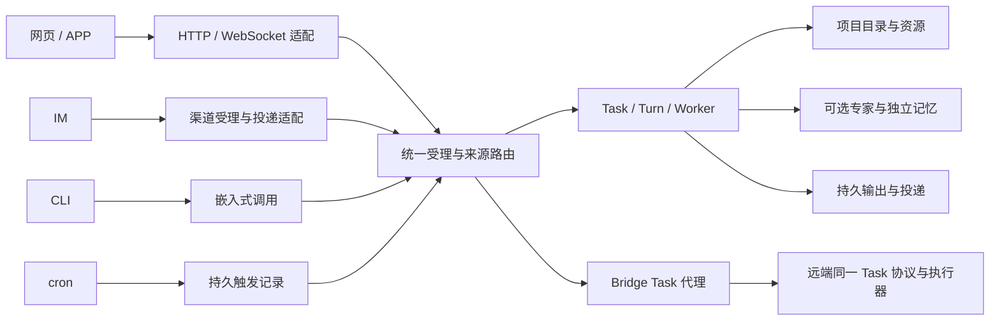

# 统一 Task 的外围入口与旧数据迁移方案

日期：2026-10-23。基线：`feature/agentcomputer-foundation @ f7500b392d6c7e50379015cae75e2ec604e3a5e2`，叠加当前工作树未提交的 M1–M3 改造。规划期间主目录新增模型路由提交，已完整备份原有改动并对齐；工作文件未因对齐而改变。

用户本次确认：旧数据可以迁移；AgentComputer APP 本阶段更新接入文档。由此将远程专家、IM/CLI/cron 和自动批量迁移纳入本轮实现范围，替换原规划的相关排除条款。本文件保留目标方案和原始工作量估算，当前实现与验证状态单列于下表；代码接线不等于全部真实入口验收完成。没有修改 APP 源码、提交或推送。

## 当前实施与验收状态

| 范围 | 已有证据 | 尚未证明的边界 |
| --- | --- | --- |
| 普通旧会话批迁 | 已实现领域 worker、离线读源、持久作业、来源 CAS/fence、附件复制、公开独立轨迹、管理 REST/CLI 与自动排队开关；24 项迁移测试通过，覆盖迟到 worker 和竞争批次不能释放别人的路由；此前 21 项显式续接回归通过 | 主库尚未执行；PG 实机与 Windows 锁行为未完成验收；多个既有续接目标不擅自合并。无法可靠关联轮次的事件保留 thread 级来源，不能恢复执行 |
| 实际旧数据副本演练 | 最新只读 SQLite backup 私有副本中，1 个普通来源完成并复制 20 条轨迹、3 个特殊来源明确跳过；原消息/轨迹及 12 张原型表摘要不变，重复批次新增 Task 为 0、模型调用为 0、quick_check 正常、外键错误为 0 | 控制库、archive、checkpoint 是各库一致快照，不宣称跨库全局原子快照；resident 与两条原型来源的跳过不计为全量成功 |
| CLI Task 入口 | `chats` CRUD、send/repl、可选专家/项目、显式 Task、旧 thread 定位、精确交互/取消已接统一入口；11 项新 SQLite/适配测试和 5 项 HITL 显示测试通过，含 `/new` 后旧请求重试仍定位原轮次；此前 CLI 与 i18n 组合 101 项通过 | REPL 输入与执行完成观察在单元测试中替代；本阶段未另跑 CLI 真实模型、真实客户端工具或终端异常退出后的跨进程接管验收 |
| 网页团队、专家记忆与高级工作台 | 前一轮独立 macOS/SQLite/Chrome 环境的真实 GLM-5 流程通过，详见[真实验收记录](unified-task-live-acceptance-2026-10-23.md) | 该证据不能替代新增 IM/cron/远程入口、真实 STT/TTS、外部 MCP 或其他操作系统/数据库验收 |
| CLI cron 管理 | 专家可空，支持 project/target/policy，默认 per_job；创建不建立旧 thread 或空 Task；owner/共享授权与 resident 隔离复用领域校验；3 项新增 CLI 选择测试与 7 项原有 run-now 等待/错误传播测试通过 | 这些确定性测试不能代替调度器的真实无人值守模型和平台投递验收 |
| IM、cron 执行 | 生产入口已接统一 Task，支持幂等、来源路由、交互、精确取消、cron 会话策略与持久 occurrence；原 gateway/核心组合 465 项、来源/记忆/团队/cron/i18n 组合 292 项通过，删除后重放专项 6 项通过 | 未做真实 IM 平台投递及 cron 无人值守真实供应商模型验收；旧 slash 中尚无 Task 语义的命令明确拒绝，不回落旧图 |
| resident 专用 Task | 唯一身份、权限、独立记忆、请求/委派/成果回流与取消均由内部 Task 执行；旧历史 GET/export 优先读取新记录。6 个受影响集成文件单轮 73 项通过 | 普通 Task/频道/远程代理不可把 resident 选成一般专家；测试替换模型流，不宣称真实 IM 或 APP 验收 |
| 远程统一 Task | 双实例真实 Bridge socket + GLM-5 通过，peer 4 条模型调用、本机 0 条；远端项目读写、附件、导出、断开后的只读摘要均通过；主机身份、令牌隔离及私人 resident 流拒绝有定向覆盖 | 未验跨系统 Chrome/PTY、真实断网后重连、所有共享撤权及 APP；同机双实例不是全部远端平台验证 |
| 普通会话四个尾项与迁移 UI | 导出、音视频内嵌、独立 Task 记忆维护、审阅应用润色和迁移管理/旧链接解析均已接线；前端主组合 249 项和专家入口 8 项复测通过，最终 TypeScript/Vite 构建通过 | 组件/协议集合有重叠，不加总；不表示已验证所有媒体编码、真实语音供应商或 APP 真机 |
| 现代频道与计划管理 | 顶层 owner-scoped 频道与 cron API 支持可选专家/项目；频道绑定即时重载，显式 null 清空。频道 HTTP 13 项与 cron 选择/通知测试通过 | 既有 Task 的项目和身份不被频道编辑改写；要在同一来源采用另一项目，先开启新上下文 |
| AgentComputer APP | 已更新[统一接入交接](agentcomputer-unified-conversations-handoff.md)，只读核对 APP 代码切点 | Swift/UI 实现、原生构建、设备验证及应用发布均不包含在本阶段已完成项中 |

副本报告：`/private/tmp/octop-migration-rehearsal-h3i_h8my/rehearsal-report.json`；CLI 与 i18n 组合日志：`/private/tmp/octop-cli-task-4.log`，最终 CLI/HITL 16 项日志：`/private/tmp/octop-cli-final-5.log`；此前迁移、CLI、cron、分支与 schema 的小范围组合 63 项通过（`/private/tmp/octop-data-final-4.log`）；随后新增迁移竞争测试后，迁移独立 24 项通过（`/private/tmp/octop-migration-fence-final.log`），schema 幂等/唯一约束独立 5 项通过（`/private/tmp/octop-schema-final-5.log`）。这些路径是本机临时证据，不是可公开分发的用户数据备份。后续完成真实实例迁移或新增验收时，应追加实际结果，不能把原始排期自动改成通过状态。

私人助手 6 个受影响集成文件单轮 73 项全部通过：`/private/tmp/octop-resident-native-complete-9.log`。首轮整合回归 281 项通过：`/private/tmp/octop-unified-final1.log`。各集合有重叠，不加总为去重总数；未运行完整 `make all`，未修改运行主库，未提交或推送。

最终增量整合 263 项通过：`/private/tmp/octop-unified-final2.log`；最终代码真实远程双实例复验 1 项通过、22.78 秒：`/private/tmp/octop-remote-live-final4.log`。后者仍为 peer 4 条模型账本、本机 0 条，细节见[实际验收记录第 9 节](unified-task-live-acceptance-2026-10-23.md#9-扩展范围远程统一-task-的真实双实例验收)。

普通 IM 没有与 Octop 登录身份的可信映射。频道 owner 授权不等于发送者本人：IM 不注入 owner 的 `USER.md`、专家/团队成员私人长期记忆和默认知识库，不采集到专家长期记忆，已有此类抽取 job 也会取消。Task 自身上下文保留；即使账号为 full_access，涉及写操作仍须本人在任务页按准确 interaction 批准，IM `/approve` 不能代批。核心 `/help /status /model /mode /compact /pending /new /stop` 已采用 Task 语义；`/switch /resume /delete` 等旧 thread 写入命令明确不支持，专家管理仍走专家设置。

## 1. 最终产品形态

- 网页、APP、IM、CLI、cron 都创建或追加同一种 Task/Turn，使用同一套受理、权限、模型路由、执行、审批、记忆、用量和成果规则。
- 专家仍是独立配置与记忆身份；项目仍独立持有目录和资源；首条消息创建 Task，后续消息追加 Turn。
- 远程专家在其所在 Octop 执行，远端 Task 是权威记录。本机只保存代理索引和观察进度，不再创建另一个可执行的镜像 Task。
- 普通旧会话完成批量转换后出现在统一列表，旧链接直接定位对应 Task。迁移原始数据和无法解释的数据继续保存，不能以隐藏异常冒充全量成功。
- 私人管家保持唯一固定身份和专用产品入口；其底层接入统一执行需要专用适配，不能把私人管家变成可任意切换专家的普通 Task。

### 普通会话的剩余尾项

本次重新按代码核对，M1–M3 的主体链路接通不等于旧 Chat 的每一个辅助入口均已替换。以下是本阶段补齐的四个尾项，接线与真实验收仍分开记录：

| 尾项 | 当前事实 | 收口方式 |
|---|---|---|
| 完整历史与执行轨迹导出 | 新增固定快照导出领域/API 和页面入口 | 采用 Task 权限与 revision，保留成员/来源和缺失附件标记；验证公开内容不包含私有思考或凭据 |
| 音视频内嵌播放 | 已复用 `ChatMediaPlayer` 处理 Task 附件与产物 | 使用 Task 鉴权链接；确定性 UI 测试不代表全部浏览器/媒体编码验证 |
| 无专家 Task 的记忆管理 | 已接 owner+Task 独立记忆 CRUD 与页面 | 独立于检查点，不建立隐含专家或跨 Task 用户记忆；外部数据库实机验证仍单列 |
| 提示词润色 | 已接草稿润色与审阅后应用 | 不自动发送、不改已受理 Turn；页面测试与真实模型端到端分别验收 |

这些尾项与 APP 协议说明同步维护；不能把“已有上传下载”“已接语音”分别当作完整导出或音视频播放已经完成。

## 2. 先统一受理，再统一入口

当前 `infra/projects/task_submission.py` 与 `tasks.py` 已完成原生 Task 受理、版本校验、幂等、配置快照与模型路由。新增一个薄的来源适配层，调用这些领域函数；IM/CLI/cron 不能通过 localhost HTTP 绕一圈，也不能另写一套 Harness 运行逻辑。

建议新增的领域模块为 `infra/projects/ingress.py`、`source_routes.py`、`deliveries.py`；名称与以下数据表均为提案，实施时随既有仓储命名收敛：

| 持久数据 | 用途与唯一性 |
|---|---|
| `conversation_source_maps` | `(source_instance, owner, source_kind, source_key)` 唯一指向 Task；含路由 revision、迁移阶段和删除 tombstone |
| `task_ingress_requests` | 来源消息/命令/触发与 Task/Turn 的稳定映射；同身份同内容返回原受理结果，异内容冲突 |
| `task_deliveries` | 目标渠道、Turn、输出阶段/块、投递状态、回执及可安全恢复的位置；不以模型重新执行修补投递失败 |
| `cron_occurrences` | job、计划触发时间/手动触发 ID、Task/Turn、调度 claim 和结果状态，防止重启重复执行同次触发 |

来源标识和执行身份由服务端可信适配器生成，不接受模型或外部请求任意声明 owner。IM sender 与 Octop owner 的可信绑定分别验证；“发送到了某专家的机器人”不等于“拥有这个专家或其私人记忆”。现有来源会话键不含 channel 实例、入站结构没有统一的一等 event ID，不能直接原样复用为新唯一键。

新消息有一个领域受理出口。来源路由、Task 创建和幂等记录应在可核对的事务边界发布；困难度分类等模型 I/O 仍位于事务之外，提交前再次校验版本与路由，不能持有数据库锁等待模型。现有 ChannelManager 入站队列和旧 HITL store 均不是持久收件箱；Task 忙碌时应让来源 inbox 按序等待或明确返回忙碌，不能另建 Task 偷绕同一会话约束。取消等控制消息需优先处理，不排在等待模型完成的消息之后。

## 3. IM / CLI / cron 的具体改造

| 入口 | 改造后行为 | 必须保留的语义 |
|---|---|---|
| IM | 规范化入站消息和附件，按持久 source map 定位 Task，提交 Turn；从 Task 的持久输出构造渠道消息 | 账号/群/主题/私聊范围隔离、配对与成员权限、渠道长度限制、附件、工具提示、语音与服务端语言 |
| CLI | 增加以 Task 为对象的新建、发送、继续、列表、读取、取消与交互；执行命令在 embedded server 中调用领域层 | 本地文件系统信任与 acting user；只读 CRUD 仍可离线；`--agent` 映射为可选专家，不能为每条命令重新建专家 |
| cron | 调度器只产生一次持久 occurrence 并提交普通 Task Turn；通过 Task 状态记录结果、用量和投递 | 服务端时区、已有启停/跳过/重叠规则、目标会话和 `fresh_thread` 设置、人工 run-now 的独立幂等身份 |

### IM

会话键至少包含可信 owner、channel/bot、渠道类型、对端会话或群、主题及原有私聊/群隔离策略；不能只以外部 sender 或专家 ID 作为会话键。重投消息优先使用平台原始 message ID；无原生 ID 时由适配器持久分配稳定接收 ID，不能每次用当前时间生成。

`/new` 切换来源当前指针到新 Task，旧 Task 保留；`/resume`、`/history` 定位 Task；`/stop` 取消该来源映射中的准确活动 Turn。工具、审批和提问从 Task 交互记录呈现；回调绑定 owner、Task、Turn、交互 ID 和原回调身份。无按钮能力的渠道给出受限文本操作，不自动批准。工作执行与消息投递分别恢复：渠道断线不重跑模型，重复入站不创建第二轮。

持久投递记录不能使不支持幂等发送/回执查询的平台获得 exactly-once。已确认回执可去重，结果未知的发送标为待核对，避免盲目重发造成重复消息。

### CLI

优先让现有 `chats` 用户命令解析为 Task 操作，保留旧 thread 定位作为迁移别名。是否增加 `tasks` 别名以现有命令冲突核对后决定，不提前再建立一套传输协议。交互 REPL 只持有当前 Task ID，追问持续追加 Turn；退出终端不隐式取消已受理工作，明确取消才操作准确 Turn。

CLI 与正在运行的服务必须共用正常的数据库 claim/fence，不额外启动旧专家图执行同一条来源。离线读取迁移报告与历史可以不启动模型；暂停、审批和客户端工具需要可用 runtime 时明确返回能力状态。

### cron

当前 `fresh_thread=False` 复用目标 session 上下文，`True` 会重置目标 session。迁移旧 job 时先固化这一语义：前者映射为继续目标 Task，后者通过新 Task 与目标指针切换实现新上下文，不删除已完成历史。不能把所有旧 job 默认为“每次新 Task”，也不能把全部旧 job 改为永远共享同一 Task。

新 job 可显式选择每次新 Task、每个 job 持续 Task 或指定 Task，存储可选项目和专家。目标 Task 忙碌时遵守明确的排队/跳过策略；等待审批只记录等待并通知，不能把 scheduled 身份当作无限审批授权。一次 occurrence 的终态与投递结果分开记录。

原 text 型 cron 继续零模型调用，只建立确定性的通知/投递记录，不把通知原文提交给模型生成，也不触发专家自动记忆抽取。`run_now(wait=True)` 保留等待执行与 bookkeeping、向 CLI 传播失败的行为；邮箱事件仍在受理与执行前复查账号权限，不能仅依赖创建 job 时的授权。

准确切点：IM 为 `gateway/process/processor.py:GlobalProcessor.__call__` 与 `stream_project.py:project_stream`；CLI 为 `cli/repl/runtime.py:CliChatSession.run_turn`、`gateway/cli/turn.py:prepare_cli_turn`；cron 为 `infra/cron/job.py:CronJob.run`、`delivery.py:CronDeliveryService.deliver`。共同调用 `task_submission.submit` / `tasks.send_in_transaction`，观察采用 Worker 通知和数据库快照，交互/取消调用领域接口，不导入 HTTP/WebSocket router。

## 4. 旧数据迁移：后台作业与逐会话切换

当前 `legacy_conversations.create()` 是显式续接，限定 dashboard、本地后端和空闲来源；幂等按 request ID，而非来源 thread；附件仍可能引用旧工作区。它可以提供可见历史转换的基础，不能直接循环调用来实现全量迁移。`conversation_imports.py` 面向 Codex/Claude，保留其外部导入语义。

### 盘点与读源

逐 owner 盘点普通 dashboard、共享/团队、IM、CLI、cron、远程来源、私人管家及早期 `ac_*` 原型。先输出数量、数据版本、完整性和阻塞原因，再对明确归属的条目执行迁移，不调用模型。

旧历史至少涉及以下来源，需固定读取锚点：

1. `threads` 的身份、来源键、标题、置顶、模型/推理设置、模式和 artifacts。
2. 完整状态为 `ready` 的 `thread_messages` 投影，以及独立核对的轨迹；投影 ready 不代表轨迹完整。
3. `HistoryArchive` 的 segment、document、body 及 legacy 混合历史；优先复用 `history/reader.py:export_messages` 的组合语义。
4. Harness checkpoint 的只读固定快照、压缩上下文，以及更早 sessions JSONL。

当前 `history_v2.sqlite` 与控制数据库的组合只支持 SQLite；不能把 PostgreSQL 的迁移文件等同于 v2 archive 已支持 PG。PG 控制库下的实际投影/checkpoint 来源需单独适配和验收。JSONL 只有能确认 thread/owner 的记录才自动归入目标；基于时间段猜测归属的记录保留待核对。

应下沉一个离线读源适配器到 `infra/history`，不启动专家，也不让 `infra` 导入 API。现有 `api/routers/chat/serialize.py` 中只读 SQLite checkpoint 的思路可复用，但实现职责须移入领域层。

### 作业与阶段

建议新增 `conversation_migration_batches` 和 `conversation_migration_items`，持久保存批次版本、配置摘要、owner/source、唯一目标、来源头与 digest、附件 manifest、阶段、lease、错误及核验结果。

每个来源按 `发现 → 等待安全边界 → 固定来源 → 导出 → 复制附件 → 写入历史 → 验证 → 切换路由 → 完成` 推进。批次支持预检、执行、暂停、恢复和报告；进程重启从已确认阶段继续。数据库 DDL 迁移只建表和约束，不在 schema 事务中扫描文件、迁移全文或调用网络。

来源映射唯一，目标 ID 在首次领取时固定。消息以原 message ID 或固定来源位置加摘要映射，不能按文本去重。已有单一显式续接目标且来源一致时可核对后复用；多个目标或来源已变化则保留各分支并报告映射冲突，不覆盖已续聊的 Task。用户删除后的 tombstone 阻止下次扫描把会话自动复活。

### 历史、附件、目录、记忆

- 保留顺序、原时间、失败/中断事实、标题、置顶、可见成员身份和来源消息 ID。历史模型/配置未知时明确 unknown，不用当前配置伪造旧快照。新一轮才解析当前有效配置。
- 历史工具仅为已发生事实，不建立新的执行租约、审批或客户端工具结果回执。未配对调用与不完整尾部保留为中断/待核对内容，既不静默丢弃，也不自动补跑。
- 附件通过 `BackendWorkspace` 读取，以大小/SHA256 和 owner 校验复制为 Task 的独立附件/不可变成果。缺失、越权、超限分别保留可见状态。禁止因迁移抓取任意 URL、读取客户端目录或复制整个专家系统目录。
- 已有真实项目关联可经当前权限校验复用；无可靠关联的会话迁为无项目 Task，执行使用 Task 独立目录。旧专家目录只记录为历史来源，不自动变成每条 Task 的项目目录。用户可提供明确的旧来源→项目映射后批量绑定，不能靠专家 ID 推断项目。
- 旧专家、人设和记忆内容保留。未分域记忆作为受控 legacy 来源，不自动提升为 general；共享使用者不能读取发布者私人记忆。聊天迁移本身不触发全历史 LLM 抽取。早期 `ac_*` 命令/回执没有可靠新语义时保留归档与报告，不能伪造成已完成或可恢复的新 Task。

### 活动轮与切换

旧 LangGraph checkpoint 不能改 ID 后交给新 Task 图继续运行。默认等待原活动轮完成；旧审批、未知工具结果和运行中的租约保留原执行处理，终态后重新迁移该条目。

需要持久的 thread/source 写入 fence。当前 `try_begin_history_backfill` 是进程内屏障，不能独自防止其他 worker/CLI/渠道写入。所有旧入口在提交前先查来源路由，迁移期间将新消息持久等待或返回可恢复状态，不能继续偷偷写旧 thread。切换前重新比较来源头与 digest；事务内发布唯一来源→Task 映射，之后新写入只进入 Task。

控制库、archive、checkpoint 与附件不属于一个原子数据库事务，因此逐阶段采用 manifest 和收据核对。复制/确认结果未知时先核对目标，不反复建立附件或重复导入。路由切换前的未发布数据不能在统一列表中冒充正式完成。

### 备份、回退与最终移除旧入口

迁移前保存控制库、archive及必要标记、checkpoint、记忆、配置和附件。在线 SQLite 使用备份 API/一致停写边界处理 WAL，不能只复制主 `.db` 文件。PG 使用一致快照并固定相关文件 manifest。

切换前可以恢复作业并核对未发布目标；切换后若没有新原生轮次，可回退来源指针；已经续聊则保留新 Task，禁止丢弃新消息后切回旧库。回退不自动删除历史、记忆或已生成工作文件。

统一列表显示迁移进度和异常数量。完成项目核验后隐藏已迁来源的重复旧入口，旧 URL 依据映射跳转。只有旧写入全被替换、特殊来源完成专项、异常项有明确归属后，才删除旧“新建/发送”实现。原始归档清理是独立动作，本次迁移授权不等于删除授权。

### 私人管家与远程来源的特殊迁移

generic 批迁必须通过 `ThreadRepo.is_resident` / `resident_conversations` 识别并分派私人管家，不能按 `agents.kind` 区分，因为其身份目前也可为 `expert`。`resident_conversations` 按 owner/role 唯一绑定 agent 和 thread；`resident_requests`、cancel requests、delegations、reports、profiles、notifications、inbox、followups 共同引用该绑定或请求，不能逐表把 thread ID 字符串替换成 Task ID。

resident 专项先排空活动请求，再建立显式 resident→Task/Turn 映射；保留唯一私有身份、授权 revision、冻结的 `ResidentToolInput`、记忆 namespace、时区/日界限、未读水位，以及每轮模型委派次数限制。普通 Task 修改专家/项目的接口不得获得对该内部 Task 的控制权。已有 delegation 的 `task_id/initial_turn_id` 本来就是实际工作 Task，直接保留，不能再次迁成第二个任务。

`ResidentConversationRuntime.send/_execute_locked`、`ResidentReportDelivery` 和 notification/followup 的发送、归档、上下文注入均切换到相同的 Task-backed 调度与持久结果后，才能退出 resident 的旧 thread 写链路；报告对 Task Turn 的唯一回传收据必须保留。此项是“全部底层统一”的必要里程碑，在完成前只能称普通入口已统一。

远程旧会话由对应 peer 的迁移器在其账号权限内转换，随后本机建立远端 TaskRef。不能把相同远程 thread 一份迁到本机、一份迁到 peer 后都继续执行。peer 尚未升级时该来源明确显示等待升级，不根据缓存私建一个本地替身。

## 5. 远程专家与 Bridge

采用 `TaskRef = (host_id, task_id)`、`ProjectRef = (host_id, project_id)` 作为客户端和代理索引的复合身份；本地 host 为明确默认值，远端 host 绑定当前用户的 Bridge 连接和远端账号身份。相同 task_id 或 project_id 在两台主机上不能混用。

远端保存专家配置、记忆、凭据、项目目录、Task、检查点和用量。本地保存远端 Task 的引用、列表摘要、观察游标与新鲜度；该缓存不能排入本地 Worker，离线时显示最后同步状态而非假定远端已失败/停止。

远程专家必须使用远端项目或远端 Task 独立工作区。选中远端专家后，项目/模型/Skill/MCP 的可选项来自同一远端账号，界面显示执行主机。当前本机项目不自动发往远端，本机 `client_directory` 更不构成远端文件授权。跨主机工作需明确新建关联 Task，只携带用户明确选择的上下文和附件；不复制旧租约、审批或记忆库。本阶段适配远端已有专家/团队；本地与远端成员混编并共享同一工作区不在这一语义内，需要另设分布式委派与文件交接协议。

代码入口为 `infra/bridge/manager.py`、`transport.py`、`http_tunnel.py`、`tunnel_policy.py` 及前端远程数据访问层。将既有统一 `/api/projects`、`/api/project-tasks` 的必要操作加入显式方法/路径白名单，并扩展 Task WebSocket 的订阅和命令承载；不恢复 `/api/agentcomputer/v1`，也不继续用旧 `stream_peer_turn()` 充当新 Task 执行器。

连接 owner 与远端认证账号的映射决定权限，不能透传任意 owner/header。凭据轮换不改变历史归属；改连另一账号或另一主机必须使旧引用失效，不能把旧 Task ID 解释成新账号的 Task。媒体、附件、审批、工作台、终端和浏览器均按远端 TaskRef 与范围版本鉴权，禁止通用无约束 HTTP/CDP 代理。

新协议要有明确能力发现和版本门槛。旧 peer 缺少统一 Task 能力时展示可升级状态，保留已有历史读取，不静默退回旧 chat 继续新写入。跨主机断线不能等同取消；重连按远端游标重取权威快照，命令携带稳定 ID，结果未知时先查收据。

## 6. AgentComputer APP 文档交付

本次更新文档，不修改 Swift/UI。新接线说明见 [APP 统一会话交接](agentcomputer-unified-conversations-handoff.md)。客户端只消费统一协议：

1. 按 TaskRef 管理列表、缓存、详情和草稿；项目、专家均可空，不再因建项目创建专家。
2. 新建/追问/重试传正确的 request ID 与配置/项目 revision；收到受理后以服务端 Task/Turn 为准。
3. 按当前 REST 与 Task WebSocket 协议接入内容、状态、交互、客户端工具和断线恢复。
4. 区分当前选择与每轮实际专家/模型；历史消息与历史工具不获得新的执行权限。
5. 远端 TaskRef、批迁状态与旧 ID 映射已提供服务端接口；客户端先核对能力与 peer 身份再使用，旧 peer 不回落到旧会话写入。
6. 保留私人管家固定身份与来源结果回流的产品语义；其专用入口不变，底层切换需要独立兼容验证。

旧 AgentComputer 专用 Run/命令回执等文档保留历史说明，主索引置顶指向最新交接，避免客户端按已删除协议开发。

## 7. 实施顺序、排期与完成标准

以下保留最初工作量估算，按后端开发日计，不能视为已完成工时或当前剩余排期；实际完成与验收状态以上表为准。各项有共享基础，不机械相加为日历承诺。

| 顺序 | 工作 | 估算 | 放行条件 |
|---|---|---|---|
| P0 | 数据盘点、来源键与TaskRef契约、特殊来源清单、DDL与版本策略 | 2–3 日 | 副本盘点和来源映射可验证，不推测 owner/project |
| P1 | 统一 ingress、持久来源路由、执行 fence 与投递基础 | 3–5 日 | 重投、并发和重启不会多建 Task/Turn；旧入口服从路由 |
| P2 | IM/CLI/cron 改造与已有配置迁移 | 9–13 日 | 三类入口的创建、继续、审批、取消、结果投递与上下文语义通过 |
| P3 | 批迁 worker、离线读源、附件、恢复、逐来源切换 | 10–15 日 | 副本全量对账、重复执行无新增、崩溃恢复和续聊通过；与 P1/P2 共用路由部分 |
| P4 | 远端TaskRef索引、Bridge统一协议、统一列表/目录与媒体 | 6–10 日 | 两实例真实模型、断线重连、撤权与跨主机目录隔离通过 |
| 专项 | 私人管家 Task-backed 适配及特殊旧运行来源 | 6–10 日；原型归档随盘点重估 | 唯一身份、请求/委派/成果回流和取消不变，不能被通用迁移替代 |
| 并行 | 普通会话四项尾项 | 另计前端/接口约 3–5 人日 | 导出、媒体、无专家记忆管理和草稿润色逐项可用 |
| 并行 | APP 接入文档、样例与契约核对 | 本次文档先交付；后续随实现维护 | 文档与实际 schema/能力一致；APP 源码由其仓库实施 |
| P5 | 升级演练、真实入口/模型联调、目标平台和数据库验证 | 4–6 日 | 数据对账、故障恢复及本轮增量门禁通过后才切换真实实例 |

建议一个后端主线先完成 P0/P1，再让迁移和远端适配并行推进；前端同时处理复合身份与统一列表。真实库迁移不是文档落盘后的立即动作：先交付可预检、可恢复的工具，完成副本演练，再按已授权范围执行并输出报告。迁移无需逐条请求用户确认；无法可靠解释的来源保留明确待处理项。

扣除各项共用的读源、路由和恢复工作，整体暂按约 35–55 后端人日估算；两名后端与一名前端并行可先按约 4–6 周窗口安排，复杂历史异常、目标平台缺依赖及 APP 原生开发不含在该承诺内。P0 样本盘点后再给日历日期和里程碑负责人，避免在数据体量未知时承诺固定迁移完成时间。

DDL 仍维护 SQLite/PG 成对 SQL；编号在实施时核对已应用 watermark 和未发布 schema 56，按仓库规则决定折叠或补齐，不现在空占一个新版本。

完成证据必须包括：每类来源统计、迁移前后消息与附件摘要、无模型调用的迁移账本、重复/恢复/切换竞争、迁移后新轮次、IM/cron重复投递、远端授权/游标/目录、APP协议契约，以及真实实例执行结果。完整发布门禁、提交、推送和上线仍单独记录；不能把“文档已更新”写成“APP 已完成适配”。
